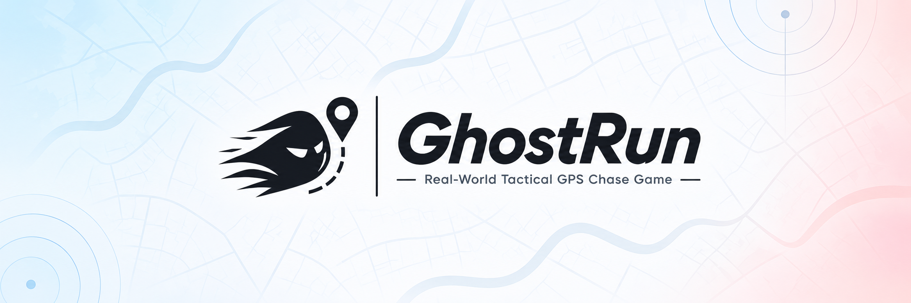

# GhostRun — Real-World Tactical GPS Stealth Chase Game

<div align="center">



[](https://github.com/ArshvirSk/GhostRun/releases/tag/v2.3.0)
[](https://github.com/ArshvirSk/GhostRun/releases/tag/v2.3.0)
[](https://expo.dev)
[](https://reactnative.dev)
[](https://supabase.com)
[](https://maplibre.org)
[](https://www.typescriptlang.org/)
[](#license)

</div>

> **GhostRun is an open-world, real-life tactical GPS stealth chase game played on smartphones.**
>
> A blend of real-world manhunt, cops & robbers, and espionage radar mechanics. One team—the **Runners**—infiltrates the area to reach a secret extraction target or survive the clock. The other team—the **Hunters**—must track, corner, and physically tag them. 
> 
> Unlike typical GPS trackers, **Hunters do not see live runner coordinates**. Instead, the server periodically broadcasts **delayed radar pings**. Gameplay revolves around bluffing, predictive pathing, stealth, and situational awareness—not chasing a moving dot on a screen.

---

## 📑 Table of Contents
- [🎮 Game Modes](#-game-modes)
- [🎛️ Modifiers (Stackable Match Dynamics)](#️-modifiers-stackable-match-dynamics)
- [🔊 Sensory Feedback & Audio Engine](#-sensory-feedback--audio-engine)
- [👻 Ghost Library & Privacy Trimming](#-ghost-library--privacy-trimming-150-m)
- [🕵️ Secret Roles: Double Agent & Tribunal](#️-secret-roles-double-agent--emergency-tribunal)
- [🔒 Privacy, Consent & Retention Architecture](#-privacy-consent--retention-architecture)
- [⚡ The Core Mechanic: Tactical Asymmetric Information](#-the-core-mechanic-tactical-asymmetric-information)
- [🌟 Key Features](#-key-features)
- [🛠️ Tech Stack & Architecture](#️-tech-stack--architecture)
- [⚙️ Serverless Automation & Keep-Alive](#️-serverless-keep-alive--retention-automation-cron-joborg--github-actions)
- [📁 Repository Structure](#-repository-structure)
- [🚀 Getting Started](#-getting-started)
- [🧪 Testing & Verification](#-testing--verification)
- [📦 Building Production Release APK](#-building-production-release-apk)
- [🛡️ Safety & Fair Play](#️-safety--fair-play)
- [📄 License & Contact](#-license)

---

## 🎮 Game Modes

### 1. Classic Chase (The Flagship Mode)
* **The Mission:** Runners secretly select a designated extraction target coordinate on the map within the boundary.
* **Runners Win:** At least one runner reaches the secret target undetected within the time limit.
* **Hunters Win:** All runners are tagged, or the match timer expires before runners reach their target.
* **The Dynamic:** Hunters must deduce where runners are heading based only on sparse, delayed radar snapshots.

### 2. Tag Hunt (Pure Survival)
* **The Mission:** No targets, no extraction. Pure adrenaline.
* **Runners Win:** At least one runner survives until the match timer runs out.
* **Hunters Win:** Every runner is located and tagged.

### 3. Hot & Cold Hunt (Directionless Proximity Pulse)
* **The Mission:** Hunter radar receives directionless heat pulses instead of coordinate snapshots.
* **Proximity Feedback:** Pressing `PULSE` queries runner distances within the area without exposing coordinates:
  - **HOT:** nearest runner $\le 75\text{ m}$.
  - **WARM:** nearest runner $75\text{ m} < d \le 175\text{ m}$.
  - **COLD:** nearest runner $> 175\text{ m}$.
* **Counter-Detection:** Runners inside the $175\text{ m}$ radius receive a physical vibration and `sensed` pulse alert, warning them that hunters are closing in.

### 4. Haunted Map & Ghost NPCs (Asymmetric AI Haunting)
* **The Mission:** Match dynamics are haunted by historical runner routes replayed as autonomous Ghost NPCs.
* **Autonomous Patrol:** At countdown completion, the engine selects verified ghost routes from the library, spawning spectral entities that patrol the area with realistic physics and time-scaled velocities.
* **Proximity Threat:** Ghosts emit radar anomalies to living runners. If a runner steps within $12\text{ m}$ of a ghost entity, they suffer an immediate haunted tag.
* **Stealth Invisibility:** Ghost entities are rendered invisible to hunters, forcing runners to navigate both the human pursuit and spectral hazards.

---

## 🎛️ Modifiers (Stackable Match Dynamics)

Lobbies can stack one or more modifiers to alter match mechanics:

1. **Noise Meter:** Real-time speed and accelerometer tracking. Sprinting or erratic movement raises your noise bar. Crossing 60 alerts hunters with an acoustic spark; hitting 100 triggers an instant radar ping. Stationary camping (>4 min) releases a camping radar ping.
2. **Dead Drops:** Physical caches spawn across the play area. Players who discover a drop within 40 m and hold position inside 15 m for 4 seconds unlock team tactical utilities (Veil, Decoy, Recon).
3. **QR Tagging:** Backup physical verification using high-entropy HMAC-SHA256 rotating QR tokens (20 s TTL), preventing GPS drift disputes in tight indoor/urban corridors. Features an integrated camera viewfinder scanner for hunters and rotating dynamic QR cards for runners.
4. **Shrinking Zone:** In the final third of the round, the play boundary contracts inward across timed stages (100% → 70% → 45%), forcing remaining runners and hunters into an intense endgame bottleneck.

---

## 🔊 Sensory Feedback & Audio Engine

GhostRun incorporates a native, zero-latency procedural audio and haptic engine with a master in-app mute toggle:
- **Sonar Radar Ping Sweep:** Plays on every scheduled ping release or fresh ring detection, accompanied by an expanding animated ripple wave.
- **Proximity Heat Alerts:** Dual high-tech pips for `HOT` proximity and muffled acoustic thud for `COLD`.
- **Target Tag Buzzer:** Confirms physical or QR-verified tags with an unmistakable alert.
- **Double Agent Whisper:** Ethereal celestial chime played when a mole transmits directional clues.
- **Endgame Stingers:** Triumphant major-chord fanfare for the winning squad and somber cadence for the defeated.
- **Match Countdown Ticks:** Tactile audio metronome ticking down the final 10 seconds before round launch.
- **One-Tap SFX Mute:** Instant persistent toggle in the HUD header (`SFX On` / `SFX Off`), saved via AsyncStorage.

---

## 👻 Ghost Library & Privacy Trimming (150 m)

GhostRun introduces an asynchronous community ghost recording system:
- **Anonymous Contribution (Consent C4):** Runners who finish a match can preview their route and contribute it to the regional ghost library.
- **Automated Privacy Trimming:** To protect player privacy, the server automatically trims **150 meters** from both the start and end of every recorded route. Private residences, school gates, and personal departure points are permanently stripped before any route is archived.
- **Cryptographic Anonymity:** Contributed ghosts retain zero player IDs, personal identifiers, or profile linkages in the `ghost_library` table.
- **Self-Service Management:** Players can view, audit, and permanently delete their contributed ghosts at any time from Settings → Privacy.

---

## 🕵️ Secret Roles: Double Agent & Emergency Tribunal

* **The Mole:** In Classic Chase matches with $\ge 2$ hunters, one hunter can be secretly designated as the **Double Agent**.
* **Covert Powers:**
  - **Whisper (Once per match):** Reveals the cardinal quadrant (`North`, `South`, `East`, `West`) of the runners' extraction target.
  - **Scramble (2-min cooldown):** Jams hunters' radar on the next ping round, shifting a chosen runner's revealed coordinate by 150–250 m.
* **Emergency Tribunal:** Suspicious hunters can convene an Emergency Tribunal and vote to eject an accused hunter. If the Double Agent is ejected, hunters gain a bonus ping round; ejecting a loyal hunter penalizes hunters with a 5-minute radar silence.

---

## 🔒 Privacy, Consent & Retention Architecture

GhostRun v2 implements rigorous, transparent privacy controls:
- **C1–C6 Consent Architecture:** Formal consent states for location, policy acknowledgment, ghost replays, leaderboard names, diagnostics, and spectator feeds.
- **Route Sharing Choice (Consent C3):** Every player explicitly chooses whether to share their replay breadcrumb trail (`Share Route` or `Keep Private`) before readying up.
- **Data Minimization:** Private trails are omitted from post-match recaps, opponent views, and closest-call statistics.
- **Auto-Retention:** Completed games, raw trails, and event logs are scheduled for deletion after 30 days via `cleanup_old_games()`.
- **User Control:** One-tap **Export My Data** and permanent **Delete My Account** (`delete_my_data()`) are available in Settings → Privacy.

---

## ⚡ The Core Mechanic: Tactical Asymmetric Information

The tension in GhostRun stems from **strict information asymmetry** enforced at the database level:

| Information / View | Runners | Hunters |
| :--- | :---: | :---: |
| **Own Live Position** | ✅ Real-time | ✅ Real-time |
| **Teammates' Live Positions** | ✅ Real-time | ✅ Real-time |
| **Opponent Live Positions** | ❌ Hidden | ❌ Hidden |
| **Periodic Radar Pings** | ✅ Visible (See what hunters see) | ✅ Visible (Tactical radar pulse) |
| **Secret Target Coordinate** | ✅ Visible (Runners only) | ❌ Hidden until match ends |
| **Play Area Boundary** | ✅ Visible with boundary HUD | ✅ Visible with boundary HUD |
| **Full Trajectories & Replay** | 🏁 Available after game ends | 🏁 Available after game ends |

### 📡 10-Second Radar Ping Window & Haptic Feedback
- **Tactical Flash:** When the server releases a delayed runner ping, it appears on the live map as an intense glowing radar pulse.
- **10-Second Lifespan:** Pings remain visible on active radar for **exactly 10 seconds** before dissolving from the live tactical display. Hunters must memorize the snapshot, infer direction and velocity, and communicate.
- **Dual-Pulse Haptic Vibration:** Whenever a ping fires, physical motor vibration alerts trigger on **both** Runners' and Hunters' phones. Runners feel the adrenaline spike knowing their past location was just compromised; Hunters feel the call to check their radar.
- **Zero-Leak Security:** Runner live positions and target coordinates are protected by PostgreSQL Row-Level Security (RLS) policies and atomic PostGIS RPCs. Hunters cannot inspect network payloads or websockets to cheat—the server never sends unauthorized coordinates.

---

## 🌟 Key Features

- **Edge-to-Edge Full-Bleed Onboarding:** Immersive dark-mode visual slides introducing core rules, roles, and safety guidelines.
- **Instant Lobby & Fast Join:** Create games in seconds; players join via a clean 4-letter room code.
- **Auto-Centering GPS Map:** Intelligent coordinate caching and staged native-ready retries ensure map creation centers directly onto the host's actual location.
- **Configurable Match Settings:**
  - Play area radius (100 m to 5,000 m).
  - Head start countdown (0 to 600 s) giving runners time to vanish before hunters are released.
  - Game duration (5 to 240 mins).
  - Radar ping interval (30 to 900 s).
  - Tag proximity radius (5 to 100 m).
- **Background Location Tracking:** Integrated Android Foreground Service (`expo-location` + `expo-task-manager`) maintains continuous GPS uploads even when the phone screen is locked in a runner's pocket.
- **Real-Time Geofence Enforcement:** Audio-visual boundary HUD notifies players when exiting the designated play area with a countdown grace period before penalty pings are triggered.
- **Fair Tagging Engine:** Server validates distance between Hunter and Runner using PostGIS (`ST_DWithin` + accuracy allowance) with an 8-second penalty cooldown on missed tags.
- **Directionless Proximity Radar (Hot & Cold):** Hunter HEAT proximity pulses with binary red/blue feedback based on area-scaled distance, triggering counter-detection alerts for nearby runners.
- **Interactive Match Modifiers:** Stackable physical rules including dynamic Noise Meters, Dead Drop tactical caches, QR tags, and Shrinking Zone perimeter contraction.
- **In-App Camera QR Code Scanner & Dynamic Badges:** Fullscreen camera viewfinder scanner (`expo-camera`) with animated reticle for hunters, and rolling 20s HMAC-SHA256 dynamic QR badges for runners.
- **Native Audio SFX Engine & Master HUD Mute:** Procedural 16-bit 44.1kHz audio effects (sonar radar sweep, proximity heat pips, tag buzzer, whisper chime, victory/defeat stingers, countdown metronome) with persistent mute toggle.
- **Radar Ping Ripple Micro-Animations:** Dual concentric animated radar rings expanding outward across the map upon ping arrival.
- **Autonomous Ghost NPCs & Pseudonymous Ghost Library:** Historical runner routes replayed as autonomous spectral entities with 12 m proximity hazards, backed by automated 150 m privacy start/end trimming.
- **Undercover Double Agent & Tribunal:** Counter-intelligence mole with secret Scramble & Whisper powers, plus an Emergency Tribunal voting dock for loyal hunters.
- **Privacy Controls & Consent Architecture:** Granular C1–C6 consent choices, mandatory Replay Route Sharing opt-in, self-service data export and deletion, and 30-day auto retention.
- **Interactive Post-Match Replay & Highlights:** Scrubbable timeline showing all player routes, tag events, ping timestamps, revealed secret target, and match highlights (Closest Call, Loudest Moment, Heat Hit Rate).
- **Emergency SOS Beacon:** Instant safety override that immediately broadcasts an unmasked, high-priority emergency location beacon to all players in the lobby.

---

## 🛠️ Tech Stack & Architecture

```
                                  [ GhostRun App (Expo / React Native) ]
                                          │                     │
                        Background GPS    │                     │  MapLibre Native GL
                        Foreground Task   │                     │  (OpenFreeMap Style)
                                          ▼                     ▼
                               ┌─────────────────────────────────────────┐
                               │       Supabase Hosted Cloud Engine      │
                               │                                         │
                               │  • PostgreSQL 15 + PostGIS              │
                               │  • Realtime WebSockets (Live Lobbies)   │
                               │  • Row-Level Security (Anti-Cheat RLS)   │
                               │  • Atomic PL/pgSQL Stored Procedures    │
                               └─────────────────────────────────────────┘
```

### ⚡ Zero-Server Architecture: Do I need to turn on a backend?

> **NO.** You do **not** need to run any local server, Docker container, or background process on your computer to play or test GhostRun.

GhostRun is **100% serverless** and operates entirely through the cloud:
1. **Hosted Cloud Database:** Authentication, real-time WebSocket lobbies, PostGIS spatial queries, and player sessions run on the hosted Supabase cloud infrastructure.
2. **Server-Authoritative PL/pgSQL:** All gameplay rules (ping timers, proximity calculations, noise meters, dead drops, double agent abilities, and tag checks) execute inside atomic PostgreSQL `SECURITY DEFINER` stored procedures.
3. **Lazy Game Clock:** Game phases, head-starts, and ping schedules advance dynamically when devices query or submit fixes. No background cron daemon or long-running worker process is required.
4. **Decentralized Vector Tiles:** MapLibre renders maps directly from OpenFreeMap’s public global CDN with no API keys or local tile servers needed.

Anyone who downloads the release APK can install it, create or join a lobby with a 4-letter room code, and play immediately outdoors without touching a terminal.

### ⚙️ Serverless Keep-Alive & Retention Automation (cron-job.org / GitHub Actions)

Because Supabase free-tier projects automatically pause after prolonged inactivity, GhostRun includes an atomic, lightweight health-check and retention sweep procedure: `health_ping()`.

You can set up an external recurring ping to keep the project warm and automatically trigger the 30-day data retention cleanup without needing any dedicated server.

#### Method 1: cron-job.org (Recommended)
1. Sign in or create a free account at [cron-job.org](https://cron-job.org/).
2. Create a new cron job with the following parameters:
   - **Title:** `GhostRun Keep-Alive & Retention Sweep`
   - **URL:** `https://<your-project-ref>.supabase.co/rest/v1/rpc/health_ping`
   - **Execution Schedule:** Every 10 minutes (`*/10 * * * *`)
   - **Request Method:** `POST`
   - **Request Headers:**
     ```http
     apikey: <your-supabase-anon-key>
     Authorization: Bearer <your-supabase-anon-key>
     Content-Type: application/json
     ```
   - **Request Body:** `{}`
3. Save the job. The server responds with `200 OK` and payload:
   ```json
   { "ok": true, "timestamp": "2026-11-01T21:00:00Z", "cleaned_games": 0 }
   ```

#### Method 2: GitHub Actions Workflow
Add a GitHub Actions workflow in `.github/workflows/keepalive.yml`:
```yaml
name: Supabase Keep-Alive & Retention
on:
  schedule:
    - cron: '*/15 * * * *' # Every 15 minutes
  workflow_dispatch:

jobs:
  keepalive:
    runs-on: ubuntu-latest
    steps:
      - name: Ping Supabase health_ping
        run: |
          curl -s -X POST "${{ secrets.EXPO_PUBLIC_SUPABASE_URL }}/rest/v1/rpc/health_ping" \
            -H "apikey: ${{ secrets.EXPO_PUBLIC_SUPABASE_ANON_KEY }}" \
            -H "Authorization: Bearer ${{ secrets.EXPO_PUBLIC_SUPABASE_ANON_KEY }}" \
            -H "Content-Type: application/json" \
            -d '{}'
```

---

## 📁 Repository Structure

```
GhostRun/
├── android/                    # Native Android Gradle project configuration
├── app/                        # Expo Router application screens & navigation
│   ├── _layout.tsx             # Root navigation stack & theme providers
│   ├── index.tsx               # Entry router / splash redirection
│   ├── auth.tsx                # Email & password authentication
│   ├── onboarding.tsx          # Full-bleed tutorial & role walkthrough
│   ├── home.tsx                # Main menu (Create, Join, Active Games)
│   ├── privacy.tsx             # Privacy controls, consent toggles, export & deletion
│   ├── create.tsx              # Game creation & map boundary configuration
│   ├── lobby/[id].tsx          # Pre-game lobby, team assignment, room code
│   ├── game/[id].tsx           # Active match: tactical radar, tags, geofencing
│   └── result/[id].tsx         # Post-match recap, stats & interactive replay
├── assets/                     # App icons, splash screens, vector illustrations
├── docs/                       # Product (PRD), Architecture (TRD), Specs & Playtest Guide
│   ├── MODES.md                # v2 modes, modifiers and role specifications
│   ├── PLAYTEST.md             # Outdoor playtest protocol, debrief questions & checklists
│   ├── DECISIONS.md            # Architecture decision records
│   └── V2_AUDIT.md             # Schema audit and migration roadmap
├── scripts/                    # Test suites, simulation tools & cooldown checkers
│   ├── rls-check.ts            # Anti-cheat RLS secrecy matrix verification
│   └── sim/index.ts            # Multi-agent game simulator (all modes & modifiers)
├── src/                        # Core application business logic
│   ├── components/             # Reusable UI components & HUD widgets
│   ├── hooks/                  # Custom location, game state & device hooks
│   ├── lib/                    # Supabase client, map abstractions, utilities
│   ├── state/                  # Zustand global game & player stores
│   └── theme/                  # Design tokens, color palette, typography
├── app.json                    # Expo project configuration & Android permissions
└── package.json                # Dependencies, scripts & build tooling
```

---

## 🚀 Getting Started

### 1. Download Pre-Built Android APK
You can install and play GhostRun directly on any modern Android device (Android 8.0+):
- Head over to the [**Latest Releases**](https://github.com/ArshvirSk/GhostRun/releases/latest).
- Download **`app-release.apk`**.
- Open the `.apk` on your device and tap **Install** (allow "Install from Unknown Sources" if prompted).

---

### 2. Local Development Setup

#### Prerequisites
- Node.js 20+ and npm
- Android Studio & Android SDK (for native Android builds)
- A [Supabase](https://supabase.com) project with PostGIS enabled

#### Installation

```bash
# Clone the repository
git clone https://github.com/ArshvirSk/GhostRun.git
cd GhostRun

# Install dependencies
npm install
```

#### Environment Variables
Create a `.env` file in the project root:

```ini
EXPO_PUBLIC_SUPABASE_URL=https://<your-project-ref>.supabase.co
EXPO_PUBLIC_SUPABASE_ANON_KEY=<your-supabase-anon-key>
EXPO_PUBLIC_MAP_STYLE_URL=https://tiles.openfreemap.org/styles/liberty
```

#### Database Setup
Apply migrations and deploy PL/pgSQL functions to your Supabase project:

```bash
# Link your project
npx supabase login
npx supabase link --project-ref <your-project-ref>

# Push migrations & schema
npx supabase db push
```

#### Start Local Dev Server

```bash
# Start Metro bundler with Dev Client
npm start

# Run directly on an attached Android device/emulator
npm run android
```

---

## 🧪 Testing & Verification

GhostRun includes an automated test and verification suite:

```bash
# Run strict TypeScript compiler verification
npm run typecheck

# Run ESLint validation
npm run lint

# Run automated RLS secrecy matrix verification
npm run rls

# Run end-to-end multi-agent game simulator (all modes & modifiers)
npm run sim

# Run rate-limit, resend cooldown, and storage pruning tests
npm run test:cooldown
```

---

## 📦 Building Production Release APK

To compile a standalone release APK locally using Gradle:

```bash
# Navigate to the Android project directory
cd android

# Clean and compile release APK
./gradlew clean assembleRelease
```

The compiled release APK will be located at:
`android/app/build/outputs/apk/release/app-release.apk`

Alternatively, build via EAS:
```bash
eas build -p android --profile preview
```

---

## 🛡️ Safety & Fair Play

GhostRun is designed for active outdoor fun, but physical safety always comes first:
1. **Public Spaces Only:** Play in parks, pedestrian zones, campuses, or open fields. Never play in active traffic, construction zones, or restricted areas.
2. **Respect Boundaries:** Never enter private property.
3. **Emergency SOS:** In any dangerous situation, press the **SOS** button in the top HUD. It will immediately reveal your exact location to all players and provide an emergency dial shortcut.

---

## 📄 License

Copyright © Arshvir. All rights reserved.

---

<div align="center">

Built with ❤️ by [Arshvir Singh Kalsi](https://github.com/ArshvirSk) · Contact: [arshvirsk26@gmail.com](mailto:arshvirsk26@gmail.com)

⭐ **Star this repo if you find it useful!**

</div>

