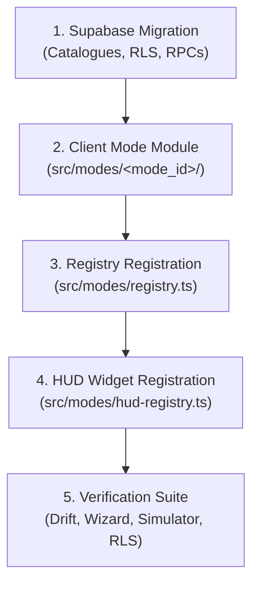

# Developer Guide: Adding a Mode, Modifier, or Role to GhostRun

This document specifies the standard end-to-end procedure for engineering and integrating new game modes, stackable modifiers, and specialized roles in **GhostRun** (v2.6.0+).

---

## 1. Architectural Architecture & Core Invariants

GhostRun enforces strict separation between **server authority** and **client presentation**:
1. **Server Authority (Single Source of Truth for Rules):**
   - The server catalogues (`public.mode_catalogue()`, `public.modifier_catalogue()`, `public.role_catalogue()`) define the canonical mode IDs, minimum/maximum player counts, supported parameters, defaults, valid ranges, compatibility matrices, and feature flags.
   - All state transitions, tag validations, timers, and scoring are evaluated in PostgreSQL / PostGIS.
2. **Client Presentation (Rich Offline-First Metadata):**
   - The typed client registry in `src/modes/` provides UI presentation: display titles, tactical badges, difficulty ratings, parameter editing widgets, detailed rules breakdowns, tour beats, and in-game HUD docks.
   - **Zero Drift Guarantee:** The automated drift test (`scripts/registry-drift.ts` via `npm run test:registry`) verifies that the client registry stays 100% synchronized with the server catalogue on every build.
3. **Secrecy & Privacy Guardrails:**
   - Live opponent GPS coordinates are **never transmitted** to hunters (only scheduled, delayed radar pings).
   - Secret roles (Double Agent, VIP, Bodyguard) and hidden tactical entities (drops, extraction points, jails) are protected by PostgreSQL column-level grants and Row Level Security (RLS).
   - In-game telemetry respects the 7-tier user consent matrix (`C1`–`C7`) documented in `docs/MODES.md §7.4`.

---

## 2. Step-by-Step Implementation Workflow



---

### Step 1: Database Migration & Catalogue Registration

1. Create a new migration file in `supabase/migrations/` (e.g. `165_<mode_id>.sql`).
2. Add your mode entry into `public.mode_catalogue()`, or modifier into `public.modifier_catalogue()`, or role into `public.role_catalogue()`:
   ```sql
   -- Example: Registering a new base mode in mode_catalogue()
   create or replace function public.mode_catalogue()
   returns jsonb
   language sql
   stable
   security definer
   as $$
     select jsonb_build_array(
       -- existing modes...
       jsonb_build_object(
         'id', 'new_mode',
         'name', 'New Base Mode',
         'min_players', 2,
         'max_players', 16,
         'enabled', true,
         'parameters', jsonb_build_object(
           'capture_radius_m', jsonb_build_object('type', 'number', 'default', 25, 'min', 10, 'max', 100)
         ),
         'compatible_modifiers', jsonb_build_array('shrinking_zone', 'ai_gm'),
         'compatible_roles', jsonb_build_array('vip')
       )
     );
   $$;
   ```
3. Implement lifecycle hooks in PostgreSQL:
   - **`start_game(p_game_id)`:** Initialize mode entities, secret roles, and `mode_params`.
   - **`advance_game(p_game_id)`:** Execute server-clock advancement, pulse cycles, or condition checks.
   - **`attempt_tag(p_game_id)`:** Enforce mode-specific tag restrictions (e.g. safe zones, frozen bodyguards).
   - **`get_game_state(p_game_id)`:** Include mode-specific public or team entities while strictly sanitizing hidden secrets.

---

### Step 2: Create the Client Mode Module

Create a dedicated module folder under `src/modes/<mode_id>/`:
- `src/modes/<mode_id>/index.ts`
- `src/modes/<mode_id>/hud.tsx`

#### `src/modes/<mode_id>/index.ts`
Export the typed mode specification conforming to `BaseModeDefinition` or `ModifierDefinition`:

```typescript
import { BaseModeDefinition } from '../types';

export const newModeDefinition: BaseModeDefinition = {
  id: 'new_mode',
  kind: 'base',
  name: 'New Base Mode',
  tagline: 'High-stakes tactical area capture',
  description: 'Infiltrate the operational grid and capture contested zones before extraction.',
  minPlayers: 2,
  maxPlayers: 16,
  difficulty: 'tactical',
  badge: 'TACTICAL',
  icon: 'radio-tower',
  parameters: {
    capture_radius_m: {
      type: 'range',
      label: 'Capture Radius',
      description: 'Maximum distance from target required to register capture',
      default: 25,
      min: 10,
      max: 100,
      step: 5,
      unit: 'm',
    },
  },
  rules: [
    {
      title: 'PRIMARY OBJECTIVE',
      body: 'Infiltrate the designated capture radius while evading hunter detection.',
    },
    {
      title: 'RADAR MECHANICS',
      body: 'Standard radar pings release every 30 seconds. Stationary operatives remain undetected.',
    },
  ],
  enabled: true,
};
```

#### `src/modes/<mode_id>/hud.tsx`
Export the in-game HUD component conforming to `ModeHudWidgetProps`:

```tsx
import React from 'react';
import { StyleSheet, View } from 'react-native';
import { Text } from '../../ui/Text';
import { colors, radii, spacing } from '../../theme/tokens';
import type { ModeHudWidgetProps } from '../types';

export function NewModeHud({ state, roleLayout }: ModeHudWidgetProps) {
  if (state.game.status !== 'live') return null;

  return (
    <View style={styles.container}>
      <Text variant="label" color={colors.primary}>
        CAPTURE ACTIVE
      </Text>
      <Text variant="caption" color={colors.textMuted}>
        Maintain position within perimeter
      </Text>
    </View>
  );
}

const styles = StyleSheet.create({
  container: {
    backgroundColor: colors.surfaceElevated,
    borderColor: colors.borderDark,
    borderRadius: radii.sm,
    borderWidth: 1,
    padding: spacing.sm,
    marginVertical: spacing.xs,
  },
});
```

---

### Step 3: Register in Mode and HUD Registries

1. **Register in `src/modes/registry.ts`:**
   ```typescript
   import { newModeDefinition } from './new_mode';

   export const ALL_BASE_MODES: BaseModeDefinition[] = [
     // existing modes...
     newModeDefinition,
   ];
   ```
2. **Register in `src/modes/hud-registry.ts`:**
   ```typescript
   import { NewModeHud } from './new_mode/hud';

   export const MODE_HUD_REGISTRY: Record<string, React.ComponentType<ModeHudWidgetProps>> = {
     // existing HUDs...
     new_mode: NewModeHud,
   };
   ```

---

### Step 4: Host Wizard & Role Briefing Integration

1. The 5-step Host Wizard (`app/host/`) automatically consumes definitions from `ALL_BASE_MODES`:
   - Step 1 (`mode.tsx`): Displays mode card with icon, difficulty, badge, and description.
   - Step 2 (`rules.tsx`): Auto-generates interactive parameter fields (`ParamField`) from your parameter definitions.
   - Step 3 (`extras.tsx`): Filters compatible modifiers and roles via your `compatible_modifiers` matrix.
   - Step 4 (`area.tsx`): Configures perimeter boundary.
   - Step 5 (`review.tsx`): Renders summary card with validation before creating game.
2. If your addition includes a specialized role, `src/ui/RoleBriefingCard.tsx` automatically renders a private intelligence dossier during lobby countdown without leaking role identity to peers.

---

### Step 5: Verification Suite

Every new mode, modifier, or role must pass the following automated verification suite:

1. **Registry Drift Audit:**
   ```bash
   npm run test:registry
   ```
   *Asserts that client metadata matches server catalogue 1:1.*

2. **Wizard Payload Snapshot Test:**
   - Append a snapshot assertion in `scripts/test-wizard-payload.ts`:
     ```typescript
     const payload = buildGameCreationPayload(storeWithNewMode);
     assert.equal(payload.mode_id, 'new_mode');
     ```
   - Run verification:
     ```bash
     npm run test:wizard
     ```

3. **RLS Secrecy Test:**
   - Add negative tests in `scripts/rls-check.ts` confirming that unauthorized clients cannot access private game state, roles, or entities.
   - Run verification:
     ```bash
     npm run rls
     ```

4. **Multi-Agent Simulation Scenario:**
   - Create a deterministic test scenario under `scripts/sim/scenarios/<mode_id>.ts`.
   - Wire into `scripts/sim/index.ts` and verify:
     ```bash
     npm run sim
     ```

5. **Static Analysis & Token Coverage:**
   ```bash
   npm run typecheck
   npm run lint
   npm run test:routes
   ```

6. **Gallery Verification:**
   - Preview the HUD component in `app/debug/hud-gallery.tsx` under the HUD GALLERY tabs.
   - Confirm dark mode outdoor contrast using Direction A "Night Radar" design tokens.
