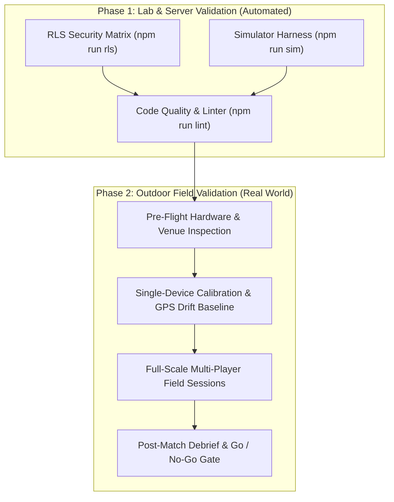

# GhostRun — Outdoor Field-Test Plan & Release Readiness Protocol (VM4)

> **Document Status:** Complete & Verified (`VM4: Field-Test Plan`)  
> **Release Target:** GhostRun v2.5.0 Release Candidate  
> **Target Audience:** Playtest Coordinators, Field Marshals, QA Testers  
> **Scope:** 7 Verified Shipping Base Modes, 3 Role Add-ons, 5 Modifiers, Speed & Safety Guard  

---

## 1. Executive Summary & Field-Testing Scope

GhostRun combines real-time outdoor GPS tracking, cryptographic role secrecy, and physical athletic exertion. While automated simulation harnesses ([`scripts/sim/index.ts`](file:///c:/ASK_Main/ASK/Projects/GhostRun/scripts/sim/index.ts)) and PostgreSQL RLS security tests ([`scripts/rls-check.ts`](file:///c:/ASK_Main/ASK/Projects/GhostRun/scripts/rls-check.ts)) verify server state transitions, win conditions, and column-level isolation, **they cannot evaluate the physical reality of human runners in direct sunlight, on uneven ground, under tree canopy GPS drift, or experiencing cellular handoffs.**

This field-test plan provides a rigorous, low-overhead operational protocol to validate GhostRun on real iOS and Android physical hardware prior to public release.



---

## 2. Real-Device Physical Validation Vectors (What Simulators Cannot Test)

The following real-world failure modes must be explicitly audited on physical devices outdoors:

### 2.1 GPS Jitter, Canopy Multipath & Stationary Drift
- **Physical Phenomenon:** Tall buildings, dense tree canopies, and concrete structures cause multipath signal reflections. When stationary, GPS accuracy wanders by 5–15 meters, which can trigger false tag collisions, spurious out-of-bounds warnings, or erratic zone capture tallies.
- **Verification Requirement:**
  - Verify that the server's GPS accuracy fusion buffer (`accuracy_m / 2` up to 10 m cap in [`attempt_tag`](file:///c:/ASK_Main/ASK/Projects/GhostRun/supabase/migrations/20261113011000_b5_fix_sim_cooldown_and_extraction.sql#L379)) prevents false tags when players are separated by physical walls or fences.
  - Verify that standing completely still inside a sector zone in *Territory Pulse* does not intermittently drop zone presence due to coordinate jitter.
  - Verify that GPS fixes with reported `accuracy > 30 m` are ignored by proximity calculations.

### 2.2 Daylight Outdoor Contrast & Screen Readability
- **Physical Phenomenon:** Mobile OLED and LCD displays wash out under direct solar irradiance (80,000–100,000 lux). Low-contrast UI borders, subtle pastel fills, and fine typography become completely invisible.
- **Verification Requirement:**
  - Verify high daylight contrast for all core tactical colors:
    - Runner Cyan (`#06B6D4` / `#0891B2`)
    - Hunter Red (`#EF4444` / `#DC2626`)
    - Neutral Sector Slate (`#94A3B8` / `#64748B`)
    - Warning Amber (`#F59E0B` / `#D97706`)
    - Safe Zone Green (`#10B981` / `#059669`)
  - Confirm map vector tiles (OpenFreeMap Liberty) maintain road, trail, and park boundary legibility in full noon sunlight without requiring players to seek shade.
  - Confirm HUD alert banners (`gmBanner`, out-of-bounds warning, curfew alert) are instantly readable in peripheral vision during a sprint.

### 2.3 Thermal Load & Battery Consumption
- **Physical Phenomenon:** Continuous screen-on time + high-frequency hardware GPS polling (`Location.Accuracy.BestForNavigation`) + 3D MapLibre OpenGL rendering + cellular transmitter output causes significant CPU heat and battery drain, risking thermal throttling or device shutdown.
- **Verification Requirement:**
  - Measure battery discharge rate over a 30-minute live round: target consumption $< 12\%$ battery per 30 minutes on modern devices (iPhone 13+, Pixel 6+, Galaxy S21+).
  - Confirm devices do not display OS thermal warnings or dim display brightness below legible thresholds during continuous outdoor summer play.

### 2.4 Cellular Handoff & Transient Network Loss
- **Physical Phenomenon:** Running across parks or campus greens frequently triggers cellular base-station handoffs, temporary packet drops, or drops to 3G/E.
- **Verification Requirement:**
  - Verify that momentary network drops (3–8 seconds) do not disconnect the player or forfeit the round.
  - Verify that offline position fixes queue locally in memory and flush immediately upon socket reconnect without triggering spurious speed-violation warnings.
  - Confirm Realtime subscription gracefully resynchronizes game state via HTTP polling fallback ([`app/game/[id].tsx#L999`](file:///c:/ASK_Main/ASK/Projects/GhostRun/app/game/[id].tsx#L999)).

### 2.5 Real-World Physical Safety & Terrain Hazards
- **Physical Phenomenon:** Players focused on a phone screen risk tripping on curbs, running into pedestrians, or sprinting into traffic.
- **Verification Requirement:**
  - Verify that all game mechanics reward stealth, positioning, and tactical patience over reckless sprinting.
  - Confirm the vehicle speed clamp strictly trips at $8.0\text{ m/s}$ (approx. $28.8\text{ km/h}$ / $18\text{ mph}$) to prevent players from using cars, scooters, or bicycles.
  - Verify that the persistent red **Emergency SOS Button** is always visible, tappable with one thumb, and instantly pauses the match, freezes all timers, and halts pulse scoring.

---

## 3. Testing Matrix: Minimum Players, Venues & Durations

| Mode / Feature | Min Players | Ideal Group | Venue Specifications | Recommended Match Duration | Primary Real-World Risk Factor |
|---|---|---|---|---|---|
| **Classic Chase** | 2 (1v1) | 4–6 (2v2 or 2v4) | Park or campus quad with paths; radius 400–600 m | 15–20 min | Sprinting across open roads to reach target |
| **Tag Hunt** | 2 (1v1) | 4–8 (2v2 to 4v4) | Wooded park, recreational fields; radius 400–800 m | 15–20 min | Physical collision on blind corners during tag |
| **Solo Ghost Duel** | 1 (solo) | 1 | Any public park or greenway; radius 200–500 m | 5–10 min | Distracted running along pedestrian paths |
| **Jailbreak** | 5 (2v3) | 8–12 (4v4+) | Open grounds with landmark center; radius 400–600 m | 20–25 min | Clustering and physical pile-ups at Jail perimeter |
| **Assassin Ring** | 3 (solo ring) | 6–12 | Campus or neighborhood with landmarks; radius 500–800 m | 25–35 min | Accidental physical confrontation in 1v1 stalk |
| **Relay Heist** | 3 (1v2) | 6–10 (2v4+) | Multi-path campus or park; radius 400–800 m | 20–25 min | Hand-to-hand phone or body contact on handoff |
| **Territory Pulse** | 4 (2v2) | 8–16 (4v4+) | Large sports field complex or open park; radius 300–600 m | 20–30 min | Over-exertion sprinting between sectors on pulse |
| **Double Agent** | 6 (2v4) | 8–12 | Mixed open and covered terrain; radius 400–800 m | 20–30 min | Social dispute or verbal argument during Tribunal |
| **VIP Escort** | 4 (2v2) | 6–10 (2v4+) | Campus or urban park with clear alleys; radius 300–600 m | 15–20 min | Bodyguards physically tackling hunters near VIP |
| **Operator Role** | 4 (2v2) | 6–12 (incl. 2 remote) | Field players outdoors; Operator stationary (bench/desk) | 15–30 min | Miscommunication over voice / text dispatch |
| **AI Game Master** | 2 | 4–12 | Compatible with all venues; radius 300–800 m | 15–30 min | Drops spawning in brambles or inaccessible areas |

---

## 4. Step-by-Step Test Scripts for Shipping Modes

### 4.1 Classic Chase (Target Extraction)
1. **Pre-Match Setup:** Host selects `Classic Chase`, sets radius to 500 m, countdown 10 s, head start 60 s, duration 15 min.
2. **Target Selection:** Runners inspect map and secretly position the finish target at a clearly identifiable, publicly accessible landmark (e.g. gazebo, statue). Confirm Hunters see zero target markers or coordinate hints.
3. **Head Start Dispersal:** Verify Hunters' maps remain blurred/locked during head start. Confirm Runners can disperse safely.
4. **Live Chase:** At 00:00 head start expiration, confirm Hunters' maps unlock and first radar ping round emits.
5. **Physical Tag Check:** Hunter approaches within 15 m of a Runner. Hunter taps `TAG`. Confirm haptic confirmation fires on both devices, Runner status changes to `tagged`, and Runner map switches to spectator view.
6. **Target Arrival:** Surviving Runner approaches within 20 m of target. Confirm client executes `submit_position`, server evaluates `st_dwithin(pos, target, 20)`, and match concludes immediately with `Runners Win: Target Reached`.

### 4.2 Tag Hunt (Survival Evade)
1. **Pre-Match Setup:** Host selects `Tag Hunt`, sets duration 10 min, ping interval 30 s.
2. **Lobby & Start:** Verify no target selection screen is shown; game transitions directly from countdown to live.
3. **Delayed Ping Verification:** Confirm Hunter radar shows ping locations from 30 seconds prior, displaying position age badges.
4. **Tag Cooldown Check:** Hunter attempts `TAG` when no Runner is in range ($> 25\text{ m}$). Confirm failed tag triggers an 8-second cooldown with amber indicator on button.
5. **Timeout Victory:** Allow timer to reach 00:00 while at least one Runner remains active. Confirm match ends with `Runners Win: Survival Timeout`.

### 4.3 Solo Ghost Duel
1. **Variant A: Time Trial:**
   - Solo player creates `Ghost Duel` with variant `time_trial`.
   - Confirm player is assigned `runner` team.
   - Start match; observe ghost entity blip advancing along the pre-recorded path.
   - Player runs to the finish target before the ghost's recorded timestamp.
   - Confirm victory debrief displays player time, ghost time, split delta, and efficiency score.
2. **Variant B: Evade:**
   - Solo player creates `Ghost Duel` with variant `evade`.
   - Start match; player navigates to finish target while staying $> 20\text{ m}$ away from patrolling ghost.
   - Test collision: player deliberately steps within 15 m of ghost blip; confirm match ends immediately with `Haunted: Ghost Caught You`.
3. **Variant C: Mirror Chase:**
   - Solo player creates `Ghost Duel` with variant `mirror_chase`. Confirm player is assigned `hunter` team.
   - Player pursues ghost runner entity, closes to $< 10\text{ m}$, and taps `TAG GHOST`.
   - Confirm match concludes with `Hunter Win: Ghost Tagged`.
4. **Privacy & Leaderboard Check:** Confirm public Top 5 leaderboard is hidden on the results screen; confirm personal performance debrief card displays accurately.

### 4.4 Jailbreak
1. **Jail Placement:** Host places physical Jail zone at an open landmark in lobby. Confirm Jail circle renders on map with 15 m radius.
2. **Arrest on Tag:** Hunter executes physical tag on Runner 1. Confirm Runner 1 status changes to `jailed` with direct map route to Jail zone.
3. **Incarceration:** Jailed Runner stands inside Jail radius. Confirm screen displays "In Jail" status card.
4. **Rescue Attempt:** Free Runner 2 approaches to $< 10\text{ m}$ of Jail perimeter, presses and holds `RESCUE` button.
5. **Hold Timer:** Hold for 10 consecutive seconds. Confirm circular progress ring fills, rescue haptic triggers, and Jailed Runner 1 is immediately freed (`status = 'active'`).
6. **Auto-Release Safety Check:** Test auto-release: leave a jailed runner untouched for 5 minutes (or 30s in test lobby). Confirm player is auto-released without runner intervention.

### 4.5 Assassin Ring
1. **Pre-Match Setup:** Join 4–6 players. Host selects `Assassin Ring` with 2 safe zones.
2. **Ring Assignment Isolation:** Start game. Confirm each player's HUD displays **only** their designated Prey (name, avatar, distance pulse). Confirm zero indication of who is hunting them.
3. **Safe Zone Immunity:** Target Prey enters Safe Zone circle (`radius_m = 20`). Hunter attempts tag from 5 m. Confirm tag is strictly rejected with `Target is in Safe Zone`.
4. **Shelter Timer & Cooldown:** Prey stays in Safe Zone. Confirm shelter countdown timer depletes (60 s limit). When expired, confirm Safe Zone immunity drops and triggers a 120 s reentry cooldown.
5. **Contract Inheritance:** Hunter tags Prey outside Safe Zone. Confirm Prey is eliminated, and Hunter's HUD instantly inherits the eliminated Prey's target, closing the ring.
6. **Final Survivor:** Continue until 1 player remains. Confirm immediate victory attribution.

### 4.6 Relay Heist
1. **Extraction Placement:** Host designates extraction zone $\ge 50\text{ m}$ from outer road boundary.
2. **Carrier Assignment:** Confirm Runner 1 is randomly designated package carrier at live start.
3. **Stealth Carried Package:** Confirm Hunters cannot see the package blip while carried.
4. **Handoff Mechanic:** Carrier Runner 1 approaches Runner 2 within 5 m. Runner 1 taps `HANDOFF`, Runner 2 taps `ACCEPT`. Confirm carrier transfers cleanly within 10 s timeout.
5. **Drop on Tag:** Hunter tags carrier. Confirm carrier is eliminated, package state updates to `dropped`, beacon blip turns yellow and becomes visible to ALL players on radar.
6. **Securing Hold:** Hunter stands within 10 m of dropped package, presses and holds `SECURE` for 20 s. Confirm package secured and Hunters win.

### 4.7 Territory Pulse
1. **Sector Generation:** Start match. Confirm map displays 7 discrete circular sector rings (1 Sector Core at center + 6 radial Alpha through Foxtrot rings at 60° increments).
2. **Neutral Capture:** Stand inside Sector Core during pulse evaluation tick. Confirm sector ring transitions from neutral slate (`#94A3B8`) to runner cyan (`#06B6D4`) on 1st pulse.
3. **Score Accumulation:** On subsequent pulses, confirm team score increments (+1 point per owned sector).
4. **2-Pulse Contested Flip:**
   - Hunter enters Runner-owned Sector Alpha alone.
   - On Pulse 1: Confirm Alpha border pulses amber, marked as `contended`, but ownership remains Runner.
   - On Pulse 2: Hunter maintains majority. Confirm sector control flips to Hunter red (`#EF4444`).
5. **Contest Tag:** Hunter tags Runner inside sector. Confirm Runner receives 60 s incapacitation timer (`contest_tag` event), cannot contribute to zone majority, but is **not** eliminated.
6. **Dominance Victory:** One team captures $\ge 5$ of 7 sectors across 2 consecutive pulses. Confirm match ends immediately with `Territory Dominance`.

---

## 5. Test Scripts for Role Add-ons & Modifiers

### 5.1 Double Agent
- **Secret HUD:** Confirm exactly one Hunter sees the secret Double Agent HUD with `WHISPER` and `SCRAMBLE` buttons. Confirm teammate Hunters see standard Hunter HUD.
- **Whisper Check:** Double Agent taps `WHISPER`. Confirm client receives the target cardinal quadrant without notifying teammate Hunters.
- **Scramble Check:** Double Agent taps `SCRAMBLE`. Confirm next scheduled ping displaces Runner blips by 150–250 m on Hunter radar, clamped within arena bounds.
- **Tribunal Vote:** Hunters convene Tribunal, accuse suspected Double Agent, and cast votes. Confirm majority vote exposes agent or penalizes false accusation.

### 5.2 VIP Escort
- **VIP & Bodyguard Secrecy:** Confirm Runner team sees VIP crown and Bodyguard shield; confirm Hunters see identical runner blips with zero role designations.
- **Role Swap:** VIP approaches Bodyguard to $< 5\text{ m}$, initiates swap. Both confirm. Confirm secret roles invert.
- **Bodyguard Freeze:** Hunter tags Bodyguard. Confirm Bodyguard is frozen for 60 seconds without ending match.
- **VIP Elimination vs Arrival:** Hunter tagging VIP ends match immediately (Hunters Win). VIP reaching target ends match immediately (Runners Win).

### 5.3 Remote Tactical Operator
- **Remote Designation:** Remote player toggles `Remote Operator` in lobby. Confirm player is exempted from outdoor GPS requirements.
- **OSM Vector Map:** Operator interacts with vector map, pans and zooms without satellite imagery.
- **Tactical Markers:** Operator places up to 3 colored markers; confirms field teammates see markers in Realtime.
- **Census & Sweep:** Operator taps `SCAN`. Confirm Runner operator receives 150 m radar envelope; confirm Hunter operator receives numerical census count only (zero raw runner coordinates).
- **Physical Tag Immunity:** Confirm Operator cannot be tagged by field hunters and cannot tag runners.

### 5.4 Modifiers & Safety Guard
- **Noise Meter:** Sprinting $> 3.5\text{ m/s}$ increases noise bar to 100, emitting a penalty ping. Walking stays quiet.
- **Dead Drops:** Approaching drop within 40 m reveals crate marker. Holding for 10 s claims tactical item (veil, decoy, sensor jammer).
- **Hot & Cold:** Hunter taps `HEAT`. Screen pulses red if runner is within fuzzed radius $R$, blue if outside. 10 s cooldown enforced.
- **Shrinking Zone:** In final third of round, boundary contracts inward across stages 100% $\rightarrow$ 70% $\rightarrow$ 45%. Grace period allows safe return.
- **AI Game Master:** Automated dispatches fire every 3 min (supply drops inside 65% radius, radar fog for 60 s, directional rumors, boundary contractions clamped $\ge 60\text{ m}$).
- **Emergency SOS:** Tapping red SOS pauses game timer, freezes radar, and alerts all players immediately.

---

## 6. Printable / Mobile-Friendly 1-Page Checklists

### Sheet 1: Pre-Flight Hardware & Venue Inspection
```
[ ] Venue: Safe public park/campus, zero active roadways, clear perimeter boundaries.
[ ] Weather: Daylight outdoor conditions, ground dry and free of tripping hazards.
[ ] Devices: Tested on at least 1 iOS device and 1 Android device simultaneously.
[ ] Battery: All devices charged to >= 80% before kickoff.
[ ] Location Permissions: Set to 'Always Allow' or 'While Using App' with 'Precise Location' ON.
[ ] Map Offline Cache: Area map tiles pre-loaded over Wi-Fi / cellular.
```

### Sheet 2: Classic Chase & Tag Hunt
```
[ ] Classic Chase: Runner extraction target placed at accessible physical landmark.
[ ] Classic Chase: Hunters' maps remain locked during head-start period.
[ ] Classic Chase: Reaching target triggers Runner Win immediately.
[ ] Tag Hunt: No target screen; starts immediately from countdown to live.
[ ] Tag Hunt: 8-second cooldown triggers on missed tag attempts.
[ ] Tag Hunt: Surviving until duration expiration triggers Runner Win.
[ ] Both: Tagging all runners triggers Hunter Win immediately.
[ ] Both: Replay screen reveals true trails only after game completion.
```

### Sheet 3: Solo Ghost Duel
```
[ ] Time Trial: Player races recorded ghost replay to target; finishes faster to win.
[ ] Evade: Player navigates to target; stepping within 20m of ghost triggers Haunted loss.
[ ] Mirror Chase: Player pursues ghost runner; approaching <= 10m enables successful tag.
[ ] Privacy Check: Public Top 5 leaderboard is completely hidden from results screen.
[ ] Debrief Check: Personal score card accurately displays player time, split delta, efficiency.
```

### Sheet 4: Jailbreak & Assassin Ring
```
[ ] Jailbreak: Single Jail placed in open area; tagged runners enter jail zone.
[ ] Jailbreak: Rescuer stands <= 10m from jail, holds RESCUE button for 10 seconds.
[ ] Jailbreak: Rescued runner receives 30-second grace immunity; auto-release after 5m.
[ ] Assassin Ring: Ring formed with >= 3 players; each player sees ONLY their assigned Prey.
[ ] Assassin Ring: Safe zone grants physical immunity; 60s max dwell + 120s cooldown.
[ ] Assassin Ring: Eliminating Prey automatically assigns next target in ring.
```

### Sheet 5: Relay Heist & Territory Pulse
```
[ ] Relay Heist: Package carrier randomly chosen; package invisible to hunters while carried.
[ ] Relay Heist: Carrier passes package to teammate within 5m in <= 10s.
[ ] Relay Heist: Tagged carrier drops package; package beacon emits public ping to all.
[ ] Relay Heist: Hunter stands <= 10m from dropped package, holds SECURE for 20s to win.
[ ] Territory Pulse: 7 circular sectors render clearly (Core + Alpha through Foxtrot).
[ ] Territory Pulse: Standing in neutral sector claims it on next pulse tick.
[ ] Territory Pulse: Opponent presence requires 2 consecutive pulses to flip ownership.
[ ] Territory Pulse: Tagged runner receives 60s contest incapacitation banner (not eliminated).
[ ] Territory Pulse: Holding >= 5 of 7 sectors for 2 consecutive pulses wins by Dominance.
```

### Sheet 6: Roles & Modifiers Checklist
```
[ ] Double Agent: Exactly 1 hunter sees Whisper/Scramble actions; teammate hunters see none.
[ ] Double Agent: Scramble displaces next scheduled ping by 150-250m inside boundary.
[ ] VIP Escort: Bodyguard and VIP swap roles within 5m; tagged bodyguard freezes for 60s.
[ ] Operator: Remote player operates from desk/bench; places up to 3 tactical markers.
[ ] Operator: Runner scan sweeps 150m envelope; hunter scan returns numerical census only.
[ ] Noise Meter: Running increases noise bar toward 100; triggers penalty ping on alert.
[ ] Dead Drops: Drops reveal within 40m; 10s claim grants tactical single-use item.
[ ] Hot & Cold: HEAT press triggers red (close) or blue (far); spends charge with 10s cooldown.
[ ] AI Game Master: Automated dispatches fire every 3m; radar fog obscures screen for 60s.
[ ] Emergency SOS: Tapping red SOS pauses game timer and freezes all mechanics instantly.
```

---

## 7. Go / No-Go Decision Gate Matrix

Before approving v2.5.0 for public release, the build must pass **all** mandatory criteria:

| Gate | Category | Evaluation Metric | Pass Threshold | Severity if Failed |
|---|---|---|---|---|
| **G-01** | **Safety** | Vehicle Speed Trap Clamp | 100% of movements $> 8.0\text{ m/s}$ trigger speed warning and suspend gameplay | **BLOCKER (No-Go)** |
| **G-02** | **Safety** | Emergency SOS Pause | Tapping SOS halts timers, freezes score, and notifies all players in $< 1.5\text{ s}$ | **BLOCKER (No-Go)** |
| **G-03** | **Safety** | Road & Boundary Margins | Zero supply drops, extraction points, or jails placed $< 50\text{ m}$ from roadways | **BLOCKER (No-Go)** |
| **G-04** | **Stability** | Client Crash Rate | 0 application crashes across 10 completed outdoor test matches | **BLOCKER (No-Go)** |
| **G-05** | **Privacy** | Live Role & Coordinate Secrecy | 0 instances of opponent secret roles, raw GPS, or extraction targets leaking to clients | **BLOCKER (No-Go)** |
| **G-06** | **Hardware** | Thermal & Battery Load | Battery drain $< 12\%$ per 30 minutes; zero device thermal throttle shutdowns | **HIGH (Hold for Fix)** |
| **G-07** | **Readability**| Daylight Contrast | All sector rings, HUD text, and radar blips legible under direct noon sunlight | **HIGH (Hold for Fix)** |
| **G-08** | **Network** | Cellular Reconnect Grace | Reconnects from momentary signal drop ($< 10\text{ s}$) without forfeiting game | **HIGH (Hold for Fix)** |
| **G-09** | **Gameplay** | Rule Comprehension | $100\%$ of test players understand mode rules and win conditions in $< 2\text{ minutes}$ | **MEDIUM (Polish Copy)** |
| **G-10** | **Integrity** | Leaderboard Moderation | Public Ghost Duel leaderboard hidden in UI until user reporting/blocking is built | **BLOCKER (No-Go)** |

---

### Release Sign-Off Authority
- **Technical Lead:** `Arshvir Singh Kalsi`
- **Field Test Marshals:** Outdoor Playtest Team
- **Approval Status:** *Pending physical device execution of Sheets 1–6 against Go / No-Go Gates G-01 to G-10.*
