# GhostRun — User and System Flows

> Companion to `PRD.md` and `TRD.md`. Diagrams use Mermaid (render in GitHub, VS Code with a Mermaid extension, or Obsidian).

---

## 1. App navigation map

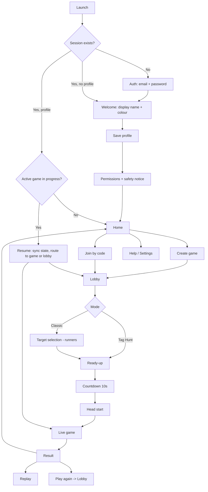

**Account recovery:** the auth screen can send a password-reset link with `resetPasswordForEmail`, or resend the confirmation email with `auth.resend({ type: 'signup' })` when an account is still unconfirmed. The reset link returns to `reset-password`, which reads the session tokens through `src/lib/authLink.ts`, sets the session and calls `updateUser({ password })`. The project's redirect allowlist must include `ghost-run://reset-password` (or the Expo development URL) for the link to return to the app.

## 2. First-run and permissions flow

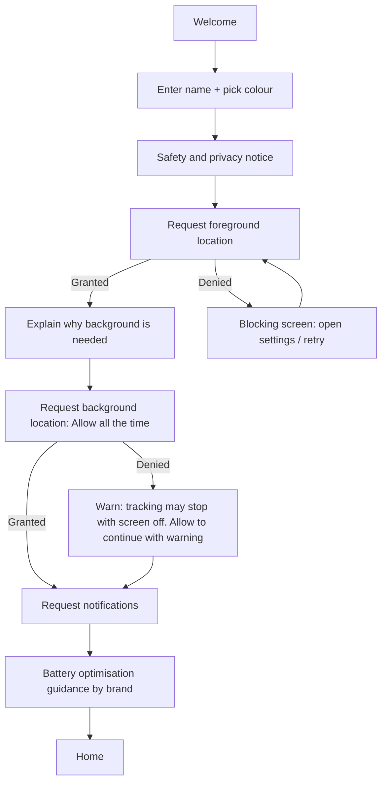

## 3. Game lifecycle (server state machine)

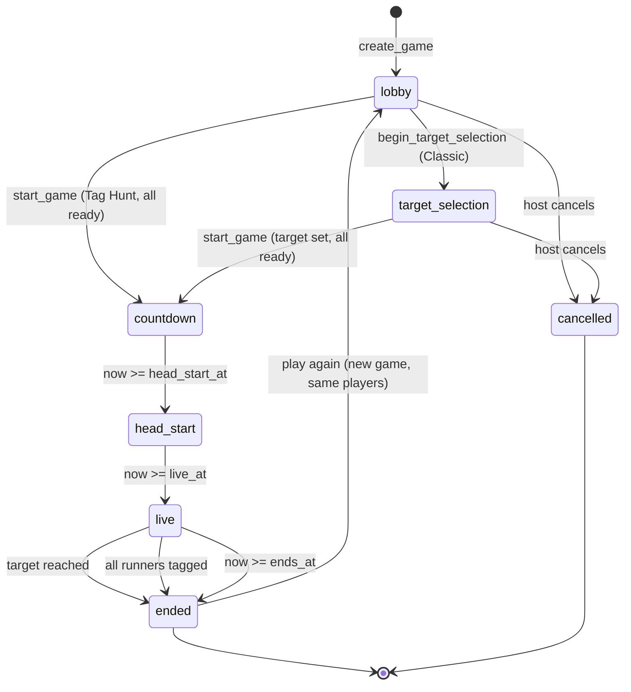

## 4. Player state machine

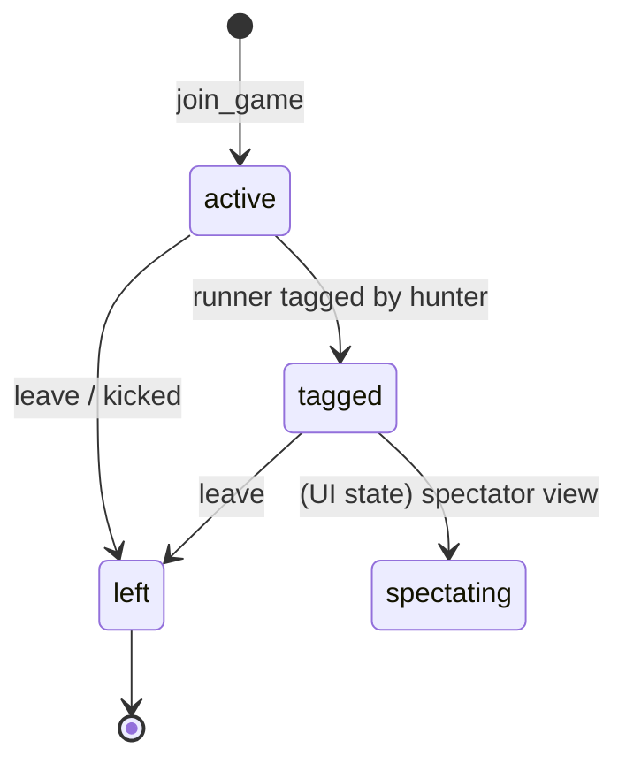
A runner who leaves mid-game is treated as tagged. A hunter who leaves is removed from play.

## 5. Lobby flow

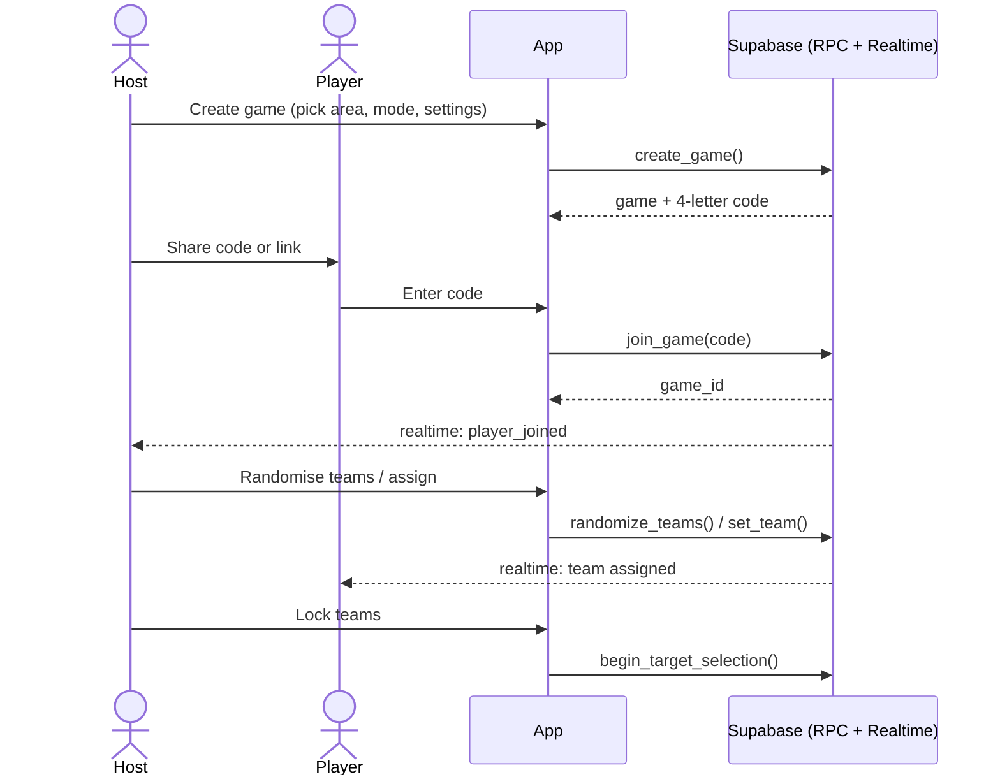

## 6. Pre-game: target selection, ready, countdown

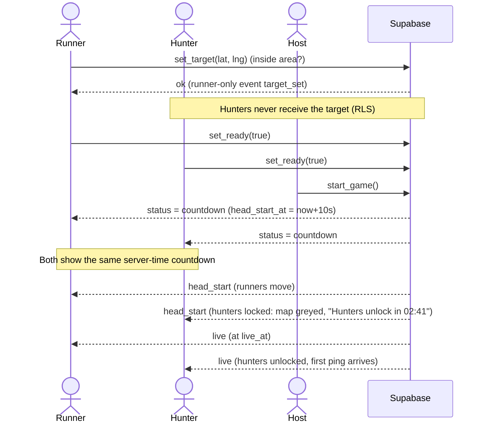

## 7. Location upload and ping release (core loop)

```mermaid
sequenceDiagram
  participant RP as Runner phone
  participant DB as Supabase
  participant HP as Hunter phone

  loop every 5-10 s (foreground service)
    RP->>DB: submit_position(lat,lng,acc,...)
    DB->>DB: advance_game(), upsert position, trail + boundary warning
    DB-->>RP: {phase, server_time, next_ping_at, in_bounds, winner}
  end

  opt next_ping_at has passed (any member read; the live screen reads at the boundary)
    HP->>DB: get_game_state()
    DB->>DB: copy active runner positions into pings (with age)
    DB-->>HP: snapshot with the new pings
    DB-->>RP: realtime: ping_released (runners see what hunters learn)
    HP->>HP: render marker "seen just now", fades with age
  end
```

## 8. Tag flow

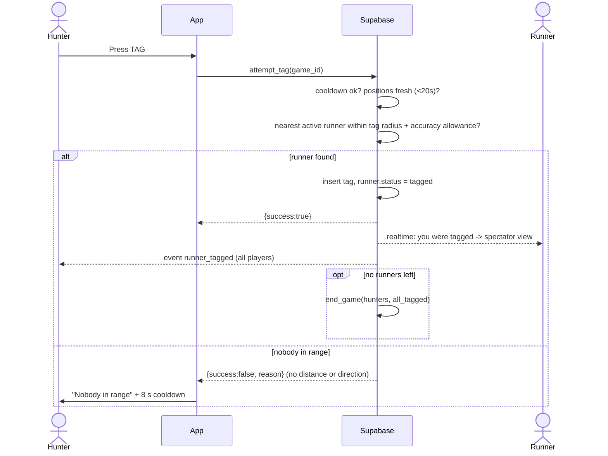

## 9. Arrival (Classic mode) and game end

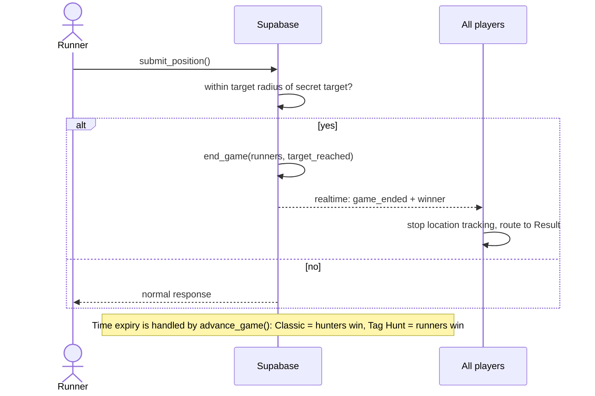

## 10. In-game screen states

| Role / phase | Map shows | Controls | HUD |
|---|---|---|---|
| Runner, head start | Area, self, teammates, target and radius, own trail | SOS | "Head start 02:10" |
| Runner, live | Same plus ping markers (what hunters know) | SOS | Time left, next ping in, hunters unlocked |
| Hunter, head start | Area, self, teammates (map greyed) | SOS | "Unlocking in 02:10" |
| Hunter, live | Area, self, teammates, ping markers with age, tag ring | **TAG**, SOS | Time left, next ping in, runners remaining |
| Tagged runner | Teammates only (spectator) | Leave | "You were tagged" |
| Any, boundary breach | Red edge, banner "Return to area (0:25)" | none | Countdown to penalty |
| Any, connection lost | Banner "Reconnecting..." and last known state | none | Auto-resync via `get_game_state` |

## 11. Boundary flow

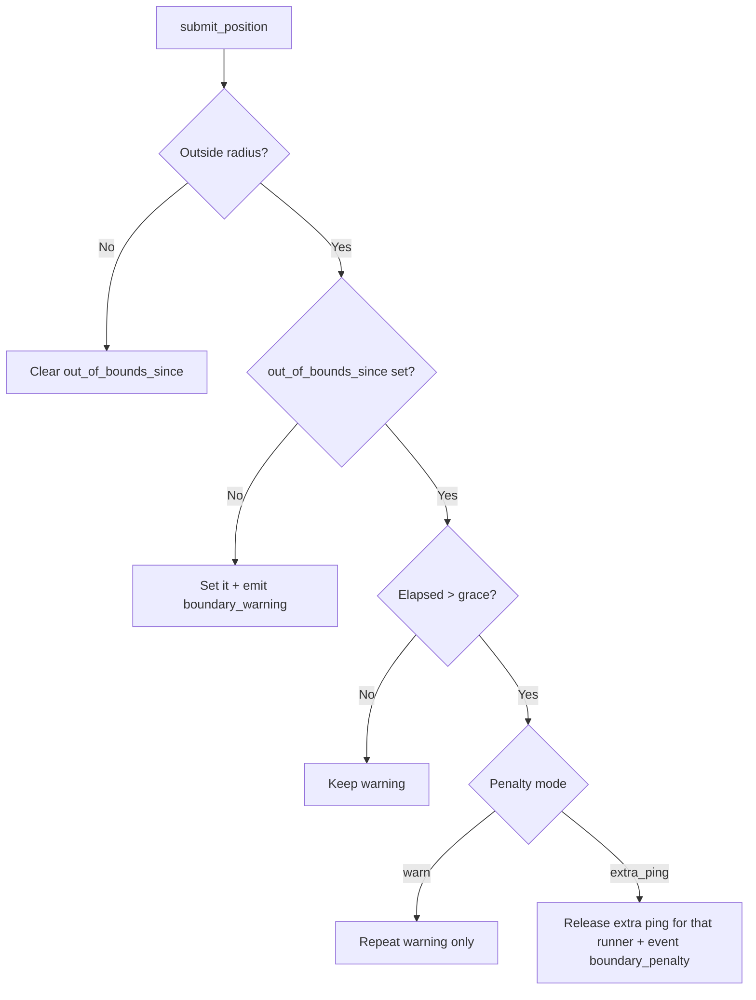

## 12. Reconnect and resilience

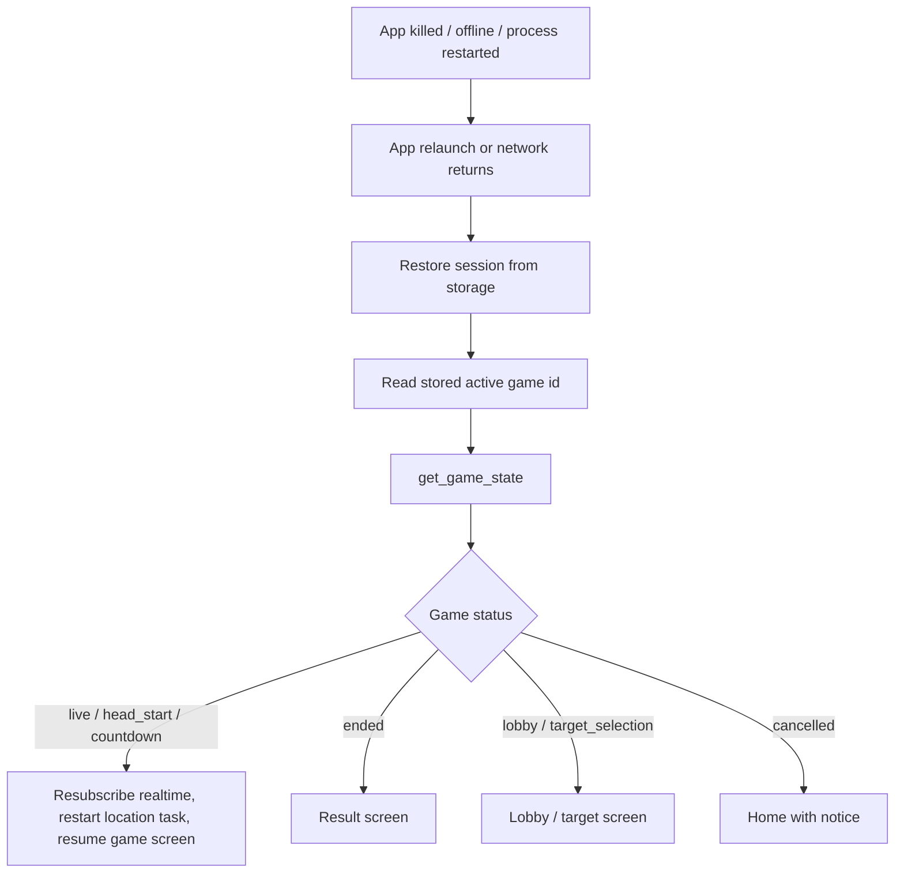

Also handled:
- **Background task killed by the OS:** foreground service plus the in-app warning if no upload was received for over 60 s ("Tracking paused, open the app").
- **Offline for a short time:** uploads queue (max 50), only the newest position matters, trail gaps are acceptable.
- **Clock skew:** all timers come from the server offset, never from device time alone.

## 13. Host and edge-case rules

| Situation | Behaviour |
|---|---|
| Host leaves in lobby | Host passes to the earliest-joined player |
| Host leaves mid-game | Game continues, host passes on |
| Last hunter leaves | Runners win by forfeit |
| Last runner leaves or is tagged | Hunters win (`all_tagged`) |
| Player leaves mid-game | Runner is treated as tagged, hunter is removed |
| Start pressed with no hunters or no runners | Blocked with message |
| Target outside the area | Rejected with message |
| Code collision | Regenerated (unique among active games) |
| Join after start | Blocked ("Game in progress") |
| SOS pressed | All players see the player's last position and a banner. The game continues, and the player can end their participation |
| Two hunters tag the same runner at once | Row lock, one tag recorded, the other gets `no_target` |

## 14. Post-game flow

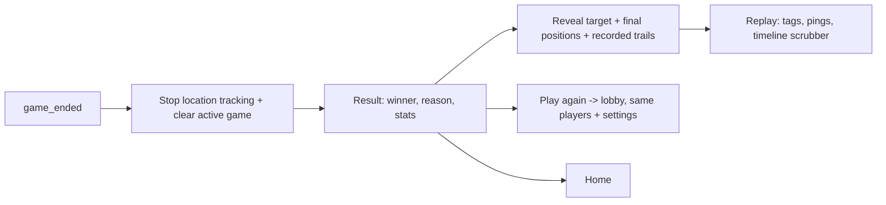

The result screen (`app/result/[id].tsx`) owns the ended phase. It loads `get_game_state` for the winner, final positions and target, then calls `get_game_trails` for the recorded routes. That RPC is member-only and refuses to run unless the game is `ended`; the `trail_points` RLS policy applies the same gate. The live screen replaces itself with the result as soon as it sees `ended`, and the result stops any surviving location task on mount.

**Play again** calls `rematch_game`. Any member can press it, not only the host. The first press copies the mode, play area and round settings into a new lobby, keeps the original host if they are still in the crew, adds every player who had not left with their previous side, and resets tags and ready flags. The source game stores the new id in `games.rematch_game_id`; later presses return that same lobby. The result screen polls the pointer, so every player still on the result moves into the fresh lobby together. Classic Chase asks a runner for a new target before the next round.

The result's “Watch replay” opens `app/replay/[id].tsx`. The replay loads `get_game_replay` for every tag and released ping, reuses `get_game_trails`, and scrubs `live_at` to the finish. Trails, positions and pings stop at the playhead; tags and pings appear as timeline markers, and playback runs at 1× or 10×. Both recap RPCs are member-only and ended-only.
