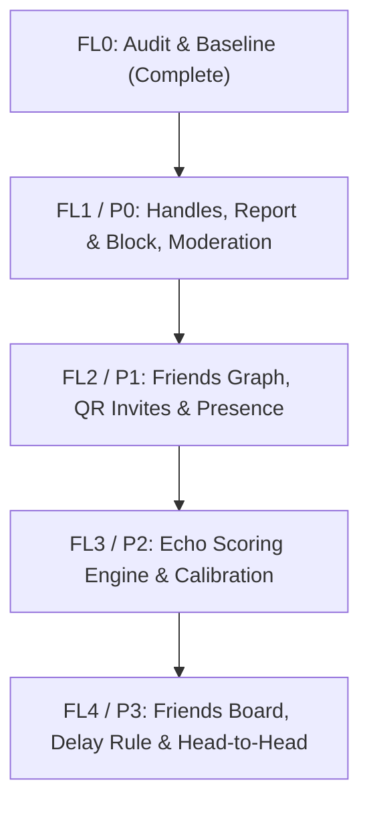

# GhostRun — Friends, Report/Block and Echo Audit (FL0)

> **Status:** Complete Read-Only Audit  
> **Milestone:** Wave 6 / Task FL0  
> **Companions:** `docs/FRIENDS_LEADERBOARDS.md`, `docs/WAVES.md`, `docs/PROGRESS.md`, `docs/DECISIONS.md`, `docs/MODES.md`

---

## 1. Executive Summary & Standing Decisions

Wave 6 integrates the comprehensive 4-phase system specified in `docs/FRIENDS_LEADERBOARDS.md` (`FL0` to `FL4`), replacing early exploratory stubs (NF-08 basics, NF-14, NF-30) with a production-grade social, moderation, and skill ranking engine.

### Standing Invariants (Non-Negotiable)
1. **Friends first, public boards later:** No global boards, country boards, or flags. No search or discovery of strangers.
2. **Ghost Duel isolation:** Ghost Duel's solo NPC leaderboards (`ghost_duel_scores`) remain completely separate and untouched.
3. **Brand-new original metric:** Echo is an original, server-computed metric measuring GhostRun's core mechanic: the delayed ping. Runners earn Echo by ghosting pings (making them lead nowhere); hunters earn Echo by cashing pings (turning stale information into contact).
4. **Zero location exposure on boards:** Friends boards and head-to-head records reveal no coordinates, route geometry, game dates, times of play, or countries.
5. **Age policy:** Strictly 18+ or guardian-supervised. No minor-targeted features.

---

## 2. Existing Systems Inventory

### 2.1 Unique Handles (`@handle`)
- **Current State:** `public.profiles` (`20261028000000_m0_profiles.sql`) contains only `id`, `display_name` (1–20 chars, mutable, non-unique), `color`, and `created_at`.
- **Findings & Gaps:**
  - `@handle` does not exist in the database or client code.
  - PostgreSQL extension `citext` has not yet been enabled in any migration.
  - Case-insensitive uniqueness requires `citext` or a lowercase unique functional index.
  - Display name (game-visible) and handle (social/boards) must be decoupled.
- **Migration & Code Plan (FL-P0):**
  - Enable `citext` schema extension.
  - Add `handle citext unique` to `public.profiles` with regex constraint `^[A-Za-z0-9_]{3,20}$`.
  - Add reserved handle deny-list (`admin`, `ghostrun`, `support`, `moderator`, `system`, etc.).
  - Implement RPCs `check_handle(handle text)` and `claim_handle(handle text)` with rate-limiting.
  - Provide a one-time "Claim your handle" prompt in onboarding and You tab for existing accounts.

### 2.2 Report and Block Moderation
- **Current State:**
  - `20261118028000_nf07_team_radio.sql` created `public.blocks (user_id, blocked_user_id, created_at)` and `public.reports (id, reporter_user_id, reported_user_id, game_id, message_id, reason, details, status, created_at)`.
  - RPCs `block_user(p_target_user_id)`, `unblock_user(p_target_user_id)`, and `report_player(...)` are in place.
- **Findings & Gaps:**
  - `public.reports` currently has RLS allowing only the reporter to view their own filed reports:
    ```sql
    create policy reports_select_own on public.reports
      for select to authenticated using (reporter_user_id = (select auth.uid()));
    ```
  - Admins (identified via `public.is_admin_user()` from `NF-26`) cannot currently view reports submitted by other players.
  - Context field in `reports` lacks lobby/friends/board source tagging.
- **Plan (FL-P0):**
  - Grant admins read/update access to `public.reports` via `is_admin_user()` policy.
  - Author formal moderation procedure `docs/MODERATION.md` detailing report ingestion, daily digest generator, 24-hour response target, enforcement actions (warning, handle removal, temporary/permanent suspension), and email appeals procedure (`support@ghostrun.app` / `PRIVACY_CONTACT_EMAIL`).

### 2.3 Friends Graph & Presence
- **Current State:** No persistent friend graph or presence table exists. Persistent crews (`NF-16`) exist for game parties but do not constitute a bidirectional 1-to-1 friends graph.
- **Findings & Requirements:**
  - Tables required:
    - `public.friendships`: `(user_a, user_b, status, requested_by, created_at, responded_at)` with canonical ordering `CHECK (user_a < user_b)`.
    - `public.host_presence`: `(user_id, game_id, mode_id, player_count, expires_at)` with 30-minute auto-expiry.
    - `public.friend_invites`: `(token_hash, owner_id, expires_at, used_at)`.
  - Presence privacy: Off by default. When enabled, reveals only host name, mode, and player count. No coordinates, routes, or areas.
  - Friend requests: Exact handle or signed invite token (24h) only. No user search or directory discovery. 10 requests/day cap, 20 pending, 200 friend ceiling, 7-day decline cooldown.
- **Plan (FL-P1):** Implement migration, RPCs, and UI sheets for friends list, requests, QR invite tokens, and Play tab presence banner.

### 2.4 Scores & Leaderboards
- **Current State:**
  - `public.ghost_duel_scores` tracks solo ghost duel attempts.
  - No generalized multiplayer round scoring or competitive rating engine exists.
- **Plan (FL-P2 / FL-P3):**
  - Implement `public.scoring_profiles`, `public.round_scores`, and `public.season_scores`.
  - Maintain strict separation from `ghost_duel_scores`.

### 2.5 Seasons & Historical Stats
- **Current State:** `public.seasons` created in `20261118035000_nf31_seasons_banners.sql` tracks season numbers, names, and active windows.
- **Plan (FL-P2 / FL-P3):**
  - Anchor `season_scores` to monthly calendar seasons (`YYYY-MM`).
  - Calculate Season Echo using best 12 counted rounds (minimum 3 rounds to appear on friends board).

### 2.6 Consent Records & Privacy Controls
- **Current State:** `public.consents` tracks C1–C7 (`location`, `policy_ack`, `ghost`, `leaderboard_name`, `diagnostics`).
- **Plan:**
  - Expand consent enum with C8 (`show_presence`, default false) and C9 (`share_echo`, default false).
  - Add corresponding boolean columns on `public.profiles`: `show_presence`, `allow_friend_requests`, `share_echo`.
  - On first friend acceptance, present two equal choices to opt in/out of `share_echo`.

### 2.7 Data Retention & Account Deletion (`delete_my_data`)
- **Current State:** `delete_my_data()` in `20261101001000_v2m1_consent_rpcs.sql` deletes the caller's row in `public.profiles` and relies on foreign key cascading.
- **Audit Verification:**
  - `friendships`: `user_a` and `user_b` reference `profiles(id) ON DELETE CASCADE`.
  - `host_presence`: references `profiles(id) ON DELETE CASCADE`.
  - `friend_invites`: references `profiles(id) ON DELETE CASCADE`.
  - `round_scores` & `season_scores`: reference `profiles(id) ON DELETE CASCADE`.
  - Deletion cascades cleanly without orphan records. Scheduled cron purges round scores older than 90 days and season scores older than 12 months.

---

## 3. Scoring Maths Data Audit & Gap Analysis

### 3.1 Data Available in Existing Database Tables

| Table | Relevant Fields | Purpose in Echo Scoring |
|---|---|---|
| `public.games` | `id`, `area_center`, `area_radius_m`, `head_start_s`, `duration_s`, `ping_interval_s`, `tag_radius_m`, `status`, `winner`, `end_reason`, `live_at`, `ended_at` | Provides match geometry, window parameters $W$, $D_{min}$, match duration, and team outcome $O$. |
| `public.players` | `id`, `game_id`, `user_id`, `team`, `status`, `secret_role`, `is_remote`, `joined_at`, `tagged_at` | Determines role, active duration for Presence $P$, and early leave detection. |
| `public.pings` | `id`, `game_id`, `seq`, `player_id`, `geog`, `accuracy_m`, `position_age_s`, `reason`, `released_at` | Ground truth for delayed ping locations $L$ and release timestamps $t$. |
| `public.trail_points` | `id`, `game_id`, `player_id`, `geog`, `accuracy_m`, `recorded_at` | High-frequency location points to evaluate displacement ($D_{min}$), hunter approach distance ($2 \times R_{tag}$), and hunter active movement ($50\text{ m}$ in $W$). |
| `public.tags` | `id`, `game_id`, `hunter_id`, `runner_id`, `distance_m`, `tagged_at` | Validates whether runner was tagged before $t + W$ or hunter cashed contact before $t + T_c$. |

### 3.2 Mathematical Formulation & Rules

1. **Window Parameters:**
   - $W = \text{clamp}(\text{ping\_interval} / 2, 45\text{ s}, 120\text{ s})$. (Default $150\text{ s} \implies W = 75\text{ s}$).
   - $D_{min} = \text{clamp}(0.10 \times \text{area\_radius\_m}, 30\text{ m}, 80\text{ m})$. (Default $600\text{ m} \implies D_{min} = 60\text{ m}$).
   - $T_c = \text{ping\_interval} + 60\text{ s}$. (Default $150\text{ s} \implies T_c = 210\text{ s}$).
   - $R_{cash} = 2 \times \text{tag\_radius\_m}$. (Default $20\text{ m} \implies R_{cash} = 40\text{ m}$).

2. **Contested Ping Definition:**
   A ping of runner $r$ released at timestamp $t$ and location $L$ is **contested** if:
   - Runner $r$ is active at $t$ (not tagged, jailed, out of bounds, or remote).
   - At least one hunter $h$ is within $200\text{ m}$ of $L$ at timestamp $t$.
   - Hunter $h$ is **active**, having moved $\ge 50\text{ m}$ along their trail in the window $[t, t + W]$.

3. **Ghosted vs. Cashed:**
   - **Ghosted by Runner:** Contested ping where runner $r$ is not tagged by $t + W$, and $r$'s position at $t + W$ is $\ge D_{min}$ from $L$.
   - **Cashed by Hunter:** Hunter $h$ (who was within $200\text{ m}$ and moved $\ge 50\text{ m}$) comes within $R_{cash}$ of $r$'s position, or tags $r$, within $[t, t + T_c]$.

4. **Yield $Y$ (Smoothed):**
   - Runner Ghost Rate: smoothed $\frac{\text{ghosted}}{\text{contested}}$.
   - Hunter Cash Rate: smoothed $\frac{\text{cashed}}{\text{contested positioned for}}$.
   - Smoothing formula with $k = 3$:
     $$Y = \frac{\text{count} + 1.5}{\text{total} + 3}$$

5. **Presence $P$:**
   - Runner: $\frac{\text{active time}}{\text{live duration}}$.
   - Hunter: fraction of live duration in zone AND moving ($\ge 100\text{ m}$ per rolling 5 min).

6. **Difficulty $D$:**
   With $H$ hunters and $R$ runners:
   - Runner: $D = 1 + 0.15 \times \text{clamp}\left(\frac{H/R - 0.5}{0.5}, -1, 1\right)$
   - Hunter: $D = 1 - 0.15 \times \text{clamp}\left(\frac{H/R - 0.5}{0.5}, -1, 1\right)$

7. **Outcome $O$:**
   - Team Win: 1.0.
   - Tagged runner in winning round: 0.8 (Classic Chase) or 0.6 (Tag Hunt / Jailbreak).
   - Team Loss: 0.0.
   - Host ended early: $O$ excluded (0 points from outcome).

8. **Round Echo:**
   $$\text{Echo} = 100 \times (0.40 \times O + 0.40 \times Y + 0.20 \times P) \times D$$

### 3.3 Scoring Data Gaps & Required Fixes

1. **Anti-Cheat Mock & Vehicle Detection Flags:**
   - *Current State:* `player_positions` has `is_mock` and `vehicle_warned`, but `player_positions` only keeps the latest position row. If a player submitted mock positions or sustained vehicle speeds during the match, the historical violation is not latched onto `players`.
   - *Fix in Migration:* Add boolean flags `mock_detected` and `vehicle_speed_detected` (default false) to `public.players`. In `submit_position`, if `is_mock` or vehicle threshold is exceeded, set the flag to true.
2. **Early Leave Tracking:**
   - *Current State:* `players.status = 'left'` records players who left early. In `compute_round_scores`, players with status `'left'` receive an automatic score of 0 with `excluded_reason = 'left_early'`.
3. **Round Validity Guard:**
   - Rounds require: $\ge 1$ hunter, $\ge 2$ runners, live duration $\ge 5\text{ minutes}$, and $\ge 50\%$ of players moving $\ge 150\text{ m}$. Rounds failing this are flagged `counted = false`.
4. **New Tables Required:**
   - `public.scoring_profiles`
   - `public.round_scores`
   - `public.season_scores`
   - RPC `compute_round_scores(game_id uuid)`
   - RPC `refresh_season_scores()`

---

## 4. Modes Inventory & Ranked Status

| Mode ID | Mode Name | Ranked in v1 | Outcome Mapping ($O$) | Notes |
|---|---|---|---|---|
| `classic_chase` | Classic Chase | **Yes** | Win: 1.0, Tagged in win: 0.8, Loss: 0.0 | Full Echo scoring active. |
| `tag_hunt` | Tag Hunt | **Yes** | Win: 1.0, Tagged in win: 0.6, Loss: 0.0 | Full Echo scoring active. |
| `jailbreak` | Jailbreak | **Yes** | Win: 1.0, Tagged in win: 0.6, Loss: 0.0 | Full Echo scoring active. |
| `assassin_ring` | Assassin Ring | **No** | n/a | Unranked in v1; counts to rounds played. |
| `relay_heist` | Relay Heist | **No** | n/a | Unranked in v1; counts to rounds played. |
| `territory_pulse`| Territory Pulse | **No** | n/a | Unranked in v1; counts to rounds played. |
| `ghost_duel` | Ghost Duel | **No (Separate)** | n/a | Solo mode; retains dedicated `ghost_duel_scores`. |

### Add-on Roles and Modifiers
- **Operator (`operator`):** Remote role with zero GPS telemetry. Earns **no Echo** in v1.
- **Double Agent (`double_agent`):** Ranked within base mode.
- **VIP (`vip`):** Ranked within base mode.
- **Denied / Unreleased Modes:** `haunted_map`, `horde`, `manhunt`, `qr_tagging` remain hidden in client deny-list and server catalogue.

---

## 5. Baseline Command Verification

The following baseline test commands were executed prior to commencing Wave 6:

1. **TypeScript Typecheck (`npm run typecheck`):**
   ```text
   > ghostrun@2.7.4 typecheck
   > tsc --noEmit
   [Exit code 0 — Zero errors]
   ```

2. **Registry Drift Audit (`npm run test:registry`):**
   ```text
   PASS haunted_map is in client deny list
   PASS horde is in client deny list
   PASS manhunt is in client deny list
   PASS qr_tagging is in client deny list
   PASS 7 base modes, 5 modifiers, 3 roles verified with zero drift
   [Exit code 0 — All checks passed]
   ```

3. **RLS Verification (`npm run rls`):**
   ```text
   Core RLS policies passed: game creation, lobby join, target locks, trail privacy, live position isolation, team resources, and ping visibility.
   ```

4. **Full Feature Suite Coverage:**
   - All 26 previous feature test scripts (`test:ready-check`, `test:notifications`, `test:safety`, `test:rotation`, `test:invite`, `test:radio`, `test:boundary`, `test:card`, `test:badges`, `test:diagnostics`, `test:push`, `test:schedule`, `test:recap`, `test:crews`, `test:seasons`, `test:web-ios`, `test:i18n`, `test:discord`, `test:a11y`, `test:admin`, `test:tts`, `test:event`, `test:wear`, `test:replay`, `test:monetisation`, `test:rules`) pass cleanly.

---

## 6. Recommendations for Standing Decisions FL-D1 to FL-D8

| Decision ID | Area | Recommendation | Rationale |
|---|---|---|---|
| **FL-D1** | Nomenclature & Tiers | **Adopt as written:** Metric name **Echo**, headline stats **Ghost rate** (runners) and **Cash rate** (hunters), tiers **Whisper** (<40), **Shade** (40–54), **Wraith** (55–69), **Phantom** (70–84), **Revenant** (85+). | Distinctive, thematically coherent with GhostRun's tactical stealth aesthetic. |
| **FL-D2** | Ranked Modes in v1 | **Adopt as written:** `classic_chase`, `tag_hunt`, `jailbreak`. | These 3 modes have mature physics and balanced hunter/runner dynamics ready for calibration. |
| **FL-D3** | Friends Board Delay | **Adopt as written:** 60-minute delay, hourly batch refresh. | Critical privacy safeguard: prevents friends from inferring when an operative just concluded a match in real time. |
| **FL-D4** | Season Aggregation | **Adopt as written:** Sum of **best 12 counted rounds**, minimum **3 rounds** to appear on board, daily cap of 6 counted rounds, 50% discount after round 3 with identical player group. | Resilient against win-trading, farming, and uneven match volumes. |
| **FL-D5** | Share-Echo Consent | **Adopt as written:** Two equal-weight buttons on first accepted friend, default **off**. | Preserves user agency and adheres strictly to privacy-first principles. |
| **FL-D6** | Handle Claim Policy | **Adopt as written:** One-time prompt for existing users, mandatory prior to using friends or boards. | Ensures clean uniqueness across social graph without disrupting offline solo play. |
| **FL-D7** | Moderation SLA | **Adopt as written:** 24-hour response target with daily digest. | Realistic and sustainable for solo-operator maintenance while providing responsive safety. |
| **FL-D8** | Public Boards | **Adopt as written:** Deferred to post-P3 review. | Maintains initial focus on private peer trust and safety. |

---

## 7. Phase Roadmap & Execution Sequence



Audit complete. Ready to proceed to Task FL1 (Phase P0: Foundations).
