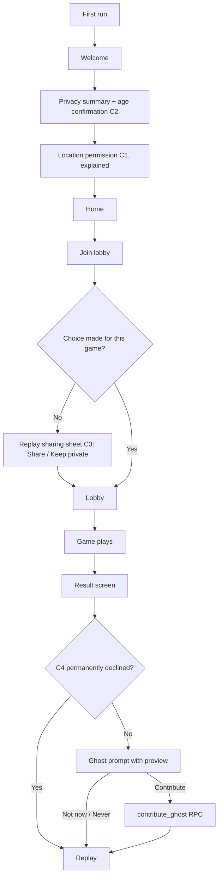
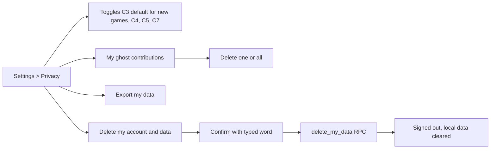

# GhostRun — v2 Game Modes and Expansion Design

> Companion to `PRD.md`, `TRD.md` and `FLOW.md`. This document specifies the candidate v2 modes, modifiers, roles and collaboration formats. Everything here builds on the existing v1 foundation: server-authoritative Postgres RPCs, RLS for secrecy, delayed pings, tagging, and trails for replay.
>
> Effort scale: **S** (about 1 to 3 days) · **M** (about 1 to 2 weeks) · **L** (more than 2 weeks). Estimates assume the v1 architecture is in place.
>
> **Revision 2:** Question Hunt has been replaced by **Hot & Cold Hunt** (section 4.2). Added the **consent flow for replay and ghost sharing** (7.4) and the **privacy policy screen** (7.5).

---

## 0. How to read this document

### 0.1 Three layers

Not every idea is a "mode". Keeping the layers separate prevents a combinatorial mess.

| Layer           | What it is                                                | Examples                                                                  |
| --------------- | --------------------------------------------------------- | ------------------------------------------------------------------------- |
| **Base mode**   | Defines teams, phases and win conditions                  | Classic Chase, Tag Hunt, Jailbreak, Assassin Ring, Horde, Territory Pulse |
| **Role add-on** | Adds secret or special roles on top of a base mode        | Double Agent, VIP Escort, Operator                                        |
| **Modifier**    | Changes rules or adds systems, combinable with most modes | Noise Meter, Dead Drops, Shrinking Zone, Fog, AI Game Master, QR Tagging  |

A game is: **one base mode + zero or more role add-ons + zero or more modifiers**, with compatibility enforced by the server (see section 2).

### 0.2 Shared design rules for every mode

1. **Server authority.** Clients never decide outcomes. Anything secret stays server-side and is exposed only through RLS-checked reads or RPC responses.
2. **Information is the currency.** Each mode should change _who knows what, when_, not just add buttons.
3. **Never reward running.** Mechanics that benefit from sprinting near roads are a safety bug. Prefer cleverness, positioning and patience.
4. **Playable with small groups.** Every mode lists its minimum and recommended player counts, and how it degrades.
5. **Everything is replayable.** New events and state must write to `events` and, where relevant, `trail_points`, so the recap and replay keep working.

---

## 1. Mode catalogue at a glance

| #   | Mode / feature                  | Layer                                                   | Players (min / ideal) | Effort | New infrastructure                                    | Safety risk |
| --- | ------------------------------- | ------------------------------------------------------- | --------------------- | ------ | ----------------------------------------------------- | ----------- |
| 1   | Noise Meter                     | Modifier                                                | 3 / 6+                | S      | Speed smoothing, extra ping trigger                   | Low         |
| 2   | Dead Drops                      | Modifier                                                | 3 / 6+                | S–M    | Item spawner, claim RPC                               | Low         |
| 3   | Jailbreak                       | Base mode                                               | 5 / 8+                | M      | `jailed` status, jail zone                            | Low–Med     |
| 4   | Hot & Cold Hunt                 | Modifier (on Classic, Tag Hunt, Jailbreak, Relay Heist) | 2 / 4+                | S–M    | Heat press RPC, team charge pool, screen tint overlay | Low         |
| 5   | Double Agent                    | Role add-on                                             | 6 / 8+                | S–M    | Hidden roles, tribunal vote                           | Low         |
| 6   | Assassin Ring                   | Base mode                                               | 6 / 8–16              | M      | Prey ring, proximity pulse                            | Med         |
| 7   | VIP Escort                      | Role add-on                                             | 6 / 8+                | M      | Hidden VIP, swap mechanic                             | Low         |
| 8   | Operator (remote role)          | Role add-on                                             | 4 / 6+                | M      | Remote players, team scan                             | Low         |
| 9   | Horde (co-op vs AI)             | Base mode                                               | 1 / 3–8               | M–L    | NPC simulation engine                                 | Med         |
| 10  | Haunted Map and Ghost Hunters   | Modifier and NPC                                        | 2 / 3+                | M      | Ghost library, replay NPCs                            | Low         |
| 11  | Ghost Duels (async solo)        | Solo mode                                               | 1 / 1                 | M      | Ghost library, scoring                                | Low         |
| 12  | Relay Heist                     | Base mode                                               | 5 / 8+                | M      | Item carry/handoff, drop                              | Low–Med     |
| 13  | Territory Pulse                 | Base mode                                               | 8 / 12+               | L      | Zone grid, pulse scoring                              | Low         |
| 14  | QR Tagging                      | Modifier                                                | any                   | S      | QR payload, scan RPC                                  | Low         |
| 15  | AI Game Master                  | Modifier                                                | any                   | M–L    | Event engine, narration                               | Low         |
| 16  | Campus / Tournament Edition     | Collaboration                                           | 16+                   | L      | Web dashboard, brackets                               | Med         |
| 17  | Streamer Mode (audience twists) | Collaboration                                           | any                   | M      | Delayed spectator feed, votes                         | Med         |
| 18  | Community Rule Packs            | Platform                                                | any                   | M–L    | Mode definition schema                                | Med         |

---

## 2. Mode framework (do this before any new mode)

All modes sit on a small "mode engine" so adding one is configuration plus a few RPCs, not a rewrite.

### 2.1 Mode definition (data)

```json
{
  "id": "jailbreak",
  "layer": "base",
  "name": "Jailbreak",
  "teams": ["runner", "hunter"],
  "min_players": 5,
  "phases": ["lobby", "setup", "countdown", "head_start", "live", "ended"],
  "setup_steps": ["teams", "jail_location"],
  "visibility": {
    "own_position": ["all"],
    "teammate_position": ["team"],
    "opponent_position": [],
    "pings": ["all"],
    "target": ["runner"],
    "jail": ["all"]
  },
  "win_conditions": [
    { "team": "hunter", "when": "all_runners_jailed" },
    { "team": "runner", "when": "time_up" }
  ],
  "abilities": [],
  "compatible_roles": ["double_agent", "operator"],
  "compatible_modifiers": ["noise_meter", "dead_drops", "shrinking_zone", "qr_tagging"],
  "parameters": { "jail_radius_m": 15, "auto_release_s": 300 }
}
```

### 2.2 Schema additions (shared)

```sql
-- Which rules apply to a game
alter table games
  add column mode_id text not null default 'classic_chase',
  add column roles text[] not null default '{}',
  add column modifiers text[] not null default '{}',
  add column mode_params jsonb not null default '{}';

-- Hidden or special roles per player (visible only to the owner, or their team, via RLS)
alter table players
  add column secret_role text,          -- agent, vip, bodyguard, operator...
  add column is_remote boolean not null default false,
  add column status_detail jsonb not null default '{}';

-- Non-player entities (zombies, ghosts, items, jail, drops, zones)
create table entities (
  id uuid primary key default gen_random_uuid(),
  game_id uuid not null references games(id) on delete cascade,
  kind text not null,                    -- zombie, ghost, item, jail, drop, zone
  team text,                             -- owner/affiliation if any
  geog geography(Point,4326),
  state jsonb not null default '{}',
  visible_to text not null default 'none' check (visible_to in ('none','runner','hunter','all','owner')),
  updated_at timestamptz not null default now()
);

-- Per-player economy (tokens, charges, cooldowns)
create table player_resources (
  player_id uuid primary key references players(id) on delete cascade,
  game_id uuid not null references games(id) on delete cascade,
  tokens int not null default 0,
  charges jsonb not null default '{}',   -- {"scramble":1,"burn":0}
  cooldowns jsonb not null default '{}'  -- {"heat_press":"2026-11-02T10:00:00Z"}
);
```

RLS rule of thumb: `entities` is readable when `visible_to` matches the caller's team (or `all`), `player_resources` only by the owner, and `secret_role` only by the owner (revealed to all when the game ends).

### 2.3 Compatibility rules

Enforced in `create_game` / `start_game`. The matrix below is the default. Incompatible choices are blocked with a clear message.

|                 | Noise Meter | Dead Drops | Hot & Cold | Double Agent | VIP | Operator | QR Tag | AI GM |
| --------------- | ----------- | ---------- | ---------- | ------------ | --- | -------- | ------ | ----- |
| Classic Chase   | Yes         | Yes        | Yes        | Yes          | Yes | Yes      | Yes    | Yes   |
| Tag Hunt        | Yes         | Yes        | Yes        | Yes          | No  | Yes      | Yes    | Yes   |
| Jailbreak       | Yes         | Yes        | Yes        | Yes          | No  | Yes      | Yes    | Yes   |
| Assassin Ring   | Yes         | Yes        | No         | No           | No  | No       | Yes    | Yes   |
| Horde           | No          | Yes        | No         | No           | No  | Yes      | No     | Yes   |
| Territory Pulse | No          | Yes        | No         | Yes          | No  | Yes      | Yes    | Yes   |
| Relay Heist     | Yes         | Yes        | Yes        | Yes          | No  | Yes      | Yes    | Yes   |

### 2.4 Simulation tick (needed by Horde, Ghosts, Territory)

- A server tick every 5 s (pg_cron with a seconds schedule, or a lightweight worker if the plan does not allow it) advances NPC entities and evaluates proximity rules.
- Ticks are idempotent and time-based (move by `speed * dt`, `dt` clamped), so a late tick never teleports an entity.
- The tick function is shared: `simulate_game(game_id, dt)`.

---

## 3. Modifiers

### 3.1 Noise Meter

**Pitch.** Movement has a cost. The faster and more erratically a runner moves, the louder they are, and loud runners get pinged more. Sneaking is rewarded. Camping is not.

**Rules**

- Each runner has a **noise value 0 to 100**.
- Noise rises with smoothed speed above a walking threshold and decays when walking or still.
- At **100**, the server releases an immediate **noise ping** of that runner and resets noise to 40.
- At **60 or above**, hunters see a **noise spark**: a direction-less, location-less alert "a runner is loud" (optional setting, default on).
- **Anti-camping:** if a runner stays within 15 m of the same spot for 4 minutes, they receive a camping ping.

**Suggested parameters**

| Parameter                      | Default                |
| ------------------------------ | ---------------------- |
| Walking threshold              | 1.6 m/s                |
| Jog threshold                  | 2.8 m/s                |
| Gain rate (jog)                | +2.0 per second        |
| Gain rate (sprint, over 4 m/s) | +5.0 per second        |
| Decay (walk / still)           | -1.0 / -2.5 per second |
| Speed smoothing window         | 15 s                   |
| Camp radius and time           | 15 m, 240 s            |

**Server and data**

- Add to `player_positions`: `smoothed_speed_mps`, `noise int`, `anchor_geog`, `anchor_since`.
- In `submit_position`: update smoothed speed from the last N fixes (ignore fixes with accuracy over 50 m), update noise, check thresholds, emit `noise_spark` and release noise pings with `reason = 'noise'` (extend the `pings.reason` check constraint).
- RLS: `noise` is readable only by the owning player.

**UX.** Runner HUD has a noise bar with colour bands and a soft haptic when crossing 60. Hunters see a faint ripple and a vibration on noise sparks.

**Edge cases and balance**

- GPS jitter can produce fake speed spikes, so smooth and clamp, and ignore speed when accuracy is poor.
- Bikes or vehicles: speed above 8 m/s for 10 s raises a "vehicle detected" warning and adds noise rapidly. This is also a safety and fair-play guard.
- The noise spark reveals nothing about location, so it adds tension but not tracking.

**Safety.** Rewards slow movement, which is a net positive.
**Effort:** S. **Depends on:** nothing.

---

### 3.2 Dead Drops

**Pitch.** Hidden supply points scattered around the area give either team a one-use advantage, creating reasons to move toward risk.

**Rules**

- At start, the server spawns **N drops** (default 6) at random points inside the area, at least 150 m apart and at least 60 m inside the boundary.
- A drop appears on the map only when a player is within 40 m. Claiming requires being within 15 m and holding for 5 s.
- Each drop is **single use** and rolls an item from the claimer's team pool. Claim events are broadcast as "a drop was claimed" without location (optional: location of drop only revealed to the claimer's team).

| Item          | Team   | Effect                                                         |
| ------------- | ------ | -------------------------------------------------------------- |
| **Veil**      | Runner | Skip your next scheduled ping                                  |
| **Decoy**     | Runner | Next ping of yours is shifted by 150 to 250 m (server picks)   |
| **Burn**      | Runner | Reveals the last known position of the nearest hunter for 10 s |
| **Free Ping** | Hunter | Immediate extra ping of one runner (random)                    |
| **Jam**       | Hunter | Cancels a runner's Veil/Decoy (if one is active)               |
| **Sweep**     | Hunter | Shows all runners within 150 m of you as a vague area, once    |

**Server and data**

- Uses `entities` with `kind='drop'` and `visible_to='none'`; reveal by range is computed in an RPC `nearby_drops(game_id)` that only returns drops within 40 m of the caller.
- Items live in `player_resources.charges`; `use_item(game_id, item)` validates and applies.
- Effects are flags on `players.status_detail` consumed by `release_ping`.

**Edge cases.** Claiming while out of bounds is blocked. Prevent drop camping with a 3 minute claim cooldown per player. Decoys must still land inside the boundary.
**Safety.** Spawn only inside the area and, if map data is available, away from roads and water (v2.1). Always provide a "report unsafe drop" button that respawns it.
**Effort:** S–M. **Depends on:** framework (2.2).

---

### 3.3 QR Tagging

**Pitch.** Every player has a personal QR code on their screen. Hunters scan a runner's code to tag them. This confirms a physical encounter and removes GPS disputes near tall buildings.

**Rules**

- Runner's QR encodes a **rotating signed token** (new every 20 s). Hunter scans and the server validates it.
- Optional hybrid: the standard GPS Tag button stays on, and QR is required for the final tag only.
- Runners may refuse to show the code only by hiding the screen (a house rule).

**Server and data**

- `qr_token(game_id)` returns a short-lived signed token for the caller. `tag_by_qr(game_id, token)` verifies signature, expiry, hunter team and phase, then applies the same tag logic as `attempt_tag`.
- HMAC with a server secret; never trust client-side token creation.

**Edge cases.** Screenshot sharing is limited by the 20 s expiry and one-time use. Dark mode and brightness handling. Camera permission flow.
**Effort:** S. **Depends on:** nothing.

---

### 3.4 Shrinking Zone and Fog (small modifiers)

- **Shrinking Zone:** the boundary radius shrinks toward a safe centre in stages (for example 100% to 70% to 45% in the last third of the game). Announcements 60 s before each stage. Only shrink toward the area centre or a host-defined safe point. Never create new boundary segments over roads.
- **Fog:** hunters' teammate positions are only visible within 300 m, which forces communication. Server-side: filter team positions by distance in `get_team_positions`.
  **Effort:** S each.

---

## 4. Base modes

### 4.1 Jailbreak

**Pitch.** Classic manhunt rules. Tagged runners are not eliminated. They go to jail, and teammates can free them.

**Teams:** Runners and Hunters. **Players:** 5 minimum, 8 or more ideal.

**Setup**

1. Hunters (or the host) place the **jail** on the map, inside the area, in an open public place.
2. Runners know where it is. Everyone sees the jail marker.

**Rules**

- A tagged runner becomes **jailed** and must walk to the jail and stay within the jail radius (15 m default).
- A free runner stands within **10 m of the jail for 10 seconds** (hold button) to free everyone currently jailed. While freeing they are exposed: hunters can tag them.
- **Auto-release** after 5 minutes of jail time so nobody sits out long.
- **Runners win** on timer expiry with at least one runner free, or by completing an optional objective. **Hunters win** if all runners are jailed at the same time.

**Optional rule: Jail guards.** Up to 2 hunters may be assigned as guards. Guards cannot tag outside a 60 m radius of the jail while assigned (stops guard-only play from being too strong).

**Server and data**

- `players.status` adds `'jailed'`; `entities` row `kind='jail'`.
- `attempt_tag` sets `status='jailed'` and `jailed_at`; `free_runners(game_id)` checks the freer is a free runner within 10 m, has held for 10 s (server records `free_started_at` in `status_detail`), and no hunter tag interrupts.
- `advance_game` evaluates auto-release and the all-jailed win condition.

**Edge cases.** A jailed player leaving the jail radius: warn, then auto-release without freeing. Simultaneous tag and free: row lock, tag wins if its timestamp is earlier. Jailed players can still see teammates and ping history.

**Balance.** Tune hold time, auto-release time and jail radius. If hunters win too often, increase auto-release or give the first free for free.
**Safety.** The jail must be an open, safe place. Do not put it next to a road. **Effort:** M.

---

### 4.2 Hot & Cold Hunt

**Pitch.** The childhood "you're getting warmer" game. Hunters get one big **HEAT** button. Press it and the whole screen washes with a translucent **red** (hot: a runner is close) or **blue** (cold: nobody near). No question menus, no tokens, no reading. One button, one colour, instant tension.

**Teams:** Runners and Hunters. **Players:** 2 minimum, 4 or more ideal.
**Layer:** modifier on top of Classic Chase, Tag Hunt, Jailbreak or Relay Heist (mode id `hot_cold`).

#### The core interaction

1. The hunter presses **HEAT** (large, thumb-reachable, bottom of the map).
2. The server decides `hot`, `cold` or `no_change` and returns it to that hunter only.
3. The screen tints, with a haptic pattern:

| Result                        | Tint                                      | Icon and label     | Haptic           | Optional sound |
| ----------------------------- | ----------------------------------------- | ------------------ | ---------------- | -------------- |
| **Hot**                       | Translucent red, about 30 to 35% opacity  | Flame + "HOT"      | Two short pulses | Rising tone    |
| **Cold**                      | Translucent blue, about 30 to 35% opacity | Snowflake + "COLD" | One soft pulse   | Falling tone   |
| **No change** (trend variant) | Grey, about 15%                           | Dash + "NO CHANGE" | None             | None           |

- Timing: fade in 150 ms, hold 1.5 s, fade out 1.5 s. The overlay must **not block touches** (pointer events off) and must **not flash or strobe**.
- **Colour-blind safe:** the icon, label and haptic pattern carry the meaning, not just the colour.
- The tint sits above the map but below the HEAT button, so the hunter can press again as soon as the cooldown allows.

#### Heat marks (team deduction layer)

Every press drops a small **red or blue mark** on the hunters' map at the spot where it was pressed, visible to the hunter team for 5 minutes (fading). A cluster of blue marks and one red mark tells the team where runners probably are. Runners never see marks. This turns single presses into a shared heat map without any extra UI.

#### Result definitions (host picks a variant)

| Variant                          | Hot means                                                                  | Cold means                | Notes                                                                                                                              |
| -------------------------------- | -------------------------------------------------------------------------- | ------------------------- | ---------------------------------------------------------------------------------------------------------------------------------- |
| **A: Proximity** (default)       | At least one active runner is within the **heat radius R** of you          | None are                  | Simple, readable, good for first games                                                                                             |
| **B: Trend** ("warmer / colder") | The nearest runner is at least 15 m **closer** than at your previous press | At least 15 m **farther** | You must have moved 40 m since your last press, otherwise `no_change` (and the charge is refunded). Rewards movement and reasoning |

#### Parameters

| Parameter                       | Default                                | Range             | Notes                                                                                                                             |
| ------------------------------- | -------------------------------------- | ----------------- | --------------------------------------------------------------------------------------------------------------------------------- |
| Heat radius R                   | clamp(area radius x 0.25, 80 m, 250 m) | 50 to 400 m       | Larger area means larger R                                                                                                        |
| Fuzz on R                       | plus or minus 15%                      | 0 to 30%          | Random per press, but see "repeat-press rule"                                                                                     |
| Team charge pool                | 6                                      | 2 to 12           | Shared by all hunters                                                                                                             |
| Charge regen                    | 1 per 30 s                             | 10 to 120 s       | Computed lazily                                                                                                                   |
| Personal cooldown               | 10 s                                   | 5 to 60 s         | Per hunter                                                                                                                        |
| Position freshness              | Runner under 45 s, hunter under 20 s   | n/a               | Stale runners are undetectable                                                                                                    |
| Pings while this modifier is on | 3x normal interval                     | Off / 3x / normal | Hunters still get a coarse picture                                                                                                |
| Runner feedback                 | On                                     | On / Off          | See "Runner side"                                                                                                                 |
| Heat levels (intensity)         | Off                                    | On / Off          | When on, red gets stronger the closer you are (20 to 50% opacity). Leaks a distance gradient, so keep it off for competitive play |

#### Runner side

- Runners see no colour, but if a press happens while any runner is within R of the pressing hunter, that runner feels a **sensed pulse** (heartbeat haptic and a faint ripple on their screen edge). No direction, no identity of the hunter. This keeps stealth tense without giving runners hunter positions.
- All players see an event "A hunter used HEAT" (no result), so runners know the hunters are probing.
- **Counter-play items** (with Dead Drops):

| Item              | Team   | Effect                                                                    |
| ----------------- | ------ | ------------------------------------------------------------------------- |
| **Frost**         | Runner | The next press whose hot result would be caused by you returns cold, once |
| **Thermal Boost** | Hunter | Your next press uses R x 1.7                                              |

- **Noise Meter synergy:** a runner with noise 60 or above counts as if the radius were R x 1.3. Camping pings still apply.

#### Win conditions

Same as the selected base mode. Heat is information, not a win condition.

#### Server and data

```sql
-- Shared hunter charge pool (lazy regeneration)
create table team_resources (
  game_id uuid not null references games(id) on delete cascade,
  team text not null check (team in ('runner','hunter')),
  heat_charges int not null default 6,
  heat_updated_at timestamptz not null default now(),
  primary key (game_id, team)
);

-- Every press, for marks and replay
create table heat_presses (
  id bigserial primary key,
  game_id uuid not null references games(id) on delete cascade,
  hunter_id uuid not null references players(id),
  variant text not null check (variant in ('proximity','trend')),
  result text not null check (result in ('hot','cold','no_change')),
  hunter_geog geography(Point,4326) not null,
  nearest_runner_m real,              -- replay only, never exposed during play
  pressed_at timestamptz not null default now()
);
```

- **RLS:** the base table `heat_presses` is readable only when the game has ended (`game_ended(game_id)`). During play, hunters read a view `heat_press_feed` that exposes only `id, game_id, hunter_id, result, hunter_geog, pressed_at`, filtered with `is_member(game_id) and my_team(game_id) = 'hunter'` (the view must apply this filter itself, because views run with the owner's rights by default). `nearest_runner_m` never appears in the view.
- **Events:** add a nullable `target_player uuid` column to `events`. The policy allows a row when `target_player is null` (existing audience rules) or `target_player = my player id`. Sensed pulses use this.
- **RPC `heat_press(game_id)`** returns `{ result, charges_left, next_available_at }`:
  1. `advance_game`. Require an active hunter, phase `live`, and the modifier enabled.
  2. Regenerate charges lazily: `charges = min(max, charges + floor((now - heat_updated_at) / regen_s))`. Reject if zero charges or personal cooldown not elapsed. Rejections do not reveal anything.
  3. Require the hunter's own fix to be under 20 s old, otherwise return `stale_position` and **do not** spend a charge.
  4. Variant A: take active runners whose positions are under 45 s old (excluding jailed or frozen runners in modes that have them). Compute each runner's effective radius `R * fuzz * noise_multiplier`. Result is `hot` if any runner is within their effective radius, else `cold`.
  5. Variant B: compare nearest-runner distance with the previous press stored for that hunter. If moved less than 40 m, return `no_change` and refund the charge.
  6. Spend the charge, insert `heat_presses`, emit `heat_used` (audience all, no result), a `heat_mark` (audience hunter, with result and location), and `sensed` events to runners within R (using `target_player`).
  7. Return the result to the caller only.

#### Anti-abuse

- **Repeat-press rule (important):** the fuzz is **seeded by (game, hunter, 60 s time bucket)**, so pressing repeatedly in the same place within a minute returns the same answer. Without this, averaging many noisy presses would reveal the exact edge of R.
- **Charge pool and cooldown** stop four hunters from triangulating a runner by pressing in turn.
- **No numbers.** The response is only a colour. Distance, direction and runner identity are never returned.
- **Freshness limits** mean a runner whose phone is asleep is undetectable, which is acceptable and is covered by the "tracking paused" warning.
- Add rows to the secrecy matrix (section 10): a hunter cannot select `heat_presses` during play, and the feed view never contains `nearest_runner_m`.

#### Edge cases and balance

- No active runners: game already ended. Hunter outside the boundary can still press.
- Multiple hunters pressing at the same instant: lock the `team_resources` row so charges never go negative.
- **Too easy:** reduce R, reduce the charge pool or raise regen time. **Too slow:** raise R or turn pings to normal interval.
- Large open areas favour Variant B, dense areas favour Variant A.

#### UX notes

- HEAT button shows 6 charge pips and a circular cooldown ring.
- A small legend on first use: red = near, blue = not near.
- Haptic and audio cues mean hunters do not have to stare at the screen. Add a settings toggle for sound.
- **Photosensitivity:** no flashing, ever. Only fades.

**Safety.** The tint is translucent, and haptics carry the meaning so hunters can keep their eyes up. Include a first-use reminder not to look at the phone while crossing roads.
**Effort:** S–M. **Why this replaces Question Hunt:** instantly understandable, easy to stream or demo (a colour wash is great to watch), minimal UI, and the abuse surface is much smaller.

---

### 4.3 Assassin Ring

**Pitch.** Free-for-all. Everyone has a secret prey and is someone else's prey. You get delayed pings of your prey, and a faint pulse when your hunter is close. Last survivor wins.

**Players:** 6 minimum, 8 to 16 ideal. No teams.

**Rules**

- At start, the server arranges players in a random **ring**: each hunts the next.
- You receive a delayed ping of **your prey only**, on the normal interval.
- You receive a **proximity pulse** (not a direction) when your hunter is within 100 m, and a stronger one within 40 m. You do not know who your hunter is.
- **Tag** your prey within the tag radius (15 m default). On success, you **inherit your prey's prey**, the prey is eliminated (or becomes a spectator with a "revenge token" in an optional rule).
- **Safe zones** (host-defined, at least two) where tags are disabled and positions are hidden for up to 60 s per visit, with a cooldown.
- **Win:** last player standing, or most eliminations when time expires.

**Server and data**

- `ring` table: `(game_id, hunter_player, prey_player)` kept as a permutation; elimination relinks.
- RLS: a player sees only their own ring row (their prey), never the whole ring. Pulses are events with `audience='player'` (extend audience to a player id via payload filtering or a per-player events table).
- `attempt_tag` variant checks the target is your assigned prey (tagging non-prey does nothing and never reveals presence).

**Edge cases.** Disconnected players: auto-relink after 3 minutes offline. Odd group counts work, since a ring has any size 3+. Pairs of friends: random assignment avoids this, with a host option to prevent adjacent friends.
**Safety (higher).** Because players hunt individuals, keep **no-contact tagging** (button or QR), cap tag radius, require public places only, show a persistent consent and safety notice, and always allow quitting. Avoid sharing real names beyond display names in-game.
**Effort:** M.

---

### 4.4 Horde (co-op versus server-controlled enemies)

**Pitch.** Everyone is on the same side. Zombies simulated by the server advance across the map. Players must complete objectives together while avoiding them. It makes the game playable with 1 to 3 people.

**Players:** 1 minimum, 3 to 8 ideal.

**Rules**

- **Health:** each player has 3 hearts. A zombie within **8 m** for 3 s removes a heart (strong haptic warning at 25 m, 15 m).
- **Fog of war:** you see zombies within **120 m** only.
- **Objectives (pick per scenario):** collect **N supply crates**, reach **extraction** after a power-on step, or **survive** a timer with periodic bonus crates.
- **Revive:** a teammate within 10 m holding for 15 s revives a downed player. All players down at once = loss.
- **Waves:** every 5 minutes the horde grows and a new objective appears, up to a finale.
- **Win:** complete the final objective, or survive the timer.

**NPC behaviour (server sim)**

- Zombies move toward the **nearest player** in straight lines at **1.0 to 1.3 m/s** (slower than a brisk walk). They ignore terrain, since they are virtual, so keep them slow and the area open.
- Spawn at the boundary edge, away from players (at least 150 m).
- Count scales with players: roughly `players * 3 + wave * 2`.

**Server and data**

- `entities kind='zombie'` with `state: {hp, speed, target_player}`; `simulate_game` moves them every 5 s. Players get hurt in `submit_position` or in the tick when proximity rules trigger.
- Visible zombies via RPC `nearby_entities(game_id)` only (never raw table select).

**Edge cases.** GPS jitter causing "teleports" (clamp distance per tick). Players standing still: zombies converge anyway, so include "stun" items (Dead Drops) and safe rooms. Prevent running: zombie speed is capped below jog speed, and Noise Meter is off for this mode.
**Safety (medium).** Do not encourage sprinting. Add speed warnings (over 4 m/s). Avoid placing crates near roads. A "pause game" vote for any safety concern.
**Effort:** M–L (the NPC engine is shared with ghost hunters).

---

### 4.5 Relay Heist

**Pitch.** A virtual package must travel from the start zone to extraction. Runners carry it, but handing it off physically between teammates is the only way to keep it safe, because a tagged carrier drops it.

**Players:** 5 minimum, 8 or more ideal. Teams: Runners and Hunters.

**Rules**

- One runner starts as **carrier**. The carrier is **noisier** (pings every interval but at 1.5x frequency, tunable) and cannot use items.
- **Handoff:** two runners within 5 m both press Hand off within 10 s. The server swaps the carrier.
- **Drop:** if the carrier is tagged, the package drops at their last position and becomes **visible to everyone** for 60 s. The first player within 10 m picks it up. If a **hunter** picks it up and holds it for 20 s, hunters win ("secured").
- **Runners win** when the carrier enters the extraction radius. **Hunters win** by securing the package, tagging everyone, or timeout.

**Server and data.** `entities kind='package'` with `state: {carrier, dropped_at}`; RPCs `handoff_request`, `handoff_confirm`, `pickup_package`.
**Edge cases.** Handoff spam: cooldown 20 s per player. Simultaneous pickup: row lock, first by server time. Disconnect of carrier: package drops after 60 s offline.
**Effort:** M.

---

### 4.6 Territory Pulse

**Pitch.** The area is divided into hex zones. Teams claim zones by standing in them. The ownership map updates only at **pulse** moments, so control changes leak where players were, never where they are.

**Players:** 8 minimum, 12 or more ideal. Two to four teams.

**Rules**

- Hex size about **120 to 180 m**. Zones start neutral.
- At each **pulse** (every 2 to 3 minutes), for every zone the server counts players per team present. The team with strictly more players holds the zone (ties keep previous owner). A **capture** requires presence at **two consecutive pulses** to flip an owned zone.
- Each held zone scores **1 point** per pulse. **Win:** most points at the end, or 70 percent zone control for 3 consecutive pulses.
- No tagging in the base rule. Optional **contest tags**: a tagged player cannot count for presence for 2 pulses.
- Optional **fortify** item from Dead Drops makes a zone require three consecutive pulses to flip.

**Server and data.** `entities kind='zone'` with hex ids (H3 library in an RPC or precomputed grid stored at game creation). `advance_game` runs pulse scoring and emits `zone_changed` events.
**Information design.** Teams see ownership of all zones (public), but not enemy positions. A zone flipping tells you someone was there at the pulse, not where they are now.
**Edge cases.** Boundary zones partially outside the area (only count the inside portion). GPS noise at zone edges (use a 15 m inner buffer for presence).
**Effort:** L (hex grid and map rendering are the main costs).

---

## 5. Role add-ons

### 5.1 Double Agent

**Pitch.** One hunter secretly works for the runners. Trust is part of the game.

**Rules**

- At start, the server picks one hunter (random, or host-chosen) as **Agent**. Only the Agent knows. At game end the role is revealed to everyone.
- **Agent powers (one use each):**
  - **Scramble:** shift the next ping of one chosen runner by 150 to 250 m.
  - **Whisper:** receive the approximate **quadrant** (N/E/S/W of the area centre) of the runners' target in Classic mode.
- **Hunter counter-play: Tribunal.** Once per game, hunters can vote on a suspect. If they eject the real Agent, hunters get an immediate extra ping round. If they eject a loyal hunter, hunters lose one ping round and the ejected player is silenced for 5 minutes.
- **Win:** the Agent shares the runners' win condition.

**Server and data.** `players.secret_role='agent'`; RLS lets only the owner read it; `agent_scramble`, `agent_whisper`, `start_tribunal`, `cast_vote`; tribunal results as events.
**Edge cases.** Only one hunter in the game: disable. Agent disconnects: powers expire silently. The Agent's text chat is team chat, so keep chat free-form so deception works (no verified quoting).
**Effort:** S–M.

---

### 5.2 VIP Escort

**Pitch.** Runners must protect a hidden VIP. Hunters see several runner dots and must work out which is the VIP.

**Rules**

- One runner is the **VIP**, the rest are **bodyguards**. All runners look identical on hunters' pings.
- Hunters win by tagging the **VIP**. Tagging a bodyguard **freezes** them for 60 s instead of eliminating them.
- **Swap:** VIP and a bodyguard within 5 m both press Swap within 10 s and the server swaps roles. Cooldown 3 minutes.
- **Runners win** when the VIP reaches the extraction target (Classic) or survives to timer.

**Server and data.** `players.secret_role` in (`vip`, `bodyguard`), readable by runner team and the owner only; `swap_roles` RPC; tags check the role.
**Edge cases.** The VIP disconnecting: assign a new VIP from nearest bodyguard. Ping design: do not leak which dot moves differently (all runners share the same ping cadence and no VIP-specific noise).
**Effort:** M.

---

### 5.3 Operator (remote teammate)

**Pitch.** One player per team runs support from anywhere, using a limited tactical view. It adds co-op, accessibility, and a "mission control" feel.

**Rules**

- The Operator joins as `is_remote = true`. They upload no location, cannot be tagged, and cannot tag.
- They see their team's live positions, pings, and the map. They can **place map markers** (visible to the team), send quick messages, and trigger a **Scan** every 90 s.
  - **Runner Operator Scan:** shows a **vague circle** (150 m radius) around the nearest hunter's last known position, valid for 10 s.
  - **Hunter Operator Scan:** shows how many runners are within 200 m of a chosen point (a count, no positions).
- **Win:** shared with their team.

**Server and data.** Remote players are team members in `players` with `is_remote`; position tables are filtered by team as usual; `operator_scan(game_id, params)` validates cooldown and returns the limited result.
**Edge cases.** A remote Operator should not outperform field players, so Scan outputs are intentionally coarse. Cheating by relaying live info through other apps is a trust issue, so treat as friendly play.
**Effort:** M.

---

## 6. Solo and asynchronous modes

### 6.1 Haunted Map and Ghost Hunters

**Pitch.** The park remembers. Trails from past games become **ghost hunters** that patrol and make small groups viable.

**Ghost library**

- When a game ends, an anonymised **simplified path** (Douglas-Peucker, 5 to 10 m tolerance) of each _opted-in_ player is stored in `ghost_library` with the area centre and a timestamp. No player ids, no names.
- Contribution is **opt-in per game** (consent C4 in section 7.4): off by default, previewed before saving, trimmed and anonymised, and deletable from Settings.

**Rules**

- Ghost hunters join the **hunter team** as NPCs. They follow a stored path (clipped and re-centred if it fits the new area), time-shifted to start when hunters unlock.
- **Ghost sightings:** when a runner is within **40 m of a ghost**, hunters receive an extra **sighting ping** of that runner ("the ghost saw you"). If a runner is within **12 m** of a ghost for 3 s, they are **haunted**: tagged out (or frozen, per setting).
- Ghosts are visible to runners as **faint blips within 80 m**, fading, so runners can avoid them.
- Ghosts never leave the boundary. A path that leaves is truncated and looped.

**Server and data.** `ghost_library(id, area_center, area_radius, path geography(LineString), duration_s, created_at)`; `entities kind='ghost'` with `state: {path_id, t0, speed_scale}`; `simulate_game` interpolates positions by time along the path. Runners get ghost positions through `nearby_entities` (80 m only); hunters get only sighting pings.
**Edge cases.** No matching ghosts: fall back to a generated random-walk patrol. Privacy: delete library entries older than 90 days and honour opt-out deletes. Routes through restricted areas could be replayed, so keep paths simplified and inside the new boundary.
**Safety.** Ghosts move at recorded walking speeds, clamped to 2.0 m/s.
**Effort:** M (shares the NPC engine with Horde).

### 6.2 Ghost Duels (async solo)

**Pitch.** Play alone, anytime. Race or evade the recording of a friend's earlier run.

**Variants**

- **Time Trial:** reach a target, beating a ghost runner's recorded time. Score = time difference plus route efficiency.
- **Evade:** reach a target without entering a 20 m radius of a replayed ghost hunter route.
- **Mirror Chase:** the ghost is a runner and you are the hunter, and you must get within tag radius at any point of their replay.

**Server and data.** Reuses `ghost_library`; a solo `game` has one player; scoring computed on the server from `trail_points`; leaderboards per area (names shown only with consent C5 in section 7.4).
**Edge cases.** Cheating via vehicles: speed cap and mock-location flag. Different areas: match by an area-centre radius (500 m), or let the creator publish a "course".
**Effort:** M.

---

## 7. Cross-cutting systems

### 7.1 AI Game Master (narration and events)

**Principle:** deterministic code decides _what happens_, a language model only writes _how it is said_. This keeps the game fair and cost predictable.

- **Event engine (rules):** every 5 to 10 minutes it may trigger an event from an approved list (shrink step, supply drop, double ping, rumour, fog). It chooses by game state (long lull, one team dominating) and dice.
- **Narrator (LLM):** receives only **public** state (pings, events, scores, phase), never secrets or positions, and writes a 1 to 2 sentence broadcast. Delivered as text and optionally spoken with on-device TTS.
- **Cost and reliability:** templated fallback messages if the API fails. Cap calls per game (for example 12). Calls run from a server function (an Edge Function would be the first one in the project), never from the client with a secret key.
- **Guardrails:** narration never names exact places beyond the public ping location, never reveals target direction or roles, and avoids unsafe suggestions ("run!").
  **Effort:** M–L.

### 7.2 Speed and safety guard (all modes)

- Speed over 8 m/s for 10 s: vehicle warning, mode-specific penalty (extra noise or disqualification flag).
- Hard speed cap for NPCs (see modes above).
- Auto-pause vote available to any player in a safety situation.
- SOS stays in every mode and overrides everything.
- Night mode warning and an optional **curfew** time that ends the game.

### 7.3 Replay and stats upgrades

- Per-mode recap cards: **closest call** (min distance to a hunter), longest unseen streak, loudest moment, best bluff, heat presses and hit rate, drops claimed.
- Replay layers: pings, heat marks, zone ownership, NPC paths, handoffs.

### 7.4 Privacy, consent and replay sharing

Location trails are sensitive personal data. Replays, ghosts, leaderboards and broadcasts all reuse them, so each reuse needs its own clear, revocable choice.

> **Not legal advice.** The flows below are a design baseline. Privacy rules differ by where your players live (for example GDPR, India's DPDP Act, CCPA). Have the policy reviewed before sharing the app beyond a group of friends, and especially before any store release or any event with strangers.

#### 7.4.1 Principles

1. **Ask in context**, at the moment the data would be used, not in one giant first-run wall.
2. **Separate required from optional.** Collecting location to run a game is required to play. Everything else (sharing your route, ghosts, leaderboards, diagnostics) is optional and never bundled with the required part.
3. **No pre-ticked boxes** for optional sharing. Where a choice is needed to proceed, show two equal buttons.
4. **Least sharing by default.** Optional uses are off until the player turns them on.
5. **Revocable at any time**, from Settings, with a clear explanation of what withdrawal can and cannot undo.
6. **Show what is stored.** Previews before sharing. Plain language, no legal jargon in the prompts.

#### 7.4.2 Consent matrix

| ID  | Consent                                     | Needed to play | Default                     | Asked when                                                     | What it allows                                                                        | Withdrawal                                                                             |
| --- | ------------------------------------------- | -------------- | --------------------------- | -------------------------------------------------------------- | ------------------------------------------------------------------------------------- | -------------------------------------------------------------------------------------- |
| C1  | **Location during games**                   | Yes            | None                        | Permissions screen (first run)                                 | Collecting your position only while a game is in head start or live                   | Stop playing, or revoke OS permission                                                  |
| C2  | **Privacy notice, terms, age confirmation** | Yes            | None                        | First run (see 7.5)                                            | Using the app. Confirms you are 18 or older, or playing with a guardian's supervision | Delete account                                                                         |
| C3  | **Replay sharing in this game**             | No             | **No default, must choose** | Lobby join sheet                                               | Everyone in this game can see your full route in the post-game replay                 | Switch off any time before the game ends. After the game, hide it from Replay settings |
| C4  | **Ghost contribution**                      | No             | Off                         | Result screen, **per game**                                    | Storing a simplified, anonymous copy of your route to power ghost hunters             | Settings, "My ghost contributions", then Delete                                        |
| C5  | **Public leaderboard name**                 | No             | Off                         | First time you open a leaderboard, or Settings                 | Showing your display name on area leaderboards                                        | Settings toggle (name reverts to "Player")                                             |
| C6  | **Broadcast visibility**                    | Per event      | None                        | Lobby banner when the host turns on a spectator or stream feed | Delayed positions visible to a public feed                                            | Leave the game before it starts                                                        |
| C7  | **Diagnostics**                             | No             | Off                         | Settings                                                       | Crash and performance reports without location                                        | Settings toggle                                                                        |

#### 7.4.3 Replay sharing choice (C3), at lobby join

When a player joins a lobby, a sheet appears before they enter:

> **Share your route after the game?**
> When the game ends, a replay shows where everyone moved. You choose what others see of you.
>
> [ **Share my route** ] [ **Keep my route private** ]
>
> Either way, in-game events such as tags and pings remain visible, because they already happened in front of everyone. You can change this until the game ends.

- The player **must pick one** to continue. Neither button is pre-selected or visually dominant.
- **Private** means: only you can see your own trail afterwards. Others see your tag and ping markers, but not your continuous route.
- The host cannot force C3 on anyone. If a game's rules require shared routes (for example a tournament), the sheet says so, and declining means not joining.
- Choices are stored per game in `players.share_trail`.

#### 7.4.4 Ghost contribution (C4), after the game

Shown on the Result screen only if C4 has not been permanently declined, and only for **games that ended normally**:

> **Turn your route into a ghost?**
> Ghosts are anonymous replays of past routes that act as computer-controlled hunters. They help small groups play.
>
> **What's saved:** a simplified outline of your route, with the first and last 150 m removed. **No name, no account, no timestamps.**
> **What's not saved:** your identity, exact start and end points, other players.
> [ Preview what's saved ]
>
> [ **Contribute this route** ] [ **Not this time** ] [ **Never ask again** ]

- A **preview map** shows the trimmed, simplified shape that would be stored.
- "Never ask again" sets C4 to permanently declined (changeable in Settings).
- Contribution is **per game**, never a blanket standing permission.

#### 7.4.5 Ghost privacy protections

| Protection                 | How                                                                                                                                                                                              |
| -------------------------- | ------------------------------------------------------------------------------------------------------------------------------------------------------------------------------------------------ |
| Start and end trimming     | Remove the first and last 150 m (hides homes and meeting spots)                                                                                                                                  |
| Minimum length             | Reject routes shorter than 300 m after trimming                                                                                                                                                  |
| Simplification             | Douglas-Peucker with 5 to 10 m tolerance, so no exact footprints                                                                                                                                 |
| No identity in the library | `ghost_library` has no user id, name or device id                                                                                                                                                |
| Relative time only         | Store durations from the start, not clock times                                                                                                                                                  |
| Deletion mapping           | A private `ghost_contributions(ghost_id, user_id)` table lets a user delete their own contributions. It is never readable by other users and is not exposed to the app beyond "my contributions" |
| Retention                  | Library entries expire after 90 days                                                                                                                                                             |
| Use limits                 | Ghosts only appear in games played in an overlapping area                                                                                                                                        |
| Residual risk              | Unusual routes can still be recognisable to someone who knows the area, which is why contribution is opt-in per game with a preview                                                              |

#### 7.4.6 Flows





#### 7.4.7 Data model and RPCs

```sql
create table consents (
  id bigserial primary key,
  user_id uuid not null references profiles(id) on delete cascade,
  consent_type text not null check (consent_type in
    ('location','policy_ack','ghost','leaderboard_name','diagnostics')),
  granted boolean not null,
  policy_version int,                   -- for policy_ack
  created_at timestamptz not null default now()
);
-- Append-only. The latest row per (user_id, consent_type) is the current state.

alter table players add column share_trail boolean;     -- null until chosen
alter table players add column share_choice_at timestamptz;

create table ghost_contributions (
  ghost_id uuid primary key references ghost_library(id) on delete cascade,
  user_id uuid not null references profiles(id) on delete cascade,
  created_at timestamptz not null default now()
);
```

- **RLS for trails:** `trail_points` is readable after the game ends when the owning player has `share_trail = true`, or when the reader is the owning player. Players with `share_trail` null cannot be in `live` (the lobby blocks ready-up until chosen).
- **RLS for `heat_presses`:** unchanged, readable after game end (see 4.2).
- `ghost_contributions` is readable only by its `user_id`. `ghost_library` is never selectable by clients. The mode engine reads it through an RPC.

| RPC                                           | Purpose                                                                                      |
| --------------------------------------------- | -------------------------------------------------------------------------------------------- |
| `set_consent(type, granted, policy_version?)` | Append a consent row                                                                         |
| `set_share_trail(game_id, share bool)`        | Set C3 for a game (allowed until `ended`, plus a post-game hide)                             |
| `preview_ghost(game_id)`                      | Returns the trimmed, simplified geometry to show in the preview                              |
| `contribute_ghost(game_id)`                   | Requires C4 not declined and game ended. Trims, simplifies, stores, records the contribution |
| `delete_my_ghosts(ids[]?)`                    | Deletes contributions (all if no ids)                                                        |
| `export_my_data()`                            | Returns a JSON bundle: profile, consents, games joined, own trails and events                |
| `delete_my_data()`                            | Deletes the account and personal data (below)                                                |

#### 7.4.8 Deleting an account

`delete_my_data()` does the following in one transaction:

- Deletes `profiles` (cascades to `players`, `player_positions`, `trail_points`, `consents`, `ghost_contributions` and their ghost library rows).
- In shared games, past events keep a neutral label such as "Deleted player" instead of the name.
- If the user is the host of an unfinished game, host rights pass to the next player.
- Signs the user out, clears local storage and any queued uploads.
  Explain in the confirmation dialog that **recaps other players already saved** (for example screenshots) cannot be recalled.

#### 7.4.9 Retention summary

| Data                                | Kept for                                    | Notes                        |
| ----------------------------------- | ------------------------------------------- | ---------------------------- |
| Live positions (`player_positions`) | Until game ends, then deleted with the game |                              |
| Trails and replay data              | 30 days after the game, then auto-deleted   | `cleanup_old_games()`        |
| Events, pings, tags, heat presses   | 30 days                                     | Same job                     |
| Ghost library routes                | 90 days                                     | Plus user-initiated deletion |
| Consent records                     | Until account deletion                      | Needed as proof of consent   |
| Account and profile                 | Until the user deletes it                   |                              |
| Backups                             | Provider rolling window                     | Mention in the policy        |

---

### 7.5 Privacy policy screen

#### 7.5.1 Where it appears

| Entry point                   | Variant                                                                            |
| ----------------------------- | ---------------------------------------------------------------------------------- |
| **First run** (after Welcome) | **Gate**: short summary, acknowledgement and age confirmation required to continue |
| Settings, "Privacy"           | Full screen with live controls                                                     |
| Lobby join sheet              | Link "How your location is used"                                                   |
| Result screen ghost prompt    | Link "What's saved"                                                                |
| Store listing or website      | Same content hosted as a public web page (needed if the app ever goes on a store)  |

#### 7.5.2 Layout

```
┌─────────────────────────────────────────┐
│ ←  Privacy                              │
│    Version 1.0 · Updated 2026-11-01     │
├─────────────────────────────────────────┤
│  THE SHORT VERSION                      │
│  • We use your location only while a    │
│    game is live.                        │
│  • Other players can't see where you    │
│    are, except as the game allows.      │
│  • After a game, players can see routes │
│    only if you chose to share yours.    │
│  • Your routes are deleted after 30     │
│    days.                                │
│  • Ghosts are optional and anonymous.   │
│  • You can export or delete everything. │
├─────────────────────────────────────────┤
│  YOUR CHOICES                           │
│  Share my route in replays  [ ask each ]│
│  Contribute ghosts           [ off ]    │
│  Public leaderboard name     [ off ]    │
│  Diagnostics                 [ off ]    │
│  [ My ghost contributions ]             │
├─────────────────────────────────────────┤
│  DETAILS (expand)                       │
│  ▸ What we collect                      │
│  ▸ Why we collect it                    │
│  ▸ Who can see what                     │
│  ▸ How long we keep it                  │
│  ▸ Services we use                      │
│  ▸ Safety, SOS and location             │
│  ▸ Age and supervision                  │
│  ▸ Your rights and controls             │
│  ▸ Changes to this policy               │
│  ▸ Contact                              │
├─────────────────────────────────────────┤
│  [ Export my data ]  [ Delete account ] │
│  [ Read full policy online ]            │
└─────────────────────────────────────────┘

First-run gate adds at the bottom:
  ☐ I've read this and I'm 18 or older, or playing with a guardian.
  [ Continue ]   (disabled until ticked)
```

#### 7.5.3 Content outline (draft copy to adapt)

| Section                      | Draft content                                                                                                                                                                                                                                                                                              |
| ---------------------------- | ---------------------------------------------------------------------------------------------------------------------------------------------------------------------------------------------------------------------------------------------------------------------------------------------------------- |
| **What we collect**          | Display name and the email you sign in with (if you use email sign-in). Your device location **only while a game is in its head-start or live phase**, including accuracy and speed. Game activity (teams, tags, pings, events). Your choices (consents). Optional diagnostics if you turn them on         |
| **Why we collect it**        | To run the game fairly, enforce rules (boundaries, tags, arrivals), show the map, and produce replays you can watch. Ghost routes and leaderboards only if you opt in                                                                                                                                      |
| **Who can see what**         | During a game: you and teammates see each other live. Opponents see only what the rules allow (such as delayed pings). After a game: players see your route only if you chose to share it. The SOS button sends your last position to everyone in that game. The host sees nothing more than other players |
| **How long we keep it**      | See the retention table (7.4.9). Trails and events are deleted 30 days after a game, ghosts after 90 days, accounts until you delete them                                                                                                                                                                  |
| **Services we use**          | Supabase (hosting and database), the map tile provider (your device requests map tiles, which can reveal the area you view and your IP to that provider), and Expo/EAS only for building the app, not for collecting your data                                                                             |
| **Safety, SOS and location** | Location is only collected during live games. Play in public, safe places. SOS shares your last position with the game's players                                                                                                                                                                           |
| **Age and supervision**      | The app is for adults, or groups supervised by a guardian. We do not knowingly provide it to children without supervision                                                                                                                                                                                  |
| **Your rights and controls** | Change choices any time. Export your data. Delete your account and data. Ask questions or complaints at the contact below                                                                                                                                                                                  |
| **Changes**                  | If we change the policy in a meaningful way, you will see a "What changed" screen and be asked to acknowledge it. The version number is stored with your acknowledgement                                                                                                                                   |
| **Contact**                  | An email address you monitor                                                                                                                                                                                                                                                                               |

#### 7.5.4 Behaviour and versioning

- `PRIVACY_VERSION` constant in the app. On launch, compare with the latest acknowledged `policy_ack` consent. If lower, show **"What changed"** (a short diff summary) before Home, and record a new acknowledgement. Declining means the app stays at the gate and no location is collected.
- The **Your choices** toggles call `set_consent` immediately and show a toast confirming the change.
- **Export** shows progress and shares a JSON file through the system share sheet.
- **Delete account** requires typing a confirmation word, explains what cannot be undone (7.4.8), and runs `delete_my_data`.
- The full policy is also published as a public web page (a static page with the same content), linked from the screen.

#### 7.5.5 Accessibility and tone

- Plain language, short sentences, large touch targets, dark mode, dynamic type, and proper screen reader order.
- The "short version" must always be understandable in under 30 seconds. Details are for people who want them.
- No dark patterns: "Not this time" and "Never ask again" are as visible as "Contribute".

---

## 8. Collaboration and event formats

### 8.1 Campus and Tournament Edition

**Goal:** departments, clubs or friend groups run structured events.

- **Organiser role:** creates a tournament, adds teams, schedules matches, assigns referees.
- **Referee role:** can pause, disqualify, resolve disputes, and sees SOS.
- **Bracket:** single elimination, round robin, or "Swiss". Each match is a normal game (or a series with swapped roles).
- **Persistent teams** (`teams`, `team_members`) with team names and colours.
- **Spectator dashboard (web, Next.js):** big-screen view for a venue with a **3 to 5 minute delay** so spectators cannot coach players. Shows delayed pings, scores, events feed and bracket.
- **Data additions:** `tournaments`, `tournament_teams`, `matches` (links to `games`), `spectator_feed` view with a delay and a signed access token.
- **Edge cases.** Late teams, forfeits, timezone handling, device checks before a match (a readiness checklist screen).
  **Effort:** L.

### 8.2 Streamer Mode and Audience Twists

- **Delayed spectator feed** for a browser overlay URL (same as the tournament feed). Players must see a broadcast notice and give consent C6 before the game starts (section 7.4).
- **Audience votes** every N minutes from a link: a vote chooses one twist from 3 options. The streamer or host approves before it applies.
- **Allowed twists (safe list):** Double ping, Fog for hunters, extra Dead Drop, a decoy ping, zone shrink toward centre. **Not allowed:** anything that moves players toward a boundary edge, forces speed, or reveals secrets.
- **Rate limits and abuse controls:** one vote per viewer per round, optional account requirement, and an "off" switch.
  **Effort:** M. **Depends on:** spectator feed.

### 8.3 Venues, brands and local partners

- **Checkpoint partners:** cafes or shops host a Dead Drop or an "intel counter" (QR). Needs written consent, liability review and a separate "partner" role.
- **Heritage and tourism hunts:** story-driven runs with location-unlocked clues. Authors use a rule-pack editor (8.5).
- **Fitness and run clubs:** pace-based handicap and "chase run" format with larger areas and a walking-only rule.
- **Team-building packs:** facilitator dashboard, branded lobby, exportable results.
  **Cross-cutting need:** a clear terms-of-use and liability stance before anything involving businesses or the public.

### 8.4 Discord integration

- `/ghostrun create` creates a lobby and posts the join code.
- Team voice channels created and linked automatically (organiser tools only).
- Post-game recap with winner, key stats, and a replay link.
  **Effort:** S–M (a small bot service; the project's first non-mobile server component).

### 8.5 Community Rule Packs

- A **pack** is a JSON bundle of mode parameters, modifier toggles, dead-drop item pools, custom text, and scenario objectives, shared by link or code.
- **Not arbitrary code.** Packs are validated against a schema and can only compose existing mechanics. Scripted custom logic would be a security problem.
- **Pack browser:** featured, popular, by area, with ratings and report buttons.
- **Moderation:** report flow, pack takedown, and visibility rules (private, link-only, public).
  **Effort:** M–L.

---

## 9. Suggested roadmap

| Release  | Theme               | Contents                                                                                                    |
| -------- | ------------------- | ----------------------------------------------------------------------------------------------------------- |
| **v2.0** | Foundations         | Mode framework, `entities`, `player_resources`, **Noise Meter**, **Dead Drops**, QR Tagging, Shrinking Zone |
| **v2.1** | Deduction and trust | **Hot & Cold Hunt**, **Double Agent**, per-mode recap stats, consent flow and privacy screen (7.4, 7.5)     |
| **v2.2** | Not enough players  | NPC simulation engine, **Ghost Hunters / Haunted Map**, **Ghost Duels**                                     |
| **v2.3** | Co-op               | **Horde**, **Operator**                                                                                     |
| **v2.4** | New dynamics        | **Jailbreak**, **VIP Escort**, **Relay Heist**                                                              |
| **v3.0** | Platform and events | Territory Pulse, Assassin Ring, Tournament Edition, Streamer Mode, Discord bot, Rule Packs, AI Game Master  |

Ordering logic: shared infrastructure first, then the cheapest high-impact depth, then the NPC engine because two modes depend on it, and finally the large social and platform features.

## 10. Playtest plan for each new mode

For every mode, before release:

1. **Simulator:** extend `scripts/sim` with scripted agents that exercise win conditions, edge cases and anti-abuse checks.
2. **Secrecy matrix:** add new rows to the RLS check (for example: a hunter cannot read `secret_role` of another player, a hunter cannot select `heat_presses` during play and `heat_press_feed` never contains `nearest_runner_m`, a player with `share_trail = false` has no readable trail for others after the game, nobody can select raw `entities`).
3. **Paper test:** run the mode with pen and paper or chat before building the UI, to find rule problems cheaply.
4. **Field test:** at least two outdoor sessions with different group sizes, logging the questions below.
   - Did every player understand the rules in under 2 minutes?
   - Were there long stretches where nothing happened?
   - Did anyone feel the game was unfair?
   - Did any mechanic encourage unsafe movement?
5. **Tuning pass:** adjust defaults using logged data (ping hits, tag success, distance travelled, time-to-first-event).

## 11. Open questions

1. Should pings keep the current short on-screen lifespan in new modes, or follow the "fade by age" rule from the original spec? This changes how much Hot & Cold Hunt and Noise Meter matter.
2. Is your friend group more interested in competitive depth (Hot & Cold Hunt, Assassin Ring) or co-op play (Horde, Operator)? That decides the order of v2.1 to v2.3.
3. Do you want to publish trail data as ghosts, and how long should it be kept? This needs a visible consent flow.
4. Which collaboration track is realistic first: campus fest, streamer mode, or Discord?
5. Do you want iOS in v2, or is Android-only fine until the modes are proven?
6. Who reviews the privacy policy before the app is shared beyond friends, and what contact email will it list?
7. Hot & Cold: start with Variant A (Proximity) only, or build both variants?
