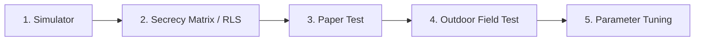

# GhostRun — Field Playtest Guide & Protocol (v2.0)

This document defines the field test protocol, checklists, and safety guidelines for validating new game modes, modifiers, and roles in GhostRun before release.

---

## 1. Five-Stage Validation Framework

Every mode, modifier, or role must pass through all five gates:

1. **Simulator (`npm run sim`):** Scripted simulated agents exercise win conditions, boundary edge cases, timeout conditions, and anti-abuse checks.
2. **Secrecy Matrix (`npm run rls`):** Automated checks verify zero-leakage RLS rules across player roles, outsider roles, base tables, and server-side RPC snapshots.
3. **Paper Test / Walkthrough:** Run through the rules, victory criteria, and roles with players in a chat or on paper before playing outdoors.
4. **Outdoor Field Test:** At least two outdoor sessions with diverse group sizes (2v1, 3v2, 4v3).
5. **Parameter Tuning Pass:** Adjust cooldowns, pulse cadences, tag ranges, and battery limits based on physical feedback.

---

## 2. Field Test Debrief Questions

Immediately following each outdoor play session, ask each participant:

| # | Question | Ideal Answer / Target Threshold | Action if Unfavorable |
|---|---|---|---|
| **Q1** | **Did every player understand the rules in under 2 minutes?** | "Yes, clear right away." | Simplify HUD text, add explanatory tooltips in the lobby, or reduce modifier count. |
| **Q2** | **Were there long stretches where nothing happened?** | No dead time longer than 90 seconds. | Reduce ping intervals, add Dead Drops, or enable Shrinking Zone. |
| **Q3** | **Did anyone feel the game was unfair?** | "Felt balanced and tense." | Check GPS accuracy offsets, tag cooldowns, or heat press charges. |
| **Q4** | **Did any mechanic encourage unsafe movement?** | "Never felt pressured into danger." | Expand tag radius, penalize high speeds via Noise Meter, or widen boundary margins. |
| **Q5** | **Did battery drain or screen readability impede play?** | Phone lasted full session; high contrast in daylight. | Optimize GPS sampling frequency and MapLibre contrast. |

---

## 3. Mode-Specific Checklists

### 3.1 Classic Chase (Target Extraction)
- [ ] Runners secretly place an extraction target coordinate inside the play area.
- [ ] Head-start phase grants runners time to disperse while hunters' maps remain locked.
- [ ] Hunter radar updates only at scheduled intervals (e.g. 30–60 s).
- [ ] Reaching the target ends the game immediately with a Runner victory.
- [ ] Tagging all runners ends the game immediately with a Hunter victory.
- [ ] Replay scrub shows true routes and extraction coordinate only after game completion.

### 3.2 Tag Hunt (Survival Evade)
- [ ] No target selection; game advances immediately from lobby to countdown.
- [ ] Runners win if at least one runner survives until the duration timer reaches 00:00.
- [ ] Hunters win only when all active runners are tagged.
- [ ] Live out-of-bounds boundary warnings trigger properly when stepping across perimeter.

### 3.3 Hot & Cold Hunt (Directionless Proximity Pulse)
- [ ] Hunters have 5 directional charges per game with a 2-second cooldown.
- [ ] Pressing `PULSE` accurately returns:
  - **HOT:** nearest runner $\le 75\text{ m}$.
  - **WARM:** nearest runner $75\text{ m} < d \le 175\text{ m}$.
  - **COLD:** nearest runner $> 175\text{ m}$ or no runners in range.
- [ ] Runners inside the $175\text{ m}$ radius receive a physical vibration and `sensed` ping event.
- [ ] All runners receive an anonymous `heat_used` banner without revealing distance or hunter identity.
- [ ] No exact coordinates or distances are leaked in network logs.

### 3.4 Jailbreak Base Mode (docs/MODES.md §4.1)
* **Recommended Group:** 5 players (2 Hunters, 3 Runners).
* **Setting:** Open park or campus grounds with a central landmark for the Jail (radius $\ge 250\text{ m}$).
* **Pre-Flight & Setup:**
  - [ ] Host selects **Jailbreak** mode on game creation.
  - [ ] In the lobby, verify the host cannot start the game until placing the Jail marker.
  - [ ] Verify placing the Jail outside the play boundary is rejected by the server.
  - [ ] Host taps inside the play boundary to place the Jail (15 m visual ring). Start button unlocks once all players ready up.
* **Phase & Play Dynamic:**
  - [ ] 10-second countdown initiates; runners disperse while hunters' screens remain locked.
  - [ ] Hunters pursue runners. First tagged runner transitions to `jailed` state instead of spectator/eliminated.
  - [ ] Verify the jailed runner's map shows the jail overlay, location broadcasting to teammates pauses, and auto-release countdown begins (default 300 s / 5 min).
  - [ ] Hunter tags a second runner; both jailed runners see the jail HUD and cannot trigger tags.
  - [ ] Remaining free runner infiltrates toward the Jail landmark.
  - [ ] Approaching within 10 m of the jail unlocks the **Rescue** action button on the runner HUD.
  - [ ] Runner presses and holds the Rescue button for 10 seconds.
  - [ ] Verify the `rescue_started` event is hidden from hunters (no radar or banner tip-off).
  - [ ] After 10 continuous seconds within 10 m, `complete_rescue` fires:
    - [ ] Both jailed runners immediately receive audio cue and transition back to `active`.
    - [ ] Rescuer and freed runners scatter to continue evasion.
* **Victory & Fail-Safes:**
  - [ ] If all runners are jailed simultaneously, round terminates immediately with **Hunters Win (`all_jailed`)**.
  - [ ] If round duration expires while at least one runner is `active`, **Runners Win (`time_expired`)**.
  - [ ] Verify auto-release: an unrescued prisoner is freed automatically after 300 seconds.
  - [ ] Verify shrinking zone safety: if an active safe zone shrinks past the jail perimeter, all prisoners are evacuated automatically.
* **Physical Device & Environmental Verification:**
  - [ ] **Touchscreen Hold Usability:** Verify holding the onscreen rescue button for 10 continuous seconds functions reliably outdoors under direct sunlight and with moist/sweaty fingers.
  - [ ] **GPS Jitter Tolerance:** Test rescue hold at the 9–10 m perimeter threshold; confirm minor satellite multipath jitter ($\pm 3\text{ m}$) does not prematurely abort the hold if the runner is stationary.
  - [ ] **Audio & Haptic Feedback:** Confirm distinct, high-volume audio tones and haptic patterns fire upon being jailed and upon being freed.
  - [ ] **Jailed Perimeter Warning:** Confirm a visual warning banner appears on a jailed player's device if they wander $>25\text{ m}$ away from the physical jail landmark.
  - [ ] **Site Safety Check:** Confirm the physical jail is placed $\ge 50\text{ m}$ away from vehicle roads, bodies of water, construction, or steep drop-offs.
  - [ ] **SOS Interruption:** Verify pressing the in-app SOS button while in jail or while performing a rescue immediately pauses the round and notifies all participants.

### 3.5 Assassin Ring Base Mode (docs/MODES.md §4.3)
* **Recommended Group:** 6–16 players (minimum 3 players).
* **Setting:** Campus, sprawling park, or urban neighborhood with defined boundaries (radius 400–800 m).
* **Pre-Flight & Setup:**
  - [ ] Host selects **Assassin Ring** mode on game creation.
  - [ ] In the lobby, verify that team assignment toggles are suppressed; all players join the solo roster.
  - [ ] Verify that starting with fewer than 3 players is blocked by the server with a clear minimum player prompt.
  - [ ] Confirm two safe zones (20 m radius) are auto-generated on the map, with host option to adjust placement in the lobby.
* **Phase & Play Dynamic:**
  - [ ] 10-second countdown initiates. The server generates a circular Hamiltonian cycle contract permutation in `ring_assignments`.
  - [ ] Verify zero-knowledge secrecy: each player's HUD only reveals their assigned prey's display name and color. Their hunter's identity and bearing remain completely hidden.
  - [ ] Scheduled radar pings display only the player's active prey location.
  - [ ] Proximity warnings:
    - [ ] Approaching within 100 m of your target (or your hunter approaching within 100 m of you) triggers an amber pulse.
    - [ ] Closing to striking distance ($\le 40\text{ m}$) triggers an urgent red pulse and distinct sensory vibration.
  - [ ] Safe Zone Shelter:
    - [ ] Stepping inside a safe zone displays the "In Safe Zone" shield banner.
    - [ ] Attempting a tag from inside (or against a target inside) a safe zone is rejected with an `in_safe_zone` status.
    - [ ] Scheduled radar pings are masked while sheltering in safe zones.
  - [ ] Elimination & Relinking:
    - [ ] When outside safe zones and within tag radius ($\le 15\text{ m}$), pressing Tag eliminates the prey.
    - [ ] The eliminated prey transitions to spectator/eliminated HUD.
    - [ ] The hunter's HUD immediately updates to their prey's former target ($P_{hunter} \to P_{prey's\_prey}$).
* **Victory & Fail-Safes:**
  - [ ] Final two players face off in an intense duel.
  - [ ] Tagging the final prey terminates the game immediately with **Solo Victory (`last_survivor`)**.
  - [ ] If round duration expires, player with the highest elimination count wins (`time_expired`).
  - [ ] Inactivity fail-safe: any player who stops transmitting location fixes for > 3 minutes while live is auto-eliminated for offline timeout, and the contract ring relinks seamlessly around them.

### 3.6 Relay Heist Base Mode (docs/MODES.md §4.5)
* **Recommended Group:** 5–12 players (minimum 1 hunter, 2 runners; recommended 2+ hunters, 4+ runners).
* **Setting:** Campus, park, or urban neighborhood with well-defined street crossings (radius 400–800 m).
* **Pre-Flight & Setup:**
  - [ ] Host selects **Relay Heist** mode on game creation.
  - [ ] Host places the extraction point on the map in the lobby; verify that starting the round before placing extraction is rejected.
  - [ ] Confirm extraction point coordinates are visible to all players from match start.
* **Phase & Play Dynamic:**
  - [ ] Match starts in countdown; server designates exactly one runner as the initial package carrier (`visible_to = 'runner'`).
  - [ ] Carrier Burden:
    - [ ] Carrier HUD displays the active package bearer badge.
    - [ ] Carrier position is updated to teammates, but concealed from hunters during normal play.
    - [ ] Scheduled radar pings occur at $1.5\times$ normal frequency for the carrier.
    - [ ] Tactical drop items are locked for the carrier.
  - [ ] Physical Handoffs:
    - [ ] Carrier approaches within 5 m of an active teammate.
    - [ ] Carrier initiates a handoff request; receiver receives confirmation prompt within 15 seconds.
    - [ ] Once confirmed, carrier status transfers seamlessly to the teammate.
  - [ ] Carrier Tag & Package Drop:
    - [ ] Hunter tags the carrier. The carrier is eliminated, and the package drops to the ground at their fix coordinates.
    - [ ] Dropped package becomes visible to all players and pulses a radar beacon every 15 s.
  - [ ] Drop Contest:
    - [ ] Surviving runner approaches within 10 m and presses "Pick Up Package" to recover it.
    - [ ] Hunter approaches within 10 m and holds "Secure Package" for 20 continuous seconds. If hold completes without leaving radius, hunters win (`package_secured`).
* **Victory & Fail-Safes:**
  - [ ] Carrier steps within the 25 m extraction zone: immediate **Runners Win (`extraction_complete`)**.
  - [ ] Hunters secure the package: immediate **Hunters Win (`package_secured`)**.
  - [ ] If carrier goes offline for > 60 seconds, package automatically drops at their last known coordinates.
  - [ ] Match timer expires before extraction: **Hunters Win (`time_expired`)**.

### 3.7 Modifiers Checklists
- [ ] **Noise Meter:**
  - Fast running / sprinting smoothly increases loudness toward 100.
  - Crossing 60 sends a `noise_spark` alert to hunters.
  - Hitting 100 triggers an emergency acoustic radar ping.
  - Stationary camping (>4 min) releases a camping radar ping.
- [ ] **Dead Drops:**
  - Secret caches appear on radar within 40 m.
  - Holding claim position within 15 m for 4 seconds unlocks the drop.
  - Tactical abilities (Veil, Decoy, Recon) apply seamlessly on next ping round.
- [ ] **Shrinking Zone:**
  - Boundary circle contracts inward during the final third of the round.
  - 60-second advance warning banner warns all players.
  - Effective boundary strictly enforces updated coordinates without shifting center.

### 3.8 Secret Role: Double Agent (§5.1)
- [ ] Exactly one hunter is secretly assigned `secret_role = 'agent'` when enabled ($\ge 2$ hunters).
- [ ] Agent HUD reveals secret **Whisper** and **Scramble** controls.
- [ ] **Whisper:** Accurately reveals the target's cardinal quadrant (`North`, `South`, `East`, `West`).
- [ ] **Scramble:** Displaces runner's next scheduled ping by 150–250 m within boundary limits.
- [ ] **Tribunal:**
  - Any loyal hunter can convene a tribunal and accuse a suspect.
  - Voting banner allows instant guilty/innocent casting.
  - Majority guilty ejects the agent and awards hunters a bonus ping round.
  - Erroneous ejection of a loyal hunter imposes a 5-minute silence penalty.

### 3.9 VIP Escort Role Add-on (docs/MODES.md §5.2)
* **Recommended Group:** 5–12 players (minimum 1 hunter, 2 runners; recommended 2+ hunters, 4+ runners).
* **Setting:** Campus, park, or urban neighborhood (radius 300–600 m).
* **Pre-Flight & Setup:**
  - [ ] Host enables **VIP Escort** role add-on in lobby settings on a Classic Chase or Tag Hunt match.
  - [ ] Verify that starting the game with fewer than 2 active runners gracefully removes the role with a clear explanation (`role_disabled`).
* **Phase & Role Assignment:**
  - [ ] At start, exactly one runner is secretly designated as the **VIP**, and all other active runners become **Bodyguards**.
  - [ ] Verify that hunter HUD and radar show identical dots and ping markers for all runners (no visual VIP cues).
  - [ ] Verify that runner HUD clearly indicates the VIP badge and bodyguard status for squad teammates.
* **Freeze Mechanics & Protection:**
  - [ ] Hunter tags a bodyguard. Confirm:
    - [ ] Bodyguard is NOT eliminated; instead enters a 60-second immobilized freeze state (`frozen_until`).
    - [ ] Bodyguard HUD displays "FREEZE IMMOBILIZED" with active countdown timer.
    - [ ] Bodyguard must remain within 10 m dwell zone.
    - [ ] Bodyguard cannot perform role swaps while frozen.
    - [ ] Hunter attempting to tag the frozen bodyguard receives `already_frozen`.
    - [ ] Hunters receive an anonymous broadcast confirming a bodyguard was frozen.
* **Tactical Role Swap:**
  - [ ] VIP and bodyguard approach within 5 m.
  - [ ] Either player presses "Request Role Swap".
  - [ ] Partner receives prompt and confirms within 15 seconds.
  - [ ] Roles are exchanged (`vip` $\leftrightarrow$ `bodyguard`); both players receive a 120-second swap cooldown.
* **Win Conditions & Disconnection:**
  - [ ] Hunter tags the VIP: immediate **Hunters Win (`vip_eliminated`)**.
  - [ ] Classic Chase: VIP reaches secret target: immediate **Runners Win (`arrival`)**.
  - [ ] Tag Hunt: Match timer expires with VIP alive: **Runners Win (`time_expired`)**.
  - [ ] VIP offline fail-safe: VIP disconnects for $> 60\text{ s}$; confirm active bodyguard is auto-promoted to VIP (`vip_promoted`).

### 3.10 Operator Remote Role Add-on (docs/MODES.md §5.3)
* **Recommended Group:** 4–12 players (e.g. 2 field runners + 1 runner operator, 2 field hunters + 1 hunter operator).
* **Setting:** Any outdoor venue; Operator can participate remotely (e.g., from home, base camp, or stationary bench).
* **Pre-Flight & Setup:**
  - [ ] Enable **Operator** role add-on in lobby settings (`classic_chase`, `tag_hunt`, `jailbreak`, or `relay_heist`).
  - [ ] Player taps team toggle to cycle to `[Op]` or presses "Assign as Remote Operator".
  - [ ] Confirm squad sub-label shows `[Operator]` and "Remote: stationary tactical oversight".
  - [ ] Verify that assigning a second operator to the same squad is rejected (limit 1 per squad).
  - [ ] Verify that starting without at least one field player on each squad is blocked.
* **Operator Interface & GPS Bypass:**
  - [ ] In game, Operator HUD presents "MISSION CONTROL: OPERATOR" tactical banner.
  - [ ] Verify that background GPS tracking and location sharing are disabled for the operator.
  - [ ] Verify that operator is immune to tagging and cannot execute tags.
* **Tactical Markers:**
  - [ ] Operator pans map and taps "+ MARK" button or long-presses to place a tactical waypoint.
  - [ ] Enter marker label (e.g., "Rendezvous Point", "Flank North").
  - [ ] Confirm marker appears on all teammates' maps with pulse animation.
  - [ ] Confirm marker expires automatically after 90 seconds.
  - [ ] Verify team isolation: opponents cannot see markers on radar or in entities queries.
* **Runner Operator Tactical Sweep:**
  - [ ] Runner Operator presses "SCAN" dock action.
  - [ ] Confirm 150 m fuzzed circular envelope appears on runners' maps centered near nearest hunter.
  - [ ] Confirm envelope expires after 10 seconds.
  - [ ] Verify zero raw hunter GPS coordinates are exposed to clients.
* **Hunter Operator Sector Census:**
  - [ ] Hunter Operator pans map crosshair to sector inside the boundary and presses "SCAN".
  - [ ] Confirm toast notification displays runner count within 200 m (e.g., "2 runners detected").
  - [ ] Verify attempting scan outside boundary is rejected.
  - [ ] Confirm 90-second tactical scan cooldown is enforced.
* **Tactical Radio Comms:**
  - [ ] Operator sends a broadcast message (e.g., "Hunter approaching west gate").
  - [ ] Verify all teammates receive the radio dispatch banner on screen.

### 3.11 Solo Ghost Duel Base Mode (docs/MODES.md §6.2)
* **Recommended Group:** 1 player (solo mode).
* **Setting:** Any outdoor area with prior ghost recordings available, or using synthetic benchmark paths.
* **Pre-Flight & Setup:**
  - [ ] Player selects **Ghost Duel** mode on game creation.
  - [ ] Variant picker displays 3 pills: Time Trial, Evade, Mirror Chase.
  - [ ] Confirm solo start is allowed (1 player, no opponents needed).
  - [ ] Verify ghost entity and finish target spawn correctly upon game start.
* **Time Trial Variant:**
  - [ ] Ghost runner blip (cyan) appears on map moving along stored path.
  - [ ] Finish target (emerald ring) visible at end of ghost path.
  - [ ] HUD shows Target Distance, Ghost Distance, and Clock chips.
  - [ ] Reaching finish target within radius ends the round immediately.
  - [ ] Score computed server-side: split delta $\Delta t$ + route efficiency.
  - [ ] `ghost_duel_scores` record created with `player_time_s`, `ghost_time_s`, `delta_s`, `efficiency`, `score`.
  - [ ] Beating ghost time → "Ghost Beaten!" result; losing → "Ghost Won" result.
* **Evade Variant:**
  - [ ] Ghost acts as hunter, moving along stored path.
  - [ ] Player must reach finish target without entering $\le 20\text{ m}$ of ghost.
  - [ ] Entering ghost proximity → immediate `haunted` end, hunters win.
  - [ ] Reaching target successfully → "Evaded Successfully!" result.
* **Mirror Chase Variant:**
  - [ ] Player is hunter; ghost acts as runner moving along stored path.
  - [ ] `TAG GHOST (X m)` floating dock button appears, enabled within 10 m.
  - [ ] Pressing tag within range → `tag_ghost` RPC → `ghost_tagged` end, runners win.
  - [ ] Ghost completing path before tag → "Ghost Escaped" result.
* **Leaderboard & Results:**
  - [ ] Result screen shows Solo Ghost Duel Debrief card with score, times, efficiency, variant badge.
  - [ ] Top 5 leaderboard table displays nearby players' scores (C5 consent-aware names).
  - [ ] Ghost Contribution preview card available for contributing route to ghost library.

### 3.12 Territory Pulse Base Mode (docs/MODES.md §4.6)
* **Recommended Group:** 4–16 players (e.g. 2+ Runners vs 2+ Hunters; scalable up to 8v8).
* **Setting:** Open park, recreation field, or campus quad (radius 200–500 m).
* **Pre-Flight & Setup:**
  - [ ] Host selects **Territory Pulse** in mode selector (`app/create.tsx`).
  - [ ] Mode preview displays 7-sector tessellated layout description and pulse rules.
  - [ ] Start round; confirm game transitions from countdown to live.
* **Map & Sector Visualization:**
  - [ ] Map renders 7 colored territory rings with dashed borders and sector markers:
    - Sector Core at map center.
    - 6 radial sectors (Alpha through Foxtrot) spaced at $60^\circ$ offsets.
    - Initial sector rings render neutral slate (`#94A3B8`).
    - Captured runner sectors render cyan (`#06B6D4`).
    - Captured hunter sectors render red (`#EF4444`).
* **Pulse Mechanics & Sector Capture:**
  - [ ] Top HUD shows next pulse countdown timer (default 90 s cadence).
  - [ ] Player standing inside a neutral sector claims it for their team when the pulse fires.
  - [ ] Score increments (+1 point per owned sector on every pulse).
  - [ ] Opponent presence inside an owned sector marks it as contested on pulse 1.
  - [ ] Opponent maintaining majority across pulse 2 successfully flips sector ownership.
* **Contest Tagging:**
  - [ ] Hunter tags a runner within tag radius.
  - [ ] Confirm runner is **not eliminated** from the match.
  - [ ] Runner receives a 60-second incapacitation timer (`contest_tag` event).
  - [ ] Runner does not contribute to sector majority counts while incapacitated.
* **Victory & Results:**
  - [ ] Dominance victory triggers if either team controls $\ge 70\%$ ($\ge 5$ of 7) sectors across 2 consecutive pulses, or all 7 sectors immediately (`territory_dominance`).
  - [ ] Point victory triggers upon round duration expiration (`points_victory` or `draw`).
  - [ ] Result screen displays Territory Pulse Debrief card with final sector ownership counts and scores.

### 3.13 Speed & Safety Guard (docs/MODES.md §7.2)

* **Vehicle Speed Detection:**
  - [ ] Move at vehicular speed (>8 m/s or 29 km/h) for $\ge 10\text{ s}$.
  - [ ] Confirm prominent vehicle speed warning banner appears on HUD.
  - [ ] Confirm `vehicle_warning` event is emitted.
  - [ ] In games with noise modifier, confirm noise meter spikes to 100.
* **Safety Pause & Resume:**
  - [ ] Tap "Safety Pause" in the HUD or bottom sheet.
  - [ ] Confirm game transitions to `paused` status for all players.
  - [ ] Confirm all player maps show amber "Game Paused" overlay with paused-by display name.
  - [ ] Confirm match timers, radar pings, and zone shrinkage are completely frozen.
  - [ ] Tap "Resume Game".
  - [ ] Confirm match returns to previous active state and all deadlines (`ends_at`, `next_ping_at`, `curfew_at`) are extended forward by the pause duration.
* **Democratic Vote Pause:**
  - [ ] Any player taps "Vote Pause".
  - [ ] Confirm vote count increments (e.g. `1/2`). Game remains active.
  - [ ] Second player taps "Vote Pause" reaching majority ($\ge 50\%$).
  - [ ] Confirm game automatically transitions to `paused` with reason `majority_safety_vote`.
* **SOS Auto-Pause:**
  - [ ] Press and hold SOS button for 2 seconds.
  - [ ] Confirm emergency dialer opens.
  - [ ] Confirm `sos` alert event broadcasts to all players with coordinates.
  - [ ] Confirm match automatically enters `paused` status with reason `emergency_sos`.
* **Night Mode & Curfew:**
  - [ ] Verify night mode indicator appears when playing during UTC 20:00–05:00.
  - [ ] Configure lobby with a curfew deadline (e.g. 15m, 30m, 60m).
  - [ ] Verify curfew countdown displays in HUD stats row.
  - [ ] When curfew expires, confirm round concludes with `end_reason = 'curfew_reached'`.
  - [ ] Verify Result screen displays amber Curfew Reached summary banner.

### 3.14 AI Game Master (Milestone C2)

* **Lobby & Setup:**
  - [ ] In lobby settings, toggle the **AI Game Master** (`ai_gm`) modifier chip across any compatible mode.
  - [ ] Confirm modifier summary displays parameter defaults (`event_interval_s: 180`, `max_events: 12`).
  - [ ] Start round and verify `game_master_init` event is emitted.
* **In-Game Radio Dispatch Dock:**
  - [ ] When an event triggers, verify the **Game Master Radio Dispatch Banner** slides in above the bottom sheet with a cyan radio broadcast icon.
  - [ ] Verify whisper audio cue (`playSound('whisper')`) and haptic pulse fire on incoming transmissions.
  - [ ] Verify the bottom sheet displays the operational AI Game Master status card with current sequence (`X/12 events`).
* **Tactical Event Verification:**
  - [ ] **Supply Drop:** Confirm a tactical supply crate marker spawns within the operation area.
  - [ ] **Satellite Sweep (Double Ping):** Confirm an immediate extra radar ping round reveals runner positions.
  - [ ] **Radar Fog:** Confirm the atmospheric haze overlay covers the map with a sensory distortion warning badge for 60 seconds.
  - [ ] **Intelligence Rumour:** Confirm radio chatter dispatch announces directional quadrant runner concentration (e.g., North-East).
  - [ ] **Perimeter Contraction Step:** Confirm the safe area boundary contracts by 15% with a HUD notification.
* **Cap & Safety Integration:**
  - [ ] Verify match pacing strictly honors the event cap (default 12 events per round).
  - [ ] Trigger a Safety Pause (`pause_game`) and verify next event deadlines are shifted forward by the pause duration upon resuming.

### 3.15 Replay & Stats Upgrades (Milestone C3)

* **Post-Game Result Highlights (`app/result/[id].tsx`):**
  - [ ] **Closest Call Card:** Verify closest opponent proximity is displayed in meters for players with `share_trail = true`. Confirm it displays "Private route" if trail sharing was declined.
  - [ ] **Longest Unseen Card:** Verify runner undetected streak is accurately calculated across scheduled and AI GM pings.
  - [ ] **Loudest Moment Card:** Verify peak noise rating (0–100) displays with clear category subtext.
  - [ ] **Best Bluff Card:** When criteria are met (close evasion $\le 35\text{ m}$, undetected double agent, or bodyguard interception), confirm the highlighted Best Bluff achievement card renders with title and narrative detail.
  - [ ] **Heat Hit Rate & Drops:** Confirm hunter heat probe hit percentage and tactical drops claimed display correctly.
* **Mode-Specific Debrief Cards:**
  - [ ] **Relay Heist:** Verify Package Status (Secured vs Intercepted), total handoffs, and package drop count.
  - [ ] **Territory Pulse:** Verify Dominance vs Points victory banner, radial sectors, and synchronized pulse counts.
  - [ ] **Jailbreak:** Verify total rescues, incarceration count, and jail break trigger debrief.
  - [ ] **AI Game Master:** Verify dispatch count (`X/12`), last event type, and verbatim final narration transmission.
* **Tactical Replay Screen (`app/replay/[id].tsx`):**
  - [ ] **Interactive Layer Chips:** Tap each layer toggle chip (🏃 Trails, 📡 Pings, 🔥 Heat, 🗺️ Sectors, 👻 Ghost, 📦 Drops) and verify layers cleanly appear and disappear from the MapLibre map canvas.
  - [ ] **Heat Probe Layer:** Confirm heat marks render as colored circles (red for hot, blue for cold, slate for no-change).
  - [ ] **Territory Sectors Layer:** Confirm 7 radial sectors display with controller color fills and dashed boundaries.
  - [ ] **Ghost NPC Path Layer:** Confirm recorded ghost paths display as dashed purple lines with entity coordinate blips.
  - [ ] **Drops & Handoffs Layer:** Confirm tactical supply crates appear on the map with claimed status coloration.
  - [ ] **Timeline Scrubber Integration:** Scrub timeline slider and confirm heat probes and game events trigger active playhead cards with formatted timestamps.

### 3.16 Privacy, Consent & Replay Sharing Audit (Milestone C4)

* **Consent Matrix Verification:**
  - [ ] **C1 Location:** Verify position tracking begins only when transitioning to countdown/live, and immediately terminates upon round completion or leaving.
  - [ ] **C2 First Run Gate:** Test fresh account onboarding; verify redirection to `/privacy?mode=gate`, requiring age confirmation (18+ or guardian) before navigating to Home.
  - [ ] **C3 Replay Sharing Choice:** Verify mandatory join sheet in Lobby. Ensure `set_ready` rejects attempts to ready up without selecting "Share my route" or "Keep my route private".
  - [ ] **C4 Ghost Contribution:** Verify post-game result prompt renders trimmed distance (-150m start/finish). Confirm tapping "Never ask again" sets consent permanently declined and suppresses future prompts. Verify "Contribute routes to Ghost Library" toggle in Settings → Privacy.
  - [ ] **C5 Leaderboard Display:** Confirm unconsented players render as "Anonymous Runner" on Ghost Duel leaderboards.
  - [ ] **C7 Diagnostics:** Confirm toggle state saves to consents table without requesting location permissions.
* **Data Portability & Account Deletion:**
  - [ ] **Export My Data:** Trigger "Export My Data" from Settings → Privacy. Confirm generated JSON bundle contains profile, consents, games, trail points, tags, SOS events, ghost contributions, duel scores, drops, and heat presses.
  - [ ] **Account Deletion Safety:** Conduct test deletion using `delete_my_data()`. Verify host reassignment in unfinished lobbies, deletion of profile, CASCADE removal of personal records, SET NULL on heat presses, purge of user's ghost library entries, and automatic sign-out. Confirm surviving players can still review game replays.

---

## 4. Safety & Real-World Precautions

1. **Traffic & Roads:** Never cross busy streets, highways, or train tracks while looking at the map. Use audio/haptic cues instead of staring at the screen.
2. **Private Property:** Stay strictly on public paths, parks, sidewalks, and open campus grounds. Never trespass on private residences or restricted areas.
3. **Night Visibility:** For evening or night runs, wear reflective armbands or high-visibility clothing.
4. **SOS Emergency Override:**
   - The red **SOS** button is accessible on the HUD at all times.
   - Pressing SOS overrides all stealth protocols and immediately broadcasts your unmasked GPS location to every player in the lobby.
5. **Weather & Physical Limits:** Carry water, dress appropriately, and respect personal physical limits.

---

## 5. Privacy & Data Consent Protocol

Before testing with real players:
- [x] Verify player is shown the **Privacy Gate** upon first sign-in.
- [x] Ensure **Consent C3 (Route Sharing)** prompt is resolved before lobby ready-up (`Share Route` or `Keep Private`).
- [x] Confirm in recap and replay that players who selected `Keep Private` do not have their trails or closest calls visible to other participants.
- [x] Test the **Export My Data** and **Delete My Account** features from Settings → Privacy.

---

## 6. Playtest Verification & Sign-Off

- **Field Playtest Status:** ⏳ Pending User Physical Sign-Off. Requires physical outdoor test session with 6+ players and explicit sign-off by project owner. Automated simulation or built APKs constitute release candidates, not signed-off releases.
- **External Cron Automation:** ✅ Completed. External keep-alive cron job configured and active, triggering the `cleanup_old_games()` retention sweep.
- **Official Contact Email:** `arshvirsk26@gmail.com`
- **Release-Candidate Verification Pack:** [`docs/VERIFICATION_PACK.md`](file:///c:/ASK_Main/ASK/Projects/GhostRun/docs/VERIFICATION_PACK.md) (contains Part 1 Physical Smoke Test Checklist, Part 2 6+ Player Log Sheet, and Part 3 Known Limitations).

