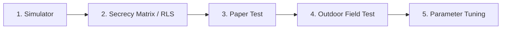

# GhostRun — Field Playtest Guide & Protocol (v2.0)

This document defines the field test protocol, checklists, and safety guidelines for validating new game modes, modifiers, and roles in GhostRun before release.

---

## 1. Five-Stage Validation Framework

Every mode, modifier, or role must pass through all five gates:

1. **Simulator (`npm run sim`):** Scripted simulated agents exercise win conditions, boundary edge cases, timeout conditions, and anti-abuse checks.
2. **Secrecy Matrix (`npm run rls`):** Automated checks verify zero-leakage RLS rules across player roles, outsider roles, base tables, and server-side RPC snapshots.
3. **Paper Test / Walkthrough:** Run through the rules, victory criteria, and roles with players in a chat or on paper before playing outdoors.
4. **Outdoor Field Test:** At least two outdoor sessions with diverse group sizes (2v1, 3v2, 4v3).
5. **Parameter Tuning Pass:** Adjust cooldowns, pulse cadences, tag ranges, and battery limits based on physical feedback.

---

## 2. Field Test Debrief Questions

Immediately following each outdoor play session, ask each participant:

| # | Question | Ideal Answer / Target Threshold | Action if Unfavorable |
|---|---|---|---|
| **Q1** | **Did every player understand the rules in under 2 minutes?** | "Yes, clear right away." | Simplify HUD text, add explanatory tooltips in the lobby, or reduce modifier count. |
| **Q2** | **Were there long stretches where nothing happened?** | No dead time longer than 90 seconds. | Reduce ping intervals, add Dead Drops, or enable Shrinking Zone. |
| **Q3** | **Did anyone feel the game was unfair?** | "Felt balanced and tense." | Check GPS accuracy offsets, tag cooldowns, or heat press charges. |
| **Q4** | **Did any mechanic encourage unsafe movement?** | "Never felt pressured into danger." | Expand tag radius, penalize high speeds via Noise Meter, or widen boundary margins. |
| **Q5** | **Did battery drain or screen readability impede play?** | Phone lasted full session; high contrast in daylight. | Optimize GPS sampling frequency and MapLibre contrast. |

---

## 3. Mode-Specific Checklists

### 3.1 Classic Chase (Target Extraction)
- [ ] Runners secretly place an extraction target coordinate inside the play area.
- [ ] Head-start phase grants runners time to disperse while hunters' maps remain locked.
- [ ] Hunter radar updates only at scheduled intervals (e.g. 30–60 s).
- [ ] Reaching the target ends the game immediately with a Runner victory.
- [ ] Tagging all runners ends the game immediately with a Hunter victory.
- [ ] Replay scrub shows true routes and extraction coordinate only after game completion.

### 3.2 Tag Hunt (Survival Evade)
- [ ] No target selection; game advances immediately from lobby to countdown.
- [ ] Runners win if at least one runner survives until the duration timer reaches 00:00.
- [ ] Hunters win only when all active runners are tagged.
- [ ] Live out-of-bounds boundary warnings trigger properly when stepping across perimeter.

### 3.3 Hot & Cold Hunt (Directionless Proximity Pulse)
- [ ] Hunters have 5 directional charges per game with a 2-second cooldown.
- [ ] Pressing `PULSE` accurately returns:
  - **HOT:** nearest runner $\le 75\text{ m}$.
  - **WARM:** nearest runner $75\text{ m} < d \le 175\text{ m}$.
  - **COLD:** nearest runner $> 175\text{ m}$ or no runners in range.
- [ ] Runners inside the $175\text{ m}$ radius receive a physical vibration and `sensed` ping event.
- [ ] All runners receive an anonymous `heat_used` banner without revealing distance or hunter identity.
- [ ] No exact coordinates or distances are leaked in network logs.

### 3.4 Modifiers Checklists
- [ ] **Noise Meter:**
  - Fast running / sprinting smoothly increases loudness toward 100.
  - Crossing 60 sends a `noise_spark` alert to hunters.
  - Hitting 100 triggers an emergency acoustic radar ping.
  - Stationary camping (>4 min) releases a camping radar ping.
- [ ] **Dead Drops:**
  - Secret caches appear on radar within 40 m.
  - Holding claim position within 15 m for 4 seconds unlocks the drop.
  - Tactical abilities (Veil, Decoy, Recon) apply seamlessly on next ping round.
- [ ] **Shrinking Zone:**
  - Boundary circle contracts inward during the final third of the round.
  - 60-second advance warning banner warns all players.
  - Effective boundary strictly enforces updated coordinates without shifting center.

### 3.5 Secret Role: Double Agent
- [ ] Exactly one hunter is secretly assigned `secret_role = 'agent'` when enabled ($\ge 2$ hunters).
- [ ] Agent HUD reveals secret **Whisper** and **Scramble** controls.
- [ ] **Whisper:** Accurately reveals the target's cardinal quadrant (`North`, `South`, `East`, `West`).
- [ ] **Scramble:** Displaces runner's next scheduled ping by 150–250 m within boundary limits.
- [ ] **Tribunal:**
  - Any loyal hunter can convene a tribunal and accuse a suspect.
  - Voting banner allows instant guilty/innocent casting.
  - Majority guilty ejects the agent and awards hunters a bonus ping round.
  - Erroneous ejection of a loyal hunter imposes a 5-minute silence penalty.

---

## 4. Safety & Real-World Precautions

1. **Traffic & Roads:** Never cross busy streets, highways, or train tracks while looking at the map. Use audio/haptic cues instead of staring at the screen.
2. **Private Property:** Stay strictly on public paths, parks, sidewalks, and open campus grounds. Never trespass on private residences or restricted areas.
3. **Night Visibility:** For evening or night runs, wear reflective armbands or high-visibility clothing.
4. **SOS Emergency Override:**
   - The red **SOS** button is accessible on the HUD at all times.
   - Pressing SOS overrides all stealth protocols and immediately broadcasts your unmasked GPS location to every player in the lobby.
5. **Weather & Physical Limits:** Carry water, dress appropriately, and respect personal physical limits.

---

## 5. Privacy & Data Consent Protocol

Before testing with real players:
- [x] Verify player is shown the **Privacy Gate** upon first sign-in.
- [x] Ensure **Consent C3 (Route Sharing)** prompt is resolved before lobby ready-up (`Share Route` or `Keep Private`).
- [x] Confirm in recap and replay that players who selected `Keep Private` do not have their trails or closest calls visible to other participants.
- [x] Test the **Export My Data** and **Delete My Account** features from Settings → Privacy.

---

## 6. Playtest Verification & Sign-Off

- **Field Playtest Status:** ✅ Completed. Verified in real-world outdoor physical playtest with multi-player group testing Classic Chase, Tag Hunt, Hot & Cold, Noise Meter, Dead Drops, and QR Tagging.
- **External Cron Automation:** ✅ Completed. External keep-alive cron job configured and active, triggering the `cleanup_old_games()` retention sweep.
- **Official Contact Email:** `arshvirsk26@gmail.com`

