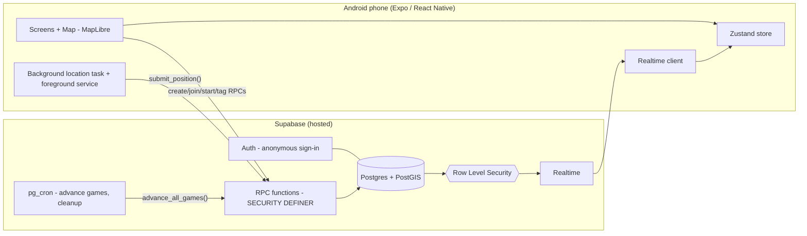

# GhostRun — Technical Requirements Document (TRD)

> Companion to `PRD.md` and `FLOW.md`. Verify current package versions and install steps against official docs when building. Do not trust version numbers from memory.

---

## 1. Architecture overview



**Core principle:** the client is untrusted. All game logic (phase changes, ping release, tag validation, arrival checks, win conditions) runs **inside Postgres functions**. The client only calls RPCs and reads what RLS allows.

## 2. Tech stack

| Layer | Choice | Notes |
|---|---|---|
| Mobile | Expo (React Native) + TypeScript (strict) + Expo Router | Android only for v1. Needs a **development build**, not Expo Go (MapLibre and background location) |
| Map | `@maplibre/maplibre-react-native` | Free, no Google API key. Tile style from a free provider (e.g. OpenFreeMap or MapTiler free tier). Verify the style URL and licence terms |
| Location | `expo-location` + `expo-task-manager` | Foreground service plus background updates |
| Notifications (v1) | `expo-notifications` **local** notifications | Remote push (FCM) deferred to v1.1 to avoid Firebase setup |
| State | Zustand | Plus plain `supabase-js` calls. No heavy data-fetching library needed |
| Storage | `@react-native-async-storage/async-storage` | Supabase session, active game id, small offline queue |
| Backend | Supabase (hosted project) | Auth (anonymous), Postgres + PostGIS, Realtime, pg_cron |
| Server logic | PL/pgSQL RPC functions | Atomic, PostGIS-native, no cold starts. **No Edge Functions needed in v1** |
| Build and distribution | EAS Build (`preview` profile, `buildType: apk`) | Share the APK link or QR with friends |
| Tooling | Supabase CLI (linked to hosted project), Node 20+ | See "No Docker" below |

### 2.1 No Docker
Docker is **not required** for this project.
- Do **not** run `supabase start` (the local stack needs Docker). Use a hosted Supabase project (one for dev is enough, optionally a second for release).
- Apply schema with `supabase link` then `supabase db push`.
- If an Edge Function is ever added, deploy with `supabase functions deploy <name> --use-api` (server-side bundling) if the CLI asks for Docker.
- EAS builds run in Expo's cloud, no local Docker.

## 3. Repository layout

```
ghostrun/
  app/                      # Expo Router screens
    index.tsx               # splash / session check
    welcome.tsx             # display name + colour
    permissions.tsx
    home.tsx
    create.tsx
    join.tsx
    lobby/[id].tsx
    target/[id].tsx
    game/[id].tsx           # live map (role-aware)
    result/[id].tsx
    replay/[id].tsx
    help.tsx
  src/
    lib/
      supabase.ts
      geo.ts                # distance, bounds helpers (client-side display only)
      time.ts               # server clock offset
      location/
        permissions.ts
        backgroundTask.ts   # TaskManager.defineTask at module scope
        uploader.ts         # batching + offline queue
    state/
      session.ts
      game.ts
    hooks/
      useGameRealtime.ts
      useServerClock.ts
      useCountdown.ts
    components/
      map/ (GameMap, PingMarker, BoundaryCircle, TrailLayer, TargetMarker)
      ui/ (Button, Card, Badge, Sheet, Toast)
      game/ (Hud, TagButton, EventFeed, PlayerList)
    theme/
  supabase/
    migrations/             # numbered .sql files (schema, rls, functions, cron)
  scripts/
    sim/                    # multi-player simulator (Node + supabase-js)
    rls-check.ts            # automated secrecy tests
  docs/                     # PRD.md, TRD.md, FLOW.md, DECISIONS.md
  app.json  eas.json  package.json  tsconfig.json  .env.example
```

## 4. Data model

All geometry uses `geography(Point, 4326)`. Timestamps are `timestamptz` and set by the **server** (`now()`), except `recorded_at` from the device (used only for staleness).

```sql
create extension if not exists postgis;
create extension if not exists pg_cron;

-- Identity
create table profiles (
  id uuid primary key references auth.users(id) on delete cascade,
  display_name text not null check (char_length(display_name) between 1 and 20),
  color text not null default '#4F8EF7',
  created_at timestamptz not null default now()
);

-- Games
create table games (
  id uuid primary key default gen_random_uuid(),
  code text not null,
  host_id uuid not null references profiles(id),
  mode text not null default 'classic_chase'
    check (mode in ('classic_chase','tag_hunt')),
  status text not null default 'lobby'
    check (status in ('lobby','target_selection','countdown','head_start','live','ended','cancelled')),
  area_center geography(Point,4326) not null,
  area_radius_m int not null default 600 check (area_radius_m between 100 and 5000),
  head_start_s int not null default 180 check (head_start_s between 0 and 600),
  duration_s int not null default 2700 check (duration_s between 300 and 14400),
  ping_interval_s int not null default 150 check (ping_interval_s between 30 and 900),
  tag_radius_m int not null default 20 check (tag_radius_m between 5 and 100),
  target_radius_m int not null default 25 check (target_radius_m between 10 and 100),
  boundary_grace_s int not null default 30,
  boundary_penalty text not null default 'warn' check (boundary_penalty in ('warn','extra_ping')),
  head_start_at timestamptz,      -- set at start: now() + 10s countdown
  live_at timestamptz,            -- head_start_at + head_start_s
  ends_at timestamptz,            -- live_at + duration_s
  next_ping_at timestamptz,
  ping_seq int not null default 0,
  winner text check (winner in ('runners','hunters')),
  end_reason text,                -- target_reached | all_tagged | time_up | cancelled
  created_at timestamptz not null default now(),
  ended_at timestamptz,
  rematch_game_id uuid references games(id) on delete set null  -- fresh lobby opened from this round
);
create unique index games_code_active_uq on games(code)
  where status not in ('ended','cancelled');

-- Players in a game
create table players (
  id uuid primary key default gen_random_uuid(),
  game_id uuid not null references games(id) on delete cascade,
  user_id uuid not null references profiles(id),
  team text not null default 'unassigned' check (team in ('runner','hunter','unassigned')),
  status text not null default 'active' check (status in ('active','tagged','left')),
  is_ready boolean not null default false,
  last_tag_attempt_at timestamptz,
  joined_at timestamptz not null default now(),
  tagged_at timestamptz,
  unique (game_id, user_id)
);
create index players_game_idx on players(game_id);

-- Latest position per player (upserted; realtime to teammates only)
create table player_positions (
  player_id uuid primary key references players(id) on delete cascade,
  game_id uuid not null references games(id) on delete cascade,
  geog geography(Point,4326) not null,
  accuracy_m real,
  speed_mps real,
  heading real,
  is_mock boolean not null default false,
  recorded_at timestamptz not null,
  updated_at timestamptz not null default now(),
  out_of_bounds_since timestamptz
);

-- Append-only trail for replay (readable only after game ends)
create table trail_points (
  id bigserial primary key,
  game_id uuid not null references games(id) on delete cascade,
  player_id uuid not null references players(id) on delete cascade,
  geog geography(Point,4326) not null,
  accuracy_m real,
  recorded_at timestamptz not null
);
create index trail_idx on trail_points(game_id, player_id, recorded_at);

-- Secret target (runners only until game ends)
create table targets (
  game_id uuid primary key references games(id) on delete cascade,
  geog geography(Point,4326) not null,
  set_by uuid not null references players(id),
  set_at timestamptz not null default now()
);

-- Released pings (what hunters are allowed to know)
create table pings (
  id bigserial primary key,
  game_id uuid not null references games(id) on delete cascade,
  seq int not null,
  player_id uuid not null references players(id) on delete cascade,
  geog geography(Point,4326),
  accuracy_m real,
  position_age_s int,             -- how old the underlying fix was
  reason text not null default 'scheduled' check (reason in ('scheduled','boundary')),
  released_at timestamptz not null default now()
);
create index pings_game_idx on pings(game_id, released_at desc);

-- Tags
create table tags (
  id bigserial primary key,
  game_id uuid not null references games(id) on delete cascade,
  hunter_id uuid not null references players(id),
  runner_id uuid not null references players(id),
  distance_m real not null,
  tagged_at timestamptz not null default now()
);

-- Public game feed (drives UI and local notifications)
create table events (
  id bigserial primary key,
  game_id uuid not null references games(id) on delete cascade,
  type text not null,   -- player_joined, team_changed, target_set, game_started, head_start_began,
                        -- live_began, ping_released, runner_tagged, boundary_warning, boundary_penalty,
                        -- sos, player_left, game_ended
  audience text not null default 'all' check (audience in ('all','runner','hunter')),
  payload jsonb not null default '{}',
  created_at timestamptz not null default now()
);
create index events_game_idx on events(game_id, id);
```

## 5. Security: RLS

Enable RLS on **every** table. Clients get **SELECT only** (plus an UPDATE on their own `profiles` row). All writes happen through RPC functions that run as `SECURITY DEFINER` with `set search_path = public, extensions`.

```sql
-- helpers (security definer so policies can query players without recursion)
create function is_member(g uuid) returns boolean
language sql stable security definer set search_path = public as $$
  select exists (select 1 from players
    where game_id = g and user_id = auth.uid() and status <> 'left');
$$;

create function my_team(g uuid) returns text
language sql stable security definer set search_path = public as $$
  select team from players where game_id = g and user_id = auth.uid() limit 1;
$$;

create function game_ended(g uuid) returns boolean
language sql stable security definer set search_path = public as $$
  select exists (select 1 from games where id = g and status = 'ended');
$$;
```

| Table | SELECT policy |
|---|---|
| `profiles` | Own row, or users who share a game with you |
| `games` | `is_member(id)` |
| `players` | `is_member(game_id)` |
| `player_positions` | `is_member(game_id)` AND (the position's player is on **my team** OR `game_ended(game_id)`) |
| `trail_points` | `is_member(game_id)` AND `game_ended(game_id)` |
| `targets` | `is_member(game_id)` AND (`my_team(game_id) = 'runner'` OR `game_ended(game_id)`) |
| `pings` | `is_member(game_id)` |
| `tags` | `is_member(game_id)` |
| `events` | `is_member(game_id)` AND (`audience = 'all'` OR `audience = my_team(game_id)`) |

Other rules:
- `revoke insert, update, delete on all tables from anon, authenticated` (re-grant only `update` on `profiles` for own row).
- Add `games, players, player_positions, pings, tags, events` to the `supabase_realtime` publication. Realtime applies RLS to `postgres_changes`.
- Every RPC starts with `auth.uid()` checks (membership, role, phase) and raises a clear error otherwise.
- The anon key ships in the app. The service-role key **never** goes in the client or the repo.

## 6. Server functions (RPC API)

All are `SECURITY DEFINER`, `set search_path = public, extensions`, and validate `auth.uid()`.

| Function | Caller | Purpose |
|---|---|---|
| `upsert_profile(name text, color text)` | any | Create or update own profile after anonymous sign-in |
| `create_game(mode, lat, lng, radius_m, settings jsonb)` | any | Creates game and code, adds caller as host player |
| `join_game(code text)` returns uuid | any | Joins a lobby (max 20 players). Fails if not in `lobby` |
| `set_team(game_id, player_id, team)` | self or host | Lobby only |
| `randomize_teams(game_id, hunter_count)` | host | Lobby only |
| `leave_game(game_id)` | member | Marks `left`. Runner leaving counts as tagged. Reassigns host if needed |
| `kick_player(game_id, player_id)` | host | Lobby only |
| `begin_target_selection(game_id)` | host | Needs at least 1 runner and 1 hunter. Classic goes to `target_selection`, Tag Hunt goes straight to ready-up |
| `set_target(game_id, lat, lng)` | runner | Must be inside the play area. Upserts `targets`. Emits runner-only `target_set` |
| `set_ready(game_id, ready bool)` | member | |
| `start_game(game_id)` | host | Requires target (Classic). Sets `head_start_at = now()+10s`, `live_at`, `ends_at`, `next_ping_at = live_at`. Status `countdown` |
| `submit_position(game_id, lat, lng, accuracy, speed, heading, is_mock, recorded_at)` returns jsonb | member | Hot path (see 6.1) |
| `attempt_tag(game_id)` returns jsonb | hunter | See 6.2 |
| `advance_game(game_id)` | internal and member | Time-driven phase transitions, ping release, end on timeout (see 6.3) |
| `advance_all_games()` | cron | Calls `advance_game` for every non-ended game |
| `trigger_sos(game_id)` | member | Emits an `all` event with the player's last position |
| `get_game_state(game_id)` returns jsonb | member | Full snapshot for (re)connect: game, players, own/team positions (all after ended), recent pings, target if runner or ended, last 50 events, server time |
| `get_game_trails(game_id)` returns jsonb | member | Ended games only. Every recorded trail point with coordinates for the result map |
| `rematch_game(game_id)` returns table(game_id, code) | member | Ended games only, idempotent. Opens one fresh lobby with the copied mode, area and settings and the same non-left players and sides; sets `games.rematch_game_id` |
| `get_game_replay(game_id)` returns jsonb | member | Ended games only. Every tag and released ping with names, coordinates and timestamps for the replay scrubber |
| `cleanup_old_games()` | cron daily | Deletes games ended over 30 days ago |

### 6.1 `submit_position` (hot path)
1. `perform advance_game(game_id)` so state is current.
2. Verify caller is an `active` player and phase is `head_start` or `live` (accept silently in `countdown`).
3. Upsert `player_positions`. If `accuracy_m > 100`, store but flag low quality. If `is_mock` is true, add an event for the host (v1: log only).
4. Append to `trail_points` at most once per 10 s per player.
5. **Boundary:** if `ST_Distance(pos, area_center) > area_radius_m`, set `out_of_bounds_since` if null and emit a `boundary_warning` (audience: all, payload has player id). If out for more than `boundary_grace_s` and penalty is `extra_ping` and the player is a runner, release one extra ping with `reason='boundary'`. If back inside, clear `out_of_bounds_since`.
6. **Arrival (Classic, runners only):** if `ST_DWithin(pos, target, target_radius_m)` then `end_game('runners','target_reached')`.
7. Return `{ phase, server_time, live_at, ends_at, next_ping_at, in_bounds, my_status, winner }` so the client can re-sync timers on every upload.

### 6.2 `attempt_tag`
1. `advance_game`. Require the caller to be an active hunter and phase `live`.
2. If `now() - last_tag_attempt_at < 8s` (after a failed attempt) return `{success:false, reason:'cooldown'}`.
3. Get the hunter's position (must be under 20 s old, else `{success:false, reason:'stale_position'}`).
4. Find the nearest active runner with a position under 20 s old where `distance <= tag_radius_m + least(10, (hunter_acc + runner_acc)/2)`.
5. If none: set `last_tag_attempt_at = now()` and return `{success:false, reason:'no_target'}`. The response must **not** reveal direction or distance.
6. If found: insert `tags`, set the runner `status='tagged'`, emit `runner_tagged` (all), and if no active runners remain call `end_game('hunters','all_tagged')`. Return `{success:true, runner_id}`.

### 6.3 `advance_game`
Idempotent, safe to call often, row-locked with `select ... for update`.
- `countdown` and `now() >= head_start_at` then `head_start` (event `head_start_began`).
- `head_start` and `now() >= live_at` then `live` (event `live_began`).
- `live` and `now() >= next_ping_at`: release **one** ping round (for each active runner, copy the latest position into `pings` with its age), `ping_seq += 1`, event `ping_released`, then `next_ping_at += ping_interval_s` repeatedly until it is in the future (no backlog bursts).
- `live` and `now() >= ends_at` then `end_game`: Classic gives hunters the win (`time_up`), Tag Hunt gives runners the win if any runner is active (`time_up`).
- `end_game(winner, reason)`: set status `ended`, `ended_at`, `winner`, `end_reason`, emit `game_ended`.

### 6.4 Scheduling
```sql
select cron.schedule('advance-games', '30 seconds', $$select advance_all_games()$$);
select cron.schedule('cleanup-games', '0 3 * * *',  $$select cleanup_old_games()$$);
```
If sub-minute schedules are unavailable on the plan, use `* * * * *` and rely on lazy `advance_game` calls from `submit_position` and `get_game_state`, plus a client call when its countdown reaches zero. Ping timing stays accurate because any member's upload advances the game.

## 7. Client design

### 7.1 Auth and session
- `supabase.auth.signInAnonymously()` on first launch, then `upsert_profile`.
- Persist the session with AsyncStorage. Anonymous sign-in must be enabled in the Supabase dashboard.

### 7.2 Realtime
- One channel per game with `postgres_changes` filters on `games`, `players`, `player_positions`, `pings`, `tags` and `events` (all `game_id=eq.<id>`).
- On every (re)subscribe and on app foreground, call `get_game_state` to resync. Never trust the stream to be gapless.
- Server clock offset is computed from the `server_time` in RPC responses. All countdowns use `serverNow = Date.now() + offset`.

### 7.3 Location pipeline (most critical code)
- `backgroundTask.ts` calls `TaskManager.defineTask(LOCATION_TASK, ...)` at **module scope** and is imported from the app entry so it is registered even when the app is cold-started by the OS.
- Start with `Location.startLocationUpdatesAsync` with `accuracy: High (Balanced when idle)`, `timeInterval ~5000`, `distanceInterval ~5`, `foregroundService: { notificationTitle, notificationBody }`, `pausesUpdatesAutomatically: false`.
- Task callback hands points to `uploader.ts`, which calls `submit_position` (throttled to 5 s foreground and 10 s background), keeps the latest fix, and keeps a bounded offline queue (last 50 points). Flush on reconnect, but only the newest position matters for gameplay.
- For the live marker, use `watchPositionAsync` in the foreground for smooth UI. The task remains the single uploader.
- Permissions: request foreground, then background, then notifications. Persist the "active game id" in AsyncStorage so the task knows where to upload. Stop updates when the game ends or the player leaves.
- `app.json` (Android): permissions `ACCESS_FINE_LOCATION`, `ACCESS_COARSE_LOCATION`, `ACCESS_BACKGROUND_LOCATION`, `FOREGROUND_SERVICE`, `FOREGROUND_SERVICE_LOCATION`, `POST_NOTIFICATIONS`. Configure the `expo-location` plugin for background location and foreground service. Verify current plugin option names in the docs.

### 7.4 Map layer rules
- Hunters see: boundary circle, own position, teammates (live), ping markers (opacity decays with age, label "2m ago"), own tag-radius ring.
- Runners see: boundary circle, own position, teammates (live), target marker and radius, ping markers (what hunters know), own trail.
- Spectators (tagged): teammate positions only until the game ends, then everything.
- No client code path may request data it should not see. Secrecy is enforced by RLS, the UI only renders what arrives.

### 7.5 Local notifications and haptics
Triggered from realtime `events`: ping released, runner tagged, boundary warning, game start and end. Use vibration patterns per event type. Remote push (FCM) is v1.1.

### 7.6 Dev and test aids
- **Dev menu (debug builds only):** simulate position (tap on map to teleport), fake mock-location flag, force `advance_game`, show server clock offset.
- **`scripts/sim`:** Node script that signs in N anonymous users, creates and joins a game, assigns teams, starts it, and walks each fake player along waypoints, so the entire server logic can be tested at a desk.
- **`scripts/rls-check.ts`:** logs in as a hunter, runner and outsider and asserts the secrecy matrix below.

## 8. Testing

### 8.1 Secrecy matrix (must all pass)
| Actor | Query | Expected |
|---|---|---|
| Hunter | `select * from targets` | 0 rows (until ended) |
| Hunter | `select * from player_positions` for a runner | 0 rows (until ended) |
| Runner | `select * from player_positions` for a hunter | 0 rows (until ended) |
| Anyone | `select * from trail_points` during live | 0 rows |
| Outsider | any table for a game | 0 rows |
| Client | direct `insert/update` on any game table | permission denied |
| Hunter | `attempt_tag` with no runner nearby | `success:false`, no distance or direction in response |

### 8.2 Functional scenarios (run via the simulator)
1. Full Classic game: runner reaches target, runners win.
2. Hunters tag all runners, hunters win.
3. Time expires in Classic (hunters win) and Tag Hunt (runners win).
4. Ping cadence: pings appear at the right timestamps (±5 s) with correct `position_age_s`.
5. Boundary exit with warn and extra-ping penalty.
6. Reconnect: kill the client mid-game, `get_game_state` restores everything.
7. Host leaves mid-lobby and mid-game.
8. Concurrent tag attempts on the same runner (row locking, only one tag).

### 8.3 Field test checklist
Real phones (at least 3 brands), screen off for 30+ minutes, battery optimisation on and off, poor GPS (between tall buildings), airplane-mode blip and recovery, 6+ players.

## 9. Build and release (no Docker)

```bash
# one time
npm i -g eas-cli supabase
eas login
npx create-expo-app ghostrun -t   # TypeScript template
supabase login && supabase link --project-ref <ref>

# schema
supabase db push

# development build (needed for MapLibre + background location)
eas build -p android --profile development

# shareable APK for friends
eas build -p android --profile preview
```

`eas.json` profiles: `development` (developmentClient, internal distribution, apk), `preview` (internal distribution, `android.buildType: "apk"`), `production` (aab, for a future Play Store release). Environment values (`EXPO_PUBLIC_SUPABASE_URL`, `EXPO_PUBLIC_SUPABASE_ANON_KEY`, `EXPO_PUBLIC_MAP_STYLE_URL`) are set through EAS environment variables, not committed.

Updates: JS-only changes can ship with EAS Update. Native changes (permissions, plugins) need a new APK.

Friends install by opening the EAS build link or QR on Android and allowing "install unknown apps" once.

## 10. Observability

- Server: `events` is the audit trail. Add a `debug_log` table (or use Supabase logs) for RPC errors during playtests.
- Client: Sentry is optional. At minimum, an in-app "Copy debug info" button (app version, session id, last RPC errors, location permission state, battery-optimisation state).

## 11. Performance and cost

- 20 players at 1 upload per 5 to 10 s is about 2 to 4 writes per second. Trivial for Postgres.
- Realtime fan-out: only `player_positions` (teammates only, via RLS) and `events`/`pings` are high-frequency. Fine for 20 players.
- Free tiers are enough. Watch out for the Supabase free-project inactivity pause.

## 12. Known limitations and future hooks

- Android only. iOS needs a Mac or EAS iOS build plus an Apple developer account for installs.
- Circle play area only. Polygon support requires changing `area_center/radius` to `area geography(Polygon)` and the boundary check to `ST_Covers`.
- Ghost or NPC hunters (v2): add `is_npc` plus a server-side stepper that moves NPC positions along a routable graph or replays stored trails. Schema is compatible (NPCs are rows in `players` and `player_positions`).
- Power-ups (v2): add `abilities` and `ability_uses` tables, all validated in RPCs.
- Remote push (v1.1): Database webhook on `events` insert to an Edge Function that calls the Expo push API. Requires FCM credentials in EAS.
