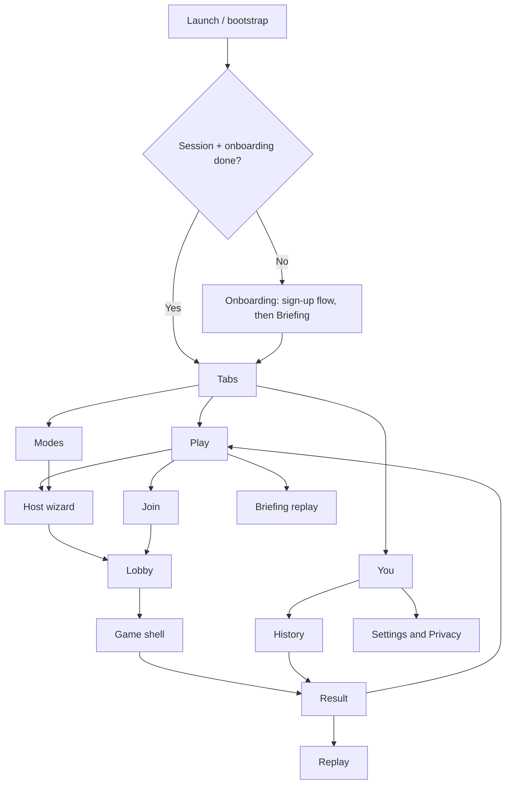

# GhostRun — UI Restructure and Redesign (Revision 2)

> **Revision 2** (Nov 2026). Updated after a teardown of a comparable app's onboarding, tour, home, profile, ranks and settings screens (SCRAM). The restructure is now **two phases**: behaviour-preserving foundations first, then a **new visual identity, animated onboarding and new screens built once, directly in that identity**.
> **Companions:** `MODES.md`, `NEW_FEATURES.md`, `TRD.md`, `FLOW.md`, `docs/V2_VERIFY.md`.
> **Starting point:** GhostRun v2.5, 15 screens (see section 1). Nothing in this document has been started.

---

## 1. Why restructure and redesign

The app grew one feature at a time and is organised around files, not around what players do. It also lacks the **first-run experience and polish** that make comparable apps feel finished.

| Problem today                                                                                                                 | Consequence                                                                                   |
| ----------------------------------------------------------------------------------------------------------------------------- | --------------------------------------------------------------------------------------------- |
| `game/[id].tsx` holds every mode's UI (jail hold, contraband, VIP swaps, operator sweeps, items, radar, tags, shrinking zone) | Each new mode makes it larger, harder to test and slower to render over the map               |
| `create.tsx` plus a modifier drawer is one long form listing every mode and option                                            | New hosts cannot tell what a mode is, what combines with what, or what defaults mean          |
| `lobby/[id].tsx` handles teams, roles, readiness and map placement, and `target/[id].tsx` duplicates placement logic          | Overloaded and duplicated                                                                     |
| Mode-specific content leaks into generic screens (role reveals and Assassin Ring chain on the result screen)                  | Adding a mode means editing many generic files                                                |
| Onboarding is a permissions and tutorial primer, and sign-up is email and password                                            | A new player learns the game by trial and error, and passwords add friction and reset screens |
| Privacy is one screen. Consent moments are not visible as flows                                                               | Hard to audit and easy to break                                                               |
| Settings and privacy overlap, audio and haptics are scattered                                                                 | Inconsistent controls                                                                         |
| No mode library, history, profile, rules pages, spectator or operator layouts, or debug gallery                               | Rules are learned the hard way                                                                |
| Colours, spacing and type are likely hard-coded across components                                                             | A redesign would touch every file                                                             |
| No consistent motion, haptic or sound language                                                                                | The app feels functional rather than crafted                                                  |

### What the teardown showed (patterns worth taking)

1. **One idea per screen**, huge type, lots of empty space, one primary action.

1. **Show-don't-tell onboarding:** a short scripted round told with the real HUD components, in story-style segments.

1. **One-question-per-screen sign-up** with live previews and live availability checks, no passwords, optional marketing consent **unchecked**, and a one-line community rule at sign-up.

1. **A hero home screen**, a floating pill tab bar, a stats grid with a personality-filled empty state.

1. **Microcopy that teaches strategy** (for example, a map setting that explains why night maps are less conspicuous).

1. **Small honest details:** season countdowns, disabled-until-valid buttons, version footer, delete-account and blocked-players in settings.

### What we will not copy (originality and trade dress)

- Its brand colour dominance, its wide-plus-condensed type pairing, its painterly teen illustrations, its miniature-city imagery, its logo or name, its copy lines, and its exact screen compositions.

- Its badge and founder mechanics.

- We take **patterns**, not identity. Section 4 defines GhostRun's own.

## 2. Scope

### Phase 1: Foundations (behaviour-preserving)

Audit, token structure, mode registry, primitives, game shell and widgets, role layouts. **No visible redesign, no flow changes.** This de-risks everything after it.

### Phase 2: Identity and new screens (built once, in the new look)

Design system and motion primitives in the chosen visual direction, then the new onboarding (sign-up flow and animated Briefing tour), home, join, host wizard, lobby, tabs, You tab, Modes library, settings, privacy, result and replay.

**Why this order:** restyling the old screens in Phase 1 and then rebuilding them in Phase 2 would pay for the same screens twice.

### Non-goals (both phases)

- No gameplay changes, new modes, or secrecy changes. No new server RPCs, migrations or RLS changes **except** those explicitly approved for the sign-up flow (section 7.1) and registry read access. If anything else seems necessary, stop and ask.

- No features from `NEW_FEATURES.md` (team radio, leaderboards, friends, demo round against bots, share cards, localisation, iOS, monetisation) in this document's scope. UI placeholders may be left where they will later go, hidden behind flags.

## 3. Principles

1. **Flows over files.** Screens exist because a player needs them.

1. **The registry is the source of truth for UI.** Wizard, lobby rules, rules card, Modes library and tour beats render from it.

1. **One hero action per screen.** Secondary actions are visibly secondary.

1. **Show, don't tell.** Prefer a moving example to a paragraph.

1. **Motion with purpose.** Every animation explains something (a ping arriving, a zone shrinking, a role being assigned) or confirms an action. Nothing decorative that costs frames.

1. **Glanceable in-game UI.** At most three action buttons, SOS always in the same place, haptics and audio before reading.

1. **Never change secrecy.** UI only renders what the server sends.

1. **Tokens only.** No hard-coded colours, spacing, sizes or radii in components after the design system milestone.

1. **Copy teaches strategy** and speaks in one voice (section 14).

1. **Small, reversible steps.** Each milestone leaves the app shippable.

## 4. Visual direction

### 4.1 Approved direction: Afterimage

**Decision U-D7:** use **Afterimage** as GhostRun's visual identity. The direction combines warm, almost-paper light surfaces with ink-dark night surfaces, spectral violet, and a restrained acid-lime action color. The brand should feel eerie, human, and outdoors-ready—not like a generic neon tactical dashboard. Violet is the identity color; lime is reserved for decisive actions and live/selected states. Ghost imagery is abstract and procedural, never cute, painterly, or horror-gory.

Design from the meaning of each token, not from a palette swatch. The palette is shared across both themes, but neutral surfaces and readable text adapt. Team colors and event colors keep their meaning in either theme. Dark is not the only supported appearance.

### 4.2 Theme tokens and initial values

All colors are semantic tokens in `src/theme/tokens.ts`, with `light` and `dark` palettes. These are design starting points; contrast must be programmatically checked against actual text sizes and component states before sign-off.

| Semantic role          | Light     | Dark      |
| ---------------------- | --------- | --------- |
| Background             | `#F3F0E8` | `#101014` |
| Surface                | `#FFFFFF` | `#1B1A22` |
| Surface elevated       | `#E9E5DC` | `#24232D` |
| Text primary           | `#202124` | `#F1EEE8` |
| Text secondary         | `#5D5A62` | `#B7B2BF` |
| Border                 | `#D8D3C9` | `#393743` |
| Brand spectral violet  | `#6650A4` | `#B8A3FF` |
| Action / runner lime   | `#557A22` | `#C7F36B` |
| Hunter / warning coral | `#B94B3A` | `#FF8A75` |
| Ping / echo violet     | `#6650A4` | `#B8A3FF` |

Use dark text on bright lime action surfaces. Do not use pale lime for small text on white or pale paper. Validate contrast; when a hue fails, adjust its lightness for that theme without changing its semantic meaning. Color must never be the sole indicator of team, status, selection, or danger: pair it with labels, shapes, icons, or patterns.

Appearance setting offers **System / Light / Dark**. Persist the user's explicit choice. System follows the OS. Theme changes update app chrome, sheets, cards, controls, and map style together. Provide map choices that include **Follow appearance**, plus an explicit map preference if the existing implementation supports it; do not make a forced dark map the only usable option. Keep map attribution and location/zone contrast clear in both styles.

Other foundations: radii 12, 20, 28 dp; spacing 4, 8, 12, 16, 24, 32, 48; motion 120 ms feedback, 240 ms transitions, 600 ms reveals, 1500 ms ambient. Apply tokens through primitives, not screen-level color literals.

### 4.3 Typography

- Three roles: **Display** (headlines and big numbers), **Body** (UI text), and **Label** (compact metadata and mono timers/HUD data).

- Use open-licensed families bundled with `expo-font` only after the font and licence are approved. A characterful but highly legible display face may pair with a neutral body face; use mono sparingly for timers and coordinates.

- **Do not** use wide-extended plus ultra-condensed pairings, all-caps for long copy, or tracked uppercase as the default body style. Typography is accessed through the `Text` primitive with variants (`display`, `title`, `body`, `label`, `mono`, `numeric`) and must respect dynamic type.

### 4.4 Imagery and iconography

- Use original vector or procedural art: soft afterimages, incomplete radar arcs, map trails, fogged rings, and abstract ghost marks. Effects should clarify game state, not decorate every surface.

- Avoid stock/painterly character illustrations, miniature city art, another product's distinctive visual motifs, and copied screen compositions.

- Use one icon set and consistent stroke weight on a 24 dp grid. Icons must have accessible labels when interactive.

- Light and dark map styles must be legible in daylight and at night. The map is a first-class themed surface, not a bright rectangle placed inside a dark UI.

### 4.5 Motion and haptics language

| Moment                 | Motion                                                                              | Haptic                                            |
| ---------------------- | ----------------------------------------------------------------------------------- | ------------------------------------------------- |
| Ping arrives           | Brief expanding ring, then a still marker with an age/decay cue                     | Double pulse                                      |
| HEAT / proximity event | Soft coral or cool-violet field cue with a clear text/icon label; fade, never flash | Two short pulses for near, one soft pulse for far |
| Role reveal            | Short, skippable reveal that resolves into a readable role card                     | Pattern per role                                  |
| Ghost / echo           | Faint, short-lived afterimage on a trail or marker                                  | None                                              |
| Tag confirmed          | Marker resolves into a clear tagged state                                           | Strong single pulse                               |
| Screen transitions     | Short slide or shared-element transition, 240 ms                                    | None                                              |

All animations must respect reduced motion. Never flash or strobe. Avoid persistent ambient animation behind important copy, and do not animate map layers every frame unless measured. Haptics respect the user's setting.

### 4.6 Originality and accessibility guardrails

Use GhostRun's own Afterimage palette, words, visual motifs, and screen compositions. Do not reproduce another app's identity or use brand color dominance copied from a reference. Maintain legible contrast, visible focus/selection, minimum 48 dp touch targets, safe-area spacing, and layouts that survive narrow screens and larger text. Never truncate critical labels or force horizontal scrolling for primary controls. Detailed visual acceptance rules live in `docs/UI_RESTRICTIONS.md`.

## 5. Information architecture

### 5.1 Tabs (decision U-D1, revised)

**Three tabs** with a floating pill tab bar: **Play · Modes · You**. Ranks is added as a fourth item only when leaderboards ship (`NEW_FEATURES.md` NF-14). History lives inside **You**. Settings sits behind a gear on **You**.

| Tab       | Contents                                                                                                                                                                                                                                                                    |
| --------- | --------------------------------------------------------------------------------------------------------------------------------------------------------------------------------------------------------------------------------------------------------------------------- |
| **Play**  | Hero home: codename greeting, resume-game pill, **Host**, **Join** (code boxes, link, QR), "How it works" (the Briefing) and "Try a demo round" (hidden until `NEW_FEATURES.md` NF-01 ships), last round summary, optional promo or season banner slot (hidden until NF-31) |
| **Modes** | Mission-briefing cards for every enabled mode and modifier: tagline, player count, difficulty, safety notes, short "how it works", **Host this mode**                                                                                                                       |
| **You**   | Case file (codename, handle, stats grid), history list, friends (hidden until NF-30), settings gear                                                                                                                                                                         |

### 5.2 Navigation map



### 5.3 Route map (old → new)

| Current                                 | New                                                                                             | Notes                                                        |
| --------------------------------------- | ----------------------------------------------------------------------------------------------- | ------------------------------------------------------------ |
| `app/index.tsx`                         | `app/index.tsx`                                                                                 | Bootstrap and routing only                                   |
| `welcome.tsx`                           | `(onboarding)/welcome.tsx`                                                                      | Short, one hero and one button                               |
| `auth.tsx`                              | `(onboarding)/signup/*` (5 steps) and `(onboarding)/signin.tsx`                                 | See 7.1. Existing accounts keep working                      |
| `reset-password.tsx`                    | `(onboarding)/reset-password.tsx`                                                               | **Keep ****`/reset-password`**** working** (deep link)       |
| `onboarding.tsx`                        | `(onboarding)/signup/before-you-play.tsx` (permissions) and `(onboarding)/briefing.tsx` (tour)  | Permissions behaviour unchanged                              |
| `home.tsx`                              | `(tabs)/play.tsx`                                                                               |                                                              |
| (none)                                  | `(tabs)/modes.tsx`, `modes/[id].tsx`                                                            | New                                                          |
| (none)                                  | `(tabs)/you.tsx`                                                                                | New, includes History                                        |
| `settings.tsx`                          | `you/settings/index.tsx`, `appearance.tsx`, `audio-haptics.tsx`, `notifications.tsx`, `map.tsx` | Gear on You                                                  |
| `privacy.tsx`                           | `you/privacy/index.tsx`, `consents.tsx`, `my-data.tsx`, `ghosts.tsx`                            | Existing controls moved                                      |
| `create.tsx` and `GameModifiers` drawer | `host/mode.tsx`, `rules.tsx`, `extras.tsx`, `area.tsx`, `review.tsx`                            | Wizard                                                       |
| `join.tsx`                              | `join.tsx` (modal)                                                                              | Code boxes                                                   |
| `lobby/[id].tsx`                        | `lobby/[id]/_layout.tsx` with `players.tsx`, `rules.tsx`, `map.tsx`                             | Segmented                                                    |
| `target/[id].tsx`                       | Folded into the generic placement step                                                          | **Keep ****`/target/:id`**** as a redirect** for one release |
| `game/[id].tsx`                         | `game/[id].tsx` (shell) plus `src/game-shell` and `src/modes/*`                                 | Section 8                                                    |
| `result/[id].tsx`                       | `result/[id].tsx`                                                                               | Composed from generic plus mode sections                     |
| `replay/[id].tsx`                       | `replay/[id].tsx`                                                                               | Composed from generic plus mode layers                       |
| (none)                                  | `help/how-to-play.tsx`, `help/safety.tsx`                                                       | From registry and safety copy                                |
| (none)                                  | `debug/hud-gallery.tsx`                                                                         | Dev builds only                                              |

**Back-compat rule:** every old path reachable from a notification, QR code, link or stored state keeps resolving (redirect) for at least one release.

## 6. Core screen specifications

### 6.1 Play (home)

- Large codename greeting in Display type, a slow ambient **radar sweep** behind it with a faint ghost trail of the player's last round (respecting C3 and trimmed ends). Reduced motion shows a static ring.

- One primary **Host a game** button, a visibly secondary **Join with a code**, then text links "How it works" and "Try a demo round" (the latter hidden until it exists).

- Resume pill if a game is active. Last round summary card (outcome, duration, distance) if any.

- No promotions or banners in v1 of this redesign.

### 6.2 Join

- **N separate code boxes** where N equals the server's code length (see U-D3). Auto-advance, paste support, backspace goes back, uppercase, active box outlined with the accent, a subtle sonar ripple per filled box, a shake and haptic on a wrong code, **disabled button until the code is complete**, QR scan button.

- Deep link `/join?code=` prefills the boxes.

### 6.3 Host wizard (replaces `create.tsx`)

| Step                      | Content                                                                                                                           |
| ------------------------- | --------------------------------------------------------------------------------------------------------------------------------- |
| 1 **Mode**                | Briefing cards from the registry (base modes only). Tapping opens the rules card. Disabled (flagged-off) modes are hidden         |
| 2 **Rules**               | Generated parameter fields with **presets** (Casual, Standard, Hardcore) and an "Advanced" section. Helper text from the registry |
| 3 **Roles and modifiers** | Only compatible options. Incompatible ones greyed with a one-line reason                                                          |
| 4 **Area and placements** | One map step: boundary and whatever placements the mode requires (target, jail, extraction, drop zones)                           |
| 5 **Review**              | Plain-language rules card, estimated length, player-count guidance, safety checklist. **Create** button                           |

- One `draft` store, back navigation never loses data, and the output payload must be **identical** to the old form's `create_game` payload.

### 6.4 Lobby (segmented)

**Players** (roster, team choice, roles, ready, replay-sharing sheet at join, host controls) · **Rules** (read-only rules card for everyone, with an "I've read the rules" acknowledgement for modes flagged `complexity: high`) · **Map** (area and placement preview, editable by allowed roles).

### 6.5 In-game

One shell with role layouts (section 8). A **role reveal ceremony** opens each game (4.5). The Double Agent role card is private and revealed by holding a finger down, auto-hiding after a few seconds.

### 6.6 Result and Replay

Result: generic header, winner, reason and stats, then mode sections, recap cards and the existing ghost contribution prompt. Replay keeps the scrubber and uses the **ghost echo** effect on trails.

### 6.7 You (case file)

- Header with codename and handle, a **stats grid** (Rounds, Won, Win rate, Never caught, Best escape, Farthest, using only stats the app already computes), a personality-filled empty state, history list, gear for settings. Friends section hidden until NF-30.

- Terms and tone are in the "case file" voice (section 14), not gamified numbers beyond the stats grid.

### 6.8 Modes library

Briefing-style cards, a filter by player count and difficulty, detail screen with rules card, safety notes and **Host this mode**.

### 6.9 Settings

Appearance (**System / Light / Dark**, per U-D7 and `UI_RESTRICTIONS.md`) applies consistently to app surfaces and maps; **Units (km / mi)** applies to every distance shown; Map style includes **Follow appearance** and **Night**, with **Satellite** only if a free, correctly licensed imagery source is confirmed (decision U-D11); audio and haptics toggles, notifications, privacy and data, account (email, sign out, delete account), contact (opens an email to the support address), terms and privacy links, version footer. Language is hidden until localisation exists (`NEW_FEATURES.md` NF-20). Every setting with a strategic effect gets a helper line that teaches. Appearance choice is persisted; System follows the OS.

## 7. Onboarding

### 7.1 Sign-up flow (five steps, one question each)

| Step                  | Content                                                                                                                                                                                                           | Notes                                                                                                                                                                                |
| --------------------- | ----------------------------------------------------------------------------------------------------------------------------------------------------------------------------------------------------------------- | ------------------------------------------------------------------------------------------------------------------------------------------------------------------------------------ |
| 1 **Name**            | "What should we call you?" with a live **"on the radar" preview chip** showing how the name appears on the map and in chat                                                                                        | Shown in games                                                                                                                                                                       |
| 2 **Handle**          | Unique `@handle` (letters, numbers, `_`), live availability check, friendly confirmation                                                                                                                          | Used later for friends and leaderboards. Guests may skip until needed (U-D8)                                                                                                         |
| 3 **Account**         | Continue with Google, emailed code, or continue as guest. "I already have an account" link                                                                                                                        | Marketing email consent is a checkbox that is **unchecked** by default. One line: "No place for abuse or harassment, and players who do it are removed" plus Terms and Privacy links |
| 4 **Code**            | Enter the emailed code (skipped for Google and guest)                                                                                                                                                             | Progress indicator adapts                                                                                                                                                            |
| 5 **Before you play** | Age confirmation (**18 or older, or playing under a guardian's supervision**), the short privacy summary, then the permission requests in context: location, background location, notifications, battery guidance | Consent records unchanged                                                                                                                                                            |

- **Auth change needs approval (U-D8).** The current app uses email and password, with guest and magic-link support. Options: (1) keep email and password under "I already have an account" while new users use Google, emailed code or guest, (2) use emailed codes everywhere. Emailed codes use the same Supabase email sender with a low hourly limit, so Google and guest remain essential. Google sign-in needs an OAuth client and the release keystore's fingerprint, which are **human prerequisites**. If this is not approved, ship the new screens over the existing sign-up method.

- Existing accounts must continue to work unchanged. No data migration for passwords.

- Policy stays **18+ or guardian-supervised**. Do not copy another app's under-18 handling.

### 7.2 The Briefing (animated tour)

A short scripted round told with **the real HUD components fed by scripted state**. No network, no location permission needed, works offline, replayable from Play ("How it works") and Settings.

**Structure:** story-style segment bar at the top (8 segments), **Skip** and **Done**, a HUD card (time left, next ping), a label pill showing whose view it is ("RUNNERS' VIEW" or "HUNTERS' VIEW"), a bottom sheet per beat with a small caps label, a headline and one line, and "Tap to continue". Beats auto-advance after their animation and also advance on tap.

| #   | Beat (label) | What happens on screen                                                                                    |
| --- | ------------ | --------------------------------------------------------------------------------------------------------- |
| 1   | THE GROUND   | Zone circle is drawn on a dark map. "The host picks the ground."                                          |
| 2   | HEAD START   | Runner markers scatter while the head-start timer counts down. Hunters hold still                         |
| 3   | DARK         | Hunters' view: no runners visible                                                                         |
| 4   | THE PING     | Rings expand and markers appear with a decay ring                                                         |
| 5   | ECHO         | Runner's true position moves on while the ping stays behind as a fading echo ("Keep moving after a ping") |
| 6   | THE SQUEEZE  | Zone shrinks. A runner outside the zone is flagged                                                        |
| 7   | TAG AND HEAT | A tag stamp, then the red or blue HEAT wash                                                               |
| 8   | YOUR TURN    | Host, Join, **Try a demo round** (only if it exists), **Watch again**                                     |

- Copy for each beat comes from the registry (`ModeModule.tourBeat`) or a core tour file, in the voice of section 14, translated later.

- **Scripted-state engine:** `TourScript { beats: { id, durationMs, camera, markers[], timers[], overlays[], copyKey }[] }` driving a `TourPlayer` that renders real widgets with mock props. The same engine powers the debug HUD gallery, so build it once.

- **Reduced motion:** replace animation with static beat cards and fades.

- **Safety:** no real positions, no network calls.

- **Map for the tour (U-D10):** use a scripted, theme-aware map treatment that works in both Afterimage appearances. It may use the real MapLibre view with compatible light/dark styles or original vector artwork. Verify what the installed MapLibre RN version and chosen styles support before committing. Do not use generated or stock imagery resembling another app.

## 8. In-game architecture

### 8.1 Shell responsibilities

Map view and layers (area, boundary, shrinking zone, pings, teammates, ghosts as allowed), realtime subscription and `get_game_state` resync, phase banner, boundary and tracking status, event feed and toasts, SOS sheet, location task lifecycle, haptic and audio dispatch, reconnect handling. **The shell never contains mode-specific logic.**

### 8.2 Slots

`top` (time, next ping, runners left, mode chips) · `banner` (phase, boundary warning, tracking paused) · `mapLayer` · `overlay` (tints, ripples, sensed pulses) · `actions` (max 3 buttons) · `nav/more` (SOS, leave, host end, rules).

### 8.3 Widget contract

```
export type Role = 'runner' | 'hunter' | 'operator' | 'spectator';
export type Phase = 'countdown' | 'head_start' | 'live' | 'ended';
export type Slot = 'top' | 'banner' | 'overlay' | 'actions' | 'sheet' | 'mapLayer';

export interface HudWidget {
  id: string;
  slot: Slot;
  roles: Role[];
  phases: Phase[];
  priority: number;                 // shell enforces max 3 in 'actions'
  Component: React.ComponentType<HudWidgetProps>;
}
```

`HudWidgetProps` gives read-only selectors and typed action functions from `src/game-shell/actions.ts` (wrappers over existing RPCs). Widgets never import the Supabase client.

### 8.4 Role layouts

Runner · Hunter · **Operator console** (no GPS upload, remote map, markers, scan) · Spectator (tagged players, teammates only until game end).

### 8.5 Performance rules

Memoised map layers fed by selectors, timers isolated in small components, no inline objects or functions in map layer props, animations on the UI thread, and **recorded before and after numbers** (re-render counts or frame stats on a mid-range device) at the end of the shell milestone and again after the motion milestone.

## 9. Mode plug-in architecture

### 9.1 Folder layout

```
src/modes/
  registry.ts  types.ts
  <mode_id>/ index.ts rules.ts setup.tsx hud.tsx result.tsx replay.ts recap.ts tour.ts
src/game-shell/    GameShell.tsx MapView.tsx HudFrame.tsx PhaseBanner.tsx SosSheet.tsx
                   EventFeed.tsx TrackingStatus.tsx actions.ts selectors.ts layouts/
src/ui/            tokens-driven primitives (Text, Button, Card, Chip, Sheet, Toast, CodeBoxes, SegmentBar, ParamField, RulesCard, BriefingCard)
src/motion/        ping-ripple, sweep, ghost-echo, count-up, role-reveal, heat-wash, reduced-motion helpers
src/tour/          TourScript.ts TourPlayer.tsx scripts/core.ts
src/theme/         tokens.ts ThemeProvider.tsx
```

### 9.2 Module contract (additions in bold)

```
export interface ModeModule {
  id: string;                         // equals server mode_id / modifier id / role id
  layer: 'base' | 'modifier' | 'role';
  name: string; tagline: string;
  minPlayers: number; idealPlayers: string;
  difficulty: 1 | 2 | 3;
  complexity: 'low' | 'high';
  safetyNotes: string[];
  featureFlag: string;
  params: ParamDef[];
  presets?: Record<'casual' | 'standard' | 'hardcore', Record<string, unknown>>;
  placements?: PlacementDef[];
  compatibleWith: string[];
  incompatibleWith?: { id: string; reason: string }[];
  rules: { summary: string; sections: { title: string; body: string }[] };
  briefing: { codename: string; intel: string[]; };   // for Modes library cards
  tourBeat?: TourBeatDef;                             // optional spotlight beat
  hudWidgets: HudWidget[];
  ResultSection?: React.ComponentType<ResultSectionProps>;
  replayLayers?: ReplayLayerDef[];
  recapStats?: RecapStatDef[];
}
```

`ParamDef` and `PlacementDef` are as in Revision 1: keys, labels, types, ranges, defaults, helper text, advanced flag, placed-by and visible-to roles.

### 9.3 Registry rules

IDs, parameter keys, defaults and ranges **must match the server**. A drift test (`scripts/registry-drift.ts`) compares client and server definitions read-only and fails on any difference. Feature-flagged modes are hidden everywhere. Presets equal today's defaults, so behaviour is unchanged.

### 9.4 Modes to register (confirm against the code in the audit)

Base: `classic_chase`, `tag_hunt`, `jailbreak`, `assassin_ring`, `relay_heist`, and **`manhunt`** (not in `MODES.md`, decision U-D4). Modifiers: `hot_cold`, `noise_meter`, `dead_drops`, `qr_tagging`, `shrinking_zone`, `ghosts`. Roles: `double_agent`, `vip_escort`, `operator`. Anything else found goes into the audit.

## 10. State management

Split stores: `session`, `draft` (host wizard), `game`, `ui`. Selectors everywhere. One realtime subscription and resync hook shared by shell and lobby. Persisted AsyncStorage keys keep working, with a migration if any key is renamed.

## 11. Motion system

Primitives live in `src/motion` and are used only through named components (`PingRipple`, `RadarSweep`, `GhostEcho`, `CountUp`, `RoleReveal`, `HeatWash`, `StaggerIn`). Dependencies (for example Reanimated, a drawing library for radar art) must be confirmed against what the project already includes. **Ask before adding any.** Performance budget: no dropped frames on the in-game screen on a mid-range device while a ping animation plays.

## 12. Accessibility and safety

- Minimum touch target 48 dp. SOS in the same place on every layout.

- Colour is never the only signal (icon, label, haptic).

- No flashing or strobing, and a reduced-motion mode.

- Respect system font scale and keep the HUD readable in sunlight.

- Tour and role reveal are skippable, and role cards never display other players' secrets.

## 13. Dependencies on other documents

- **Auth methods (Google, emailed code)** are specified in `NEW_FEATURES.md` NF-29. The sign-up UI can ship earlier over the existing auth if NF-29 is not approved.

- **Handles** are created in the sign-up flow. Uniqueness and moderation rules come from `NEW_FEATURES.md` NF-08 and NF-14.

- **Demo round, friends, seasons and banners** are features. This document leaves hidden placeholders only.

## 14. Copy and voice

### 14.1 Voice

Terse, dry, slightly conspiratorial, never childish, never shouty. Short sentences. It teaches the game through the wording of settings and empty states. Use one name per concept everywhere: ping, radar, heat, echo, ghost, zone, codename, handle, briefing, case file.

### 14.2 Examples (provisional, to be refined)

| Where             | Line                                                                 |
| ----------------- | -------------------------------------------------------------------- |
| Join              | "Got a code?" with "Your host has it at the top of the lobby."       |
| Name step         | "What should we call you?" with "It's how you show up on the radar." |
| Night map setting | "Dark is easier on the eyes and harder to spot."                     |
| Empty case file   | "No rounds on file. Play one and this fills in."                     |
| Ping beat         | "Every few minutes the radar tells the hunters where you were."      |
| Echo beat         | "Only where you were. Keep moving."                                  |

### 14.3 Fixes included in this work

1. Reword the "zero-knowledge GPS handling" text in the privacy screen to what is true: positions are visible only to players the rules allow, routes are shared only if the player chose to share them, and data is deleted after the retention period.

1. Make the room code length consistent across the UI, README and server (U-D3).

1. Remove any wording implying legal compliance.

1. Keep the age text consistent with the policy version.

## 15. Milestones

Each milestone ends with a **STOP**. Work on branches named `ui/<milestone>`. No pushes, tags or releases without approval.

### Phase 1: Foundations (behaviour-preserving)

| ID        | Goal                                 | Main work                                                                                                                                                                                                                                                                                                                                                                                                                  | Acceptance                                                                                                                                         |
| --------- | ------------------------------------ | -------------------------------------------------------------------------------------------------------------------------------------------------------------------------------------------------------------------------------------------------------------------------------------------------------------------------------------------------------------------------------------------------------------------------- | -------------------------------------------------------------------------------------------------------------------------------------------------- |
| **UI-M0** | Audit and baseline (no code changes) | `docs/UI_AUDIT.md`: routes and screens with line counts, shared components, stores, deep links, notification targets, persisted keys, hard-coded style counts, modes found in code vs registry list, existing auth methods and what the screens do. Baseline screenshots and golden-path checklist. Baseline outputs of typecheck, lint, tests, `npm run rls`, `npm run sim`. Answers or recommendations for U-D1 to U-D12 | Audit exists, baselines captured, decisions answered                                                                                               |
| **UI-M1** | Foundations (no visible change)      | Token structure with **today's values**, `Text` primitive, mode registry and types for every existing mode (metadata only), `RulesCard` and `ParamField` generators in a hidden dev screen, registry drift test                                                                                                                                                                                                            | App looks and behaves identically, drift test passes, all baseline checks pass                                                                     |
| **UI-M2** | Game shell and widgets               | Extract the shell, move each mode's HUD into widgets, role layouts (runner, hunter, operator console, spectator), isolate timers, record performance before and after                                                                                                                                                                                                                                                      | Every mode's in-game features work per a per-mode checklist, `game/[id].tsx` has no mode logic, performance equal or better, `/game/:id` unchanged |

**Gate between phases:** I choose the visual direction (U-D7), fonts (U-D9), tour map approach (U-D10) and auth approach (U-D8). The agent proposes, I decide.

### Phase 2: Identity and new screens

| ID        | Goal                                  | Main work                                                                                                                                                                                                                                                     | Acceptance                                                                                                                                                                                                                        |
| --------- | ------------------------------------- | ------------------------------------------------------------------------------------------------------------------------------------------------------------------------------------------------------------------------------------------------------------- | --------------------------------------------------------------------------------------------------------------------------------------------------------------------------------------------------------------------------------- |
| **UI-M3** | Design system and motion              | Final tokens in the chosen direction, fonts bundled, primitives (`Button`, `Card`, `Chip`, `Sheet`, `Toast`, `CodeBoxes`, `SegmentBar`, `BriefingCard`), motion components, haptics map, reduced-motion support, **HUD gallery** and **tour engine skeleton** | Gallery shows every primitive and every role layout in the new look, contrast check passes, reduced motion works, performance budget met, token coverage: zero hard-coded hex colours in `src/ui`, `src/motion`, `src/game-shell` |
| **UI-M4** | Onboarding                            | Welcome, five-step sign-up (over existing auth unless U-D8 approves changes), permissions step, Briefing tour with all 8 beats, skip and replay                                                                                                               | A new account can complete sign-up and the tour on a device. Existing accounts sign in unchanged. Tour works offline and with reduced motion. No network calls or location use in the tour                                        |
| **UI-M5** | Home, join, host wizard               | Play tab, code boxes, five-step wizard and generic placement step, redirects for old routes                                                                                                                                                                   | Payload equals the old form's for 10+ representative choices (snapshot test), deep links and `/target/:id` redirect work, incompatible options explained                                                                          |
| **UI-M6** | Lobby, tabs and You                   | Segmented lobby, three-tab pill bar, Modes library and detail, You tab with case file and history, Settings split (including units and appearance), Privacy split, How to play and Safety pages, copy fixes                                                   | All old entry points reachable, route-resolution test passes, privacy controls behave as before, units apply everywhere distances appear                                                                                          |
| **UI-M7** | Result, replay and gallery completion | Result and replay composed from mode modules, ghost echo on trails, recap cards, remaining gallery entries, token coverage check across the app                                                                                                               | Result and replay show the same data as before for every mode, zero hard-coded hex colours outside tokens (or listed exceptions with reasons)                                                                                     |
| **UI-M8** | Hardening and release candidate       | Redirect and deep-link tests, accessibility pass, regression runs, performance numbers after motion, release-candidate APK, device checklist and field-test sheet, `docs/ADDING_A_MODE.md`, README update                                                     | `npm run typecheck`, `lint`, unit tests, `npm run rls` and `npm run sim` pass with pasted output. Device checks marked `not run` until I run them. **I** decide whether it ships                                                  |

## 16. Testing strategy

- **Regression after every milestone:** typecheck, lint, existing tests, `npm run rls`, `npm run sim` (no server logic changes, so these pass unchanged).

- **Registry drift test** from UI-M1.

- **Wizard payload snapshot test** (UI-M5).

- **Route resolution test** (UI-M6).

- **Tour test:** script plays every beat deterministically with mock state, reduced-motion variant renders static cards, no network calls (assert).

- **HUD gallery** compared against baseline screenshots and, from UI-M3, against the new look.

- **Per-mode manual checklists** for me to run on a device.

- **Performance:** record frame or re-render numbers before and after UI-M2 and UI-M3 on the same scenario.

## 17. Risks and mitigations

| Risk                                                                     | Mitigation                                                                                           |
| ------------------------------------------------------------------------ | ---------------------------------------------------------------------------------------------------- |
| Motion and visuals hurt in-game frame rate                               | UI-thread animation, performance budget, measure before and after, reduce effects on low-end devices |
| Looking derivative of another app                                        | Originality guardrails (4.6), own palette, type, art and copy, review in the gallery                 |
| Redesign and restructure break deep links, QR joins or notification taps | Redirects and route-resolution tests                                                                 |
| Background location or realtime depends on a screen being mounted        | Lifecycle moves to the shell and is tested when backgrounded                                         |
| Auth changes lock out or confuse existing users                          | Existing accounts keep working, auth changes need explicit approval, Google needs human setup        |
| Supabase email limits block emailed-code sign-up                         | Keep Google and guest as alternatives, consider custom SMTP                                          |
| Font licensing                                                           | Use open-licensed families and record licences                                                       |
| Registry drifts from server                                              | Drift test                                                                                           |
| Map style or tiles for night mode or the tour have licensing limits      | Verify the style and tile terms before relying on them, ask before adding sources                    |
| Large diffs cause regressions                                            | One milestone at a time, branches, baselines, per-mode checklists                                    |
| Scope creep into features                                                | Non-goals and STOP gates                                                                             |

## 18. Decisions needed from me

| #     | Decision                                                                                          | Recommendation                                                                                                                                  |
| ----- | ------------------------------------------------------------------------------------------------- | ----------------------------------------------------------------------------------------------------------------------------------------------- |
| U-D1  | Tabs                                                                                              | Three tabs (Play, Modes, You) with a floating pill bar, Ranks added later                                                                       |
| U-D2  | Host flow                                                                                         | Five-step wizard with a Review step                                                                                                             |
| U-D3  | Room code format                                                                                  | Keep what the server accepts today and make the UI, README and server agree. The code boxes adapt to the length                                 |
| U-D4  | `manhunt` mode found in `create.tsx`                                                              | Hide behind its flag until it has a spec                                                                                                        |
| U-D5  | Built-but-gated modes (Jailbreak, Assassin Ring, Relay Heist, VIP, Operator) in the Modes library | Show only if the flag is on and RLS checks exist                                                                                                |
| U-D6  | History placement                                                                                 | Inside You                                                                                                                                      |
| U-D7  | **Visual direction**                                                                              | A, Night Radar (provisional)                                                                                                                    |
| U-D8  | **Auth approach**                                                                                 | Google, emailed code and guest for new users, existing email and password kept for existing users. Approve only with the human setup for Google |
| U-D9  | Fonts                                                                                             | One tech grotesque, one neutral body, one mono, all open-licensed                                                                               |
| U-D10 | Tour map                                                                                          | Real MapLibre with a custom dark style and extruded buildings if supported, otherwise own vector art                                            |
| U-D11 | Satellite map option                                                                              | Skip until a free, licensed imagery source is confirmed                                                                                         |
| U-D12 | Light theme                                                                                       | Dark only at first, add Light later                                                                                                             |
| U-D13 | Age policy                                                                                        | Keep 18 or older, or guardian-supervised                                                                                                        |

## 19. Definition of done

- Navigation follows section 5, with old paths still resolving.

- `game/[id].tsx` is a shell with no mode-specific logic, and every mode lives in `src/modes/<id>`.

- Onboarding, Briefing, home, join, host wizard, lobby, tabs, You, Modes, settings, privacy, result and replay exist in the new identity.

- Tokens are the only source of colours, spacing and type, with zero hard-coded hex values outside them (or listed exceptions).

- Reduced motion, minimum touch targets and no-flash rules are met.

- Typecheck, lint, tests, `npm run rls` and `npm run sim` pass with pasted output.

- A release-candidate APK and field checklist are ready. **I** decide whether it ships.

## 20. Out of scope (see `NEW_FEATURES.md`)

Team radio chat, quick-chat chips, report and block, demo round against bots, shareable cards, leaderboards, friends and presence, seasons and promo banners, localisation, iOS, hosting purchase, push notifications, analytics, website.
