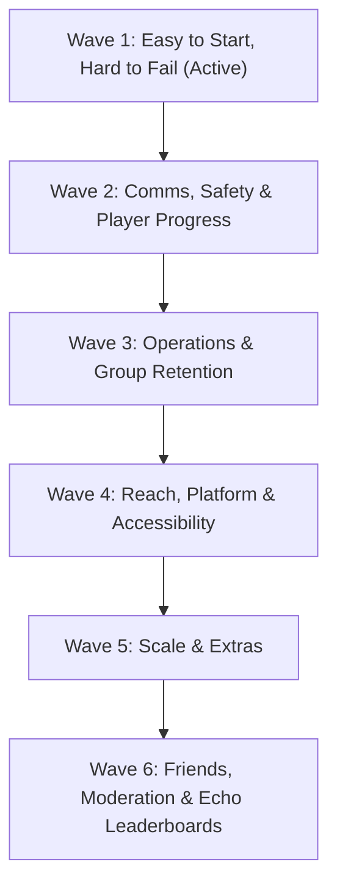

# GhostRun — Master Feature Waves

> **Status:** Active Master Roadmap  
> **Companions:** `docs/NEW_FEATURES.md`, `docs/FRIENDS_LEADERBOARDS.md`, `docs/PROGRESS.md`, `docs/DECISIONS.md`

---

## Roadmap Overview

---

## Wave 1: Easy to Start, Hard to Fail (Completed)
*Focus: Eliminating friction and physical GPS/tracking failures before match start.*

| ID | Feature | Priority | Effort | Status | Companion / Spec |
|---|---|---|---|---|---|
| **NF-04** | Pre-game Ready Check (tracking health & sensors) | A | S–M | Completed | `docs/specs/NF-04.md` |
| **NF-05** | Silent-by-default alerts (tactical vibration channels) | A | S | Completed | `docs/specs/NF-05.md` |
| **NF-06** | Safety check-in & curfew (host toggles & alert) | A | S–M | Completed | `docs/specs/NF-06.md` |
| **NF-03** | Rematch & role rotation (fairness & ratio balance) | A | S | Completed | `docs/specs/NF-03.md` |
| **NF-02** | Invite links & share sheet (code prefill & join link) | A | S–M | Completed | `docs/specs/NF-02.md` |

---

## Wave 2: Comms, Safety & Player Progress (Completed)
*Focus: In-game team tactical coordination, boundary penalties, and personal records.*

| ID | Feature | Priority | Effort | Status | Notes |
|---|---|---|---|---|---|
| **NF-07** | Team Radio (team text chat & quick-chat chips) | B | M | Completed | `docs/specs/NF-07.md`. Team-isolated channels, quick chips, moderation. |
| **NF-09** | Boundary rule options (`reveal_live`, `auto_tag`) | B | S–M | Completed | `docs/specs/NF-09.md`. Drift buffer, accuracy gating, auto-tag. |
| **NF-10** | Shareable round card (privacy-trimmed graphic) | B | S–M | Completed | `docs/specs/NF-10.md`. 150m privacy start/finish trim, scorecard modal. |
| **NF-11** | Badges & personal records (server-computed) | B | M | Completed | `docs/specs/NF-11.md`. 7 canonical medals, dossier achievements. |
| **NF-17** | Privacy-safe analytics & crash reporting | B | S–M | Completed | `docs/specs/NF-17.md`. Opt-in consent C7; zero GPS/name telemetry. |
| **NF-18** | In-app feedback & bug report form | B | S | Completed | `docs/specs/NF-18.md`. Diagnostics bundle without raw coordinates. |
| **NF-32** | In-app review prompt & support contact | B | S | Completed | `docs/specs/NF-32.md`. Google Play review & support mailto intent. |

---

## Wave 3: Operations & Group Retention (Completed)
*Focus: Group scheduling, asynchronous alerts, and seasonal calendar.*

| ID | Feature | Priority | Effort | Status | Notes |
|---|---|---|---|---|---|
| **NF-12** | Remote push notifications (FCM / Expo) | B | M | Completed | `docs/specs/NF-12.md`. Inactive invites, start alerts, channel mapping. |
| **NF-13** | Scheduled games & calendar reminders | C | M | Completed | `docs/specs/NF-13.md`. RSVP tracking and RFC 5545 `.ics` export. |
| **NF-15** | Season recap card ("Wrapped") | C | S–M | Completed | `docs/specs/NF-15.md`. Aggregated metrics, tactical dossier card. |
| **NF-16** | Crews & squad lists | C | M–L | Completed | `docs/specs/NF-16.md`. Minimal privacy-safe persistent squads. |
| **NF-31** | Season framework & promo announcement banners | C | S–M | Completed | `docs/specs/NF-31.md`. Remote-config banner slots on Play tab. |

---

## Wave 4: Reach, Platform & Accessibility (Completed)
*Focus: Cross-platform distribution, internationalization, and accessibility.*

| ID | Feature | Priority | Effort | Status | Notes |
|---|---|---|---|---|---|
| **NF-19** | Official website & join gateway | B | M | Completed | `docs/specs/NF-19.md`. Landing, safety, privacy, support, and join gateway. |
| **NF-20** | Localisation (i18n string table) | C | M | Completed | `docs/specs/NF-20.md`. 5 locales (en, es, de, fr, ja), full key parity. |
| **NF-21** | iOS build & configuration | C | L | Completed | `docs/specs/NF-21.md`. Entitlements, background modes, Universal Links. |
| **NF-22** | Discord bot integration | D | S–M | Completed | `docs/specs/NF-22.md`. Privacy-safe rich embed webhooks. |
| **NF-25** | Accessibility extras (colorblind radar, high-contrast) | C | M | Completed | `docs/specs/NF-25.md`. Protanopia, Deuteranopia, Tritanopia, TalkBack formatters. |
| **NF-26** | Admin console & remote config tooling | C | S–M | Completed | `docs/specs/NF-26.md`. Admin role, RLS kill-switches, health telemetry. |
| **NF-33** | Spoken narration for AI Game Master (TTS) | C | S | Completed | `docs/specs/NF-33.md`. Priority speech cue queue, tactical prompts. |

---

## Wave 5: Scale & Extras
*Focus: Large community events, wearables, and optional commercial tooling.*

| ID | Feature | Priority | Effort | Status | Notes |
|---|---|---|---|---|---|
| **NF-23** | Event mode for large games (50–150 players) | D | L | Queued | Realtime broadcast channels & spectator feeds. |
| **NF-24** | Wear OS companion app | D | L | Queued | Wrist haptics and one-tap actions. |
| **NF-27** | Replay video export (MP4/GIF) | D | L | Queued | Animated trail video with privacy trimming. |
| **NF-28** | Hosting purchase (Monetisation) | D | M | Queued | One-time unlock (only if public release). |
| **NF-36** | Community rule packs (Data-only) | D | M | Queued | Validated custom rules (no code/scripts). |

---

## Wave 6: Friends, Moderation & Echo Leaderboards
*Source: `docs/FRIENDS_LEADERBOARDS.md` (Dedicated 4-Phase System)*

| Phase | Milestone | Scope | Status | Notes |
|---|---|---|---|---|
| **FL1** | **Phase P0: Foundations** | Unique `@handle`, Report & Block, Moderation guide | Queued | Fulfills & deepens base NF-08. |
| **FL2** | **Phase P1: Friends Graph** | Exact-handle requests, signed invite links/QR, presence | Queued | Fulfills & deepens base NF-30 & NF-02. |
| **FL3** | **Phase P2: Echo Scoring Engine** | Original ping metric, 3 ranked modes, anti-cheat, owner-only | Queued | Calibration in `docs/ECHO_CALIBRATION.md`. |
| **FL4** | **Phase P3: Private Friends Board** | Hourly refresh, 60m delay, head-to-head records | Queued | Fulfills & deepens private NF-14. |
| — | *Phase P4: Public Boards* | Opt-in global leaderboard (top 100, no country/flags) | Deferred | Gated on post-P3 review. |

---

## Execution Rules
1. Work one feature at a time, spec first: write `docs/specs/<ID>.md` and wait for approval.
2. Every feature ships with server feature flag off by default.
3. Zero weakening of Row-Level Security (RLS) or privacy guarantees.
4. All deferred physical checks logged in `docs/PHYSICAL_CHECKLIST.md`.
