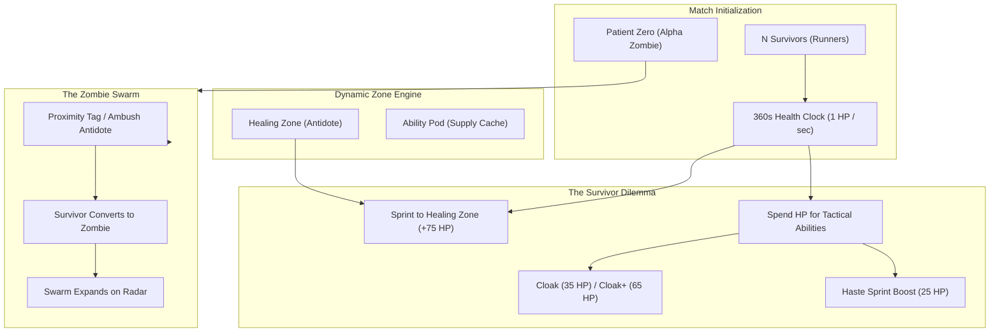
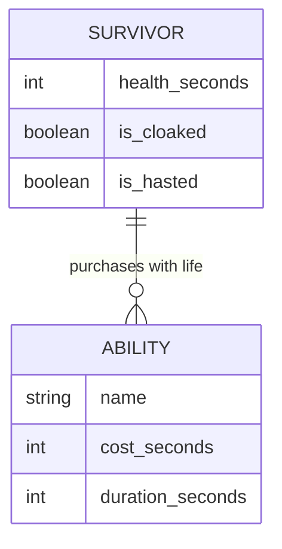
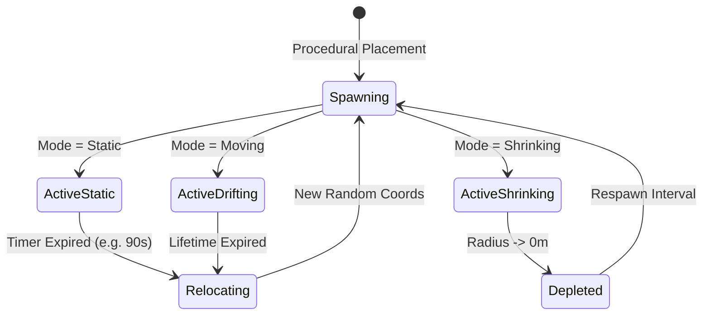

# GhostRun v3.0 Mode Specification — Outbreak Horde Mode ("Zombies / Infection Swarm")

**Document Version:** 1.0.0  
**Target Milestone:** GhostRun v3.0 Flagship  
**Status:** Approved for Implementation  
**Architecture Pillar:** Pillar 3 (Horde Infection Engine)  
**Companion Documents:** [`docs/V3_BRAINSTORMING.md`](../V3_BRAINSTORMING.md), [`docs/specs/FL-P0.md`](FL-P0.md)

---

## 1. Executive Summary & Narrative Context

Outbreak Horde Mode transforms real-world outdoor stealth into an adrenaline-fueled urban survival thriller. Inspired by field-proven mechanics from PlayCulture ("Zombies") and SCRAM, Outbreak combines **asymmetric swarm infection** with **a ticking biological health clock (health-as-time)**, **tactical ability purchases (time-as-currency)**, and **dynamically shifting, shrinking, and drifting supply zones**.

> [!IMPORTANT]
> **Strictly Real-World PvP (Human vs Human) — Zero AI Bots:**
> Outbreak Horde Mode is 100% human-driven multiplayer infection tag (1 real human Patient Zero vs N real human Survivors). There are **no AI bots, no simulated NPC zombies, and no automated bot pathfinding**. Every zombie chasing you is a real friend running in the physical world with their phone. The legacy concept of "co-op vs AI simulated horde" has been completely removed from v3 scope and deferred to future post-v3 backlog.



---

## 2. Core Game Rules & The Swarm Ratio

### 2.1 Starting Team Distribution
- **The Alpha Zombie (Patient Zero):** 1 real human player randomly selected (or host-designated) as the initial Alpha Zombie.
- **The Survivors:** All remaining players ($N-1$, scalable from 3 up to 50+ participants) start as uninfected Survivors.
- **Pure Physical PvP (No Bots):** Both Patient Zero and all converted Zombies are live human players. GhostRun relies entirely on real-world human foot pursuit; no virtual NPC bot zombies exist in this mode.
- **Head Start Phase:** Survivors receive a 60–90 second head start to scatter into the arena before Patient Zero is released into the grid.

### 2.2 Asymmetric Victory Conditions
- **Zombies Win:** If all Survivors are successfully infected or succumb to biological decay before the match countdown reaches 00:00.
- **Survivors Win:** Any surviving Runner who outlasts the match duration is extracted and crowned **Lone Survivor**. If multiple Survivors remain alive when the timer expires, all surviving operatives share extraction victory.

---

## 3. The Ticking Infection Health Pool (Health-As-Time)

### 3.1 The Bio-Lifespan Clock
Unlike traditional tag games where runners can camp motionless in hiding spots, Outbreak forces constant tactical movement through a biological health countdown:
- **Starting Health Pool:** Each Survivor begins with **300 to 360 HP** (exactly 5 to 6 minutes of unassisted survival).
- **Constant Biological Decay:** Health continuously depletes at a steady rate of **-1 HP per second**:
  $$\text{HP}(t) = \text{HP}_0 - \int_{0}^{t} \lambda \, dt \quad (\text{where } \lambda = 1.0\text{ HP/s})$$
- **Terminal Infection Threshold:** If a Survivor's HP drops to 0, they immediately succumb to the virus and convert into a Zombie, regardless of physical distance from other players.

### 3.2 Antidote / Healing Zones (Decontamination Stations)
To stay alive, Survivors must navigate to active **Healing Zones** plotted dynamically across the map:
- **Replenishment Payload:** Stepping inside an active Healing Zone geofence injects **+50 to +75 HP** (restoring 50–75 seconds of life and bio-currency).
- **Cooldown & Depletion:** A Healing Zone has a maximum capacity (e.g., 3 heals total) or a cooldown period (30s per player) to prevent camping.
- **Sensory Decontamination:** Entering the station triggers a soothing medical tone in the player's earbuds and flashes a calm emerald green HUD aura (`#10B981`).

---

## 4. Health As Currency (The Tactical Ability Economy)

In Outbreak Mode, health is not merely a survival gauge—it is also the player's **tactical currency**. Survivors can burn their remaining life seconds to purchase high-leverage defensive countermeasures:



### 4.1 Available Abilities

| Ability | Cost | Duration | Tactical Effect |
| :--- | :--- | :--- | :--- |
| **Cloak** | **35 HP** (35s) | 20s | Completely erases the Survivor from Zombie radar and proximity heatmaps. |
| **Cloak+** | **65 HP** (65s) | 30s | Full radar invisibility + suppresses zombie proximity audio warnings and infection alerts. |
| **Haste** | **25 HP** (25s) | 15s | Grants a high-speed sprint indicator, reduces stamina strain, and extends the physical tag evasion buffer by $+50\%$. |
| **Decoy Ping** | **20 HP** (20s) | Instant | Emits a false Survivor radar ping 80 meters away in a chosen quadrant, diverting nearby Zombie pursuit vectors. |

### 4.2 The Psychological Dilemma
This mechanic introduces intense psychological risk/reward calculations during active chases:
- *Scenario:* A Survivor with 120 HP hears a Zombie approaching within 30 meters.
- *Choice A (Risk It):* Save the 35 HP, run through alleys, risk being tagged and infected.
- *Choice B (Spend Life):* Activate **Cloak** for 35 HP. The player drops to 85 HP (under 1.5 minutes to live!), vanishes from radar, and escapes—but now *must* sprint toward an Antidote station immediately before their timer expires.

---

## 5. The Dynamic Procedural Zone Engine

Zones in Outbreak are not static map landmarks. They are procedural entities managed by the server and client physics engine.

### 5.1 Zone Types
1. **Healing / Antidote Stations (Green Reticle `#10B981`):**
   - Restores $+50\text{ to }+75\text{ HP}$.
   - Diameter: $15\text{m} - 25\text{m}$.
2. **Tactical Drop Pods (Cyan `#00F0FF` / Amber `#F59E0B`):**
   - Ability supply caches where Survivors can purchase tactical upgrades or collect free tactical charges.
   - Diameter: $10\text{m} - 15\text{m}$.

### 5.2 Zone Lifecycles & Dynamic Physics (Host Configurable)



1. **Static Timed Nodes:**
   - Spawns at a random walkable location within the arena perimeter.
   - Active for $T$ seconds (default: 90s). A radial countdown timer ticks on the radar. When $T=0$, the node dissolves and respawns in a new quadrant.
2. **Shrinking Geofence Nodes:**
   - Spawns with an initial radius of $35\text{m}$.
   - The boundary ring continuously contracts at a constant rate (e.g., $-0.3\text{ m/s}$) until it reaches $0\text{m}$ and vanishes. Players must sprint inside before the perimeter closes.
3. **Dynamic Drifting Nodes (Gliding Zones):**
   - The zone centroid moves smoothly across the terrain at pedestrian speeds ($0.6 - 1.2\text{ m/s}$).
   - Boundary Collision: When the drifting centroid touches the arena perimeter boundary, it reflects inward using vector raycasting:
     $$\vec{v}_{\text{reflected}} = \vec{v} - 2(\vec{v} \cdot \hat{n})\hat{n}$$
4. **Shrinking & Drifting Hybrid:**
   - The zone glides across streets while simultaneously shrinking down to 0, providing the ultimate dynamic objective capture challenge.

---

## 6. Asymmetric Roles & Zombie Counterplay

### 6.1 Survivor Dynamics
- **Anti-Camping Guarantee:** Survivors can never camp in one room or behind one bush; their biological timer forces them to traverse the park toward the next Antidote drop.
- **Teammate Beacon Telemetry:** Survivors can see allied teammates as blue reticle cards with distance readouts, allowing them to coordinate multi-runner escorts to supply pods.

### 6.2 Zombie (Hunter) Dynamics
- **Antidote Ambush Strategy:**
  - Because Zombies can see active Healing Zones on their radar, intelligent Zombie packs will not blindly chase random runners—they will set up perimeter ambushes around the nearest Antidote stations, cutting off dying Survivors in desperate sprints for health.
- **Scent Trails & Distress Telemetry:**
  - When a Survivor's HP drops below **60 seconds**, they begin coughing / emitting biological distress signals.
  - On the Zombie radar, faint pulsating orange ripples appear along the Survivor's relative bearing, giving Zombies a sensory tracking edge over weakened prey.
- **Infection Tag Registration:**
  - Standard GPS proximity tag ($\le 12\text{m}$) or optical QR code scan for high-interference urban corridors.

---

## 7. Radar HUD & Visual Integration

Outbreak Mode integrates natively with the **PlayCulture-style dynamic radar canvas** and 2D vector street map:

```
┌──────────────────────────────────────────────────────────┐
│  [☣ OUTBREAK HORDE]    [❤ 245s BIO-LIFE]    [03m REMAIN] │
├──────────────────────────────────────────────────────────┤
│                                                          │
│                      [ ☠ 120m ]                          │
│                   (Red Threat Arc)                       │
│                                                          │
│                                                          │
│            (( (   [ • YOU ]   ) ))                       │
│             Forward Sonar Ripples                        │
│                                                          │
│     [ ⌖ 45m ]                                            │
│   (Danger Halo)                                          │
│                                 [ ✚ ANTIDOTE 85m ]       │
│                               (Green Pulsing Ring)       │
│                                                          │
├──────────────────────────────────────────────────────────┤
│  [ CLOAK -35s ]       [ HASTE -25s ]      [ DECOY -20s ] │
└──────────────────────────────────────────────────────────┘
```

1. **Center Operative:** Purple dot with forward teal sonar ripples and a top-level bio-life gauge bar (`245s / 360s`).
2. **Threat Sector Arcs:** Approaching Zombies cast curved red wavefront arcs (`#FF2A55`) along their relative bearing.
3. **Contact Badges:** Vertical reticle cards showing exact distance (`45m`, `120m`).
4. **Healing Zone Badges:** Concentric pulsing green reticles (`#10B981`) with vector distance lines.
5. **Quick Ability Drawer:** Bottom persistent dock with 1-tap ability triggers displaying health cost (`CLOAK -35s`, `HASTE -25s`).

---

## 8. Host Configuration & Rule Presets

Hosts can select from three balanced presets or customize sliders in the Host Wizard:

| Parameter | Casual Outbreak | Standard Survival | Extreme Pandemic |
| :--- | :--- | :--- | :--- |
| **Initial Health** | 420s (7 min) | 360s (6 min) | 240s (4 min) |
| **Health Decay Rate** | 1.0 HP / s | 1.0 HP / s | 1.2 HP / s |
| **Antidote Boost** | $+80\text{ HP}$ | $+65\text{ HP}$ | $+45\text{ HP}$ |
| **Zone Lifecycle** | Static Timed (120s) | Shrinking (60s) | Drifting & Shrinking |
| **Drift Velocity** | $0.0\text{ m/s}$ | $0.6\text{ m/s}$ | $1.2\text{ m/s}$ |
| **Cloak Cost / Duration** | $25\text{s} \rightarrow 25\text{s}$ | $35\text{s} \rightarrow 20\text{s}$ | $45\text{s} \rightarrow 15\text{s}$ |
| **Distress Ping Threshold**| $\le 30\text{s}$ | $\le 60\text{s}$ | $\le 90\text{s}$ |

---

## 9. Technical Architecture & Data Model

### 9.1 TypeScript Data Schemas

```typescript
export type ZoneType = 'antidote' | 'drop_pod' | 'safe_zone';
export type ZoneLifecycle = 'static' | 'shrinking' | 'drifting' | 'shrinking_drifting';

export interface DynamicZone {
  id: string;
  type: ZoneType;
  lifecycle: ZoneLifecycle;
  latitude: number;
  longitude: number;
  radius_m: number;
  initial_radius_m: number;
  created_at: string;
  expires_at: string;
  remaining_charges: number;
  velocity_mps?: { vx: number; vy: number };
}

export interface OutbreakPlayerState {
  player_id: string;
  team: 'runner' | 'zombie';
  bio_health_seconds: number;
  max_health_seconds: number;
  is_cloaked: boolean;
  cloak_expires_at: string | null;
  is_hasted: boolean;
  haste_expires_at: string | null;
  infections_caused: number;
  antidotes_collected: number;
}

export interface OutbreakGameState {
  game_id: string;
  mode: 'outbreak_horde';
  phase: 'head_start' | 'active_hunt' | 'complete';
  time_remaining_seconds: number;
  active_zones: DynamicZone[];
  players: Record<string, OutbreakPlayerState>;
}
```

### 9.2 Supabase Realtime Channels & RPCs
- **`rpc_activate_ability(p_game_id, p_ability_type)`:** Validates player's current `bio_health_seconds >= cost`, deducts health, applies ability timestamp, and returns updated state.
- **`rpc_claim_antidote(p_game_id, p_zone_id)`:** Performs spatial distance check (`ST_DWithin <= zone.radius_m`), increments player's health by payload, decrements zone charges, and broadcasts `zone_depleted` if charges hit 0.
- **`rpc_infect_runner(p_game_id, p_runner_id, p_zombie_id)`:** Atomically flips runner to zombie team, resets health to infinite/zombie mode, triggers swarm audio broadcast, and evaluates whether remaining survivors == 0.

---

## 10. Implementation Plan & Milestones

1. **Phase 1: State Machine & Timers:** Implement `bio_health_seconds` decay loop and ability purchase RPCs.
2. **Phase 2: Procedural Zone Engine:** Implement dynamic zone generation, shrinking radius math, and 2D drift physics loop.
3. **Phase 3: Tactical HUD Integration:** Wire Antidote reticles and quick-ability drawer into `TacticalRadarCanvas` and `MapView`.
4. **Phase 4: Field Testing & Calibration:** Run multi-player playtests to balance health decay rates against park traversal speeds.
