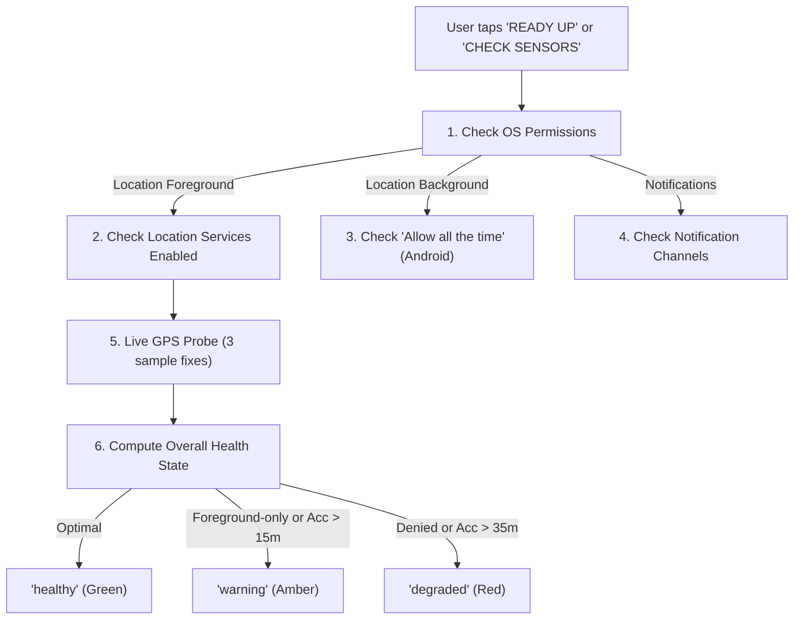

# GhostRun — Specification: Pre-Game Ready Check & Tracking Health (NF-04)

> **Status:** Proposed (Wave 1 · Task NF-04.1)  
> **Companions:** `docs/WAVES.md`, `docs/NEW_FEATURES.md §4 (NF-04)`, `docs/DECISIONS.md`, `docs/TRD.md`

---

## 1. Executive Summary

Outdoor real-world GPS evasion games frequently fail due to client device configuration issues:
- Background location set to "While using the app" rather than "Allow all the time".
- OS battery-saver killing background tasks.
- Degraded GPS accuracy indoors or under dense canopy.
- Location services disabled at the OS level.
- Swiping away the app from the recent apps switcher.

Today, players tap "READY UP" in `app/lobby/[id].tsx` without a verification pass. If a runner has degraded tracking, the game starts, pings fail to release, or the runner drops offline immediately.

**NF-04 (Pre-Game Ready Check)** introduces:
1. An on-demand and pre-ready **Tracking Health Diagnostic Sheet** in the lobby.
2. Direct system settings deep links (`Linking.openSettings()`) to resolve permission and battery-optimization issues.
3. A live 3-fix GPS accuracy probe before readiness confirmation.
4. An aggregate, privacy-preserving readiness dot (`healthy` | `warning` | `degraded`) visible to lobby members and the host so the host knows whether the squad is physically ready to deploy.

---

## 2. Privacy & Safety Review

| Question | Assessment |
|---|---|
| **What new data is collected?** | A single coarse state enum: `'healthy' \| 'warning' \| 'degraded'`. |
| **Are coordinates or battery metrics sent?** | **NO.** GPS fixes and accuracy numbers remain purely local in client memory. Device models, battery levels, and sensor readings are **never transmitted**. |
| **Who can see the status?** | Only members of the same lobby while the match is in the `lobby` phase. |
| **How long is it kept?** | Transient column on `public.players`. Cascades on game deletion; wiped on 30-day retention or `delete_my_data()`. |
| **Abuse potential?** | Low. Host could kick a degraded player, but this protects against failed matches. No harassment vector. |

---

## 3. Architecture & Health Matrix

### 3.1 Diagnostic Checklist



### 3.2 Evaluation Criteria

| Diagnostic Item | Optimal (`healthy`) | Marginal (`warning`) | Degraded (`degraded`) |
|---|---|---|---|
| **Foreground Location** | Granted (`fine`) | Granted (`coarse`) | Denied |
| **Background Location** | Granted (`all the time`) | Granted (`while in use`) | Denied |
| **Hardware Location Services** | Enabled | — | Disabled (GPS off) |
| **GPS Accuracy Probe** | $\le 15\text{ m}$ within 5 s | $15\text{ m} < \text{acc} \le 35\text{ m}$ | $> 35\text{ m}$ or probe timeout |
| **Notification Permission** | Granted | Denied (warning only) | — |
| **Network Connectivity** | Active (latency $< 500\text{ ms}$) | High latency ($> 500\text{ ms}$) | Offline |

---

## 4. Server Schema & RPCs

### 4.1 Database Migration (`supabase/migrations/`)
Add `tracking_health` column to `public.players`:

```sql
-- Feature Flag in public.app_settings
INSERT INTO public.app_settings (key, value)
VALUES ('feature.ready_check', 'false'::jsonb)
ON CONFLICT (key) DO NOTHING;

-- Tracking health state enum on players
ALTER TABLE public.players
  ADD COLUMN IF NOT EXISTS tracking_health text NOT NULL DEFAULT 'unknown'
  CHECK (tracking_health IN ('healthy', 'warning', 'degraded', 'unknown'));
```

### 4.2 Security Definer RPC: `submit_tracking_health`
```sql
CREATE OR REPLACE FUNCTION public.submit_tracking_health(
  game_id uuid,
  health text
)
RETURNS jsonb
LANGUAGE plpgsql
SECURITY DEFINER
SET search_path = public, extensions
AS $$
DECLARE
  caller_id uuid := auth.uid();
  game_rec record;
  player_rec record;
BEGIN
  IF caller_id IS NULL THEN
    RAISE EXCEPTION 'Not authenticated';
  END IF;

  IF health NOT IN ('healthy', 'warning', 'degraded') THEN
    RAISE EXCEPTION 'Invalid health state: %', health;
  END IF;

  SELECT status INTO game_rec FROM public.games WHERE id = game_id;
  IF NOT FOUND THEN
    RAISE EXCEPTION 'Game not found';
  END IF;

  IF game_rec.status != 'lobby' THEN
    RAISE EXCEPTION 'Tracking health can only be updated in lobby';
  END IF;

  SELECT id INTO player_rec FROM public.players
  WHERE game_id = submit_tracking_health.game_id AND user_id = caller_id;
  
  IF NOT FOUND THEN
    RAISE EXCEPTION 'Player not in game';
  END IF;

  UPDATE public.players
  SET tracking_health = submit_tracking_health.health
  WHERE id = player_rec.id;

  RETURN jsonb_build_object(
    'success', true,
    'tracking_health', health
  );
END;
$$;
```

---

## 5. Client UI & Interaction Design

### 5.1 Lobby Integration (`app/lobby/[id].tsx`)
1. **Lobby Roster**:
   - Each player row displays an accessible health dot next to their name:
     - 🟢 Green dot (`#3DFFA2`): Verified tracking health.
     - 🟡 Amber dot (`#FFB800`): Acceptable with warnings (e.g., foreground-only).
     - 🔴 Red dot (`#FF3B30`): Hardware/permission issues detected.
   - Accessible label: `accessibilityLabel="Tracking health: healthy"` etc.

2. **Ready-Up Intercept**:
   - When a player taps `READY UP`:
     - If local tracking health has not been verified, or is in `degraded` state, the **Ready Check Sheet** opens automatically.
     - If health is `warning`, the sheet highlights the warning (e.g. "Screen must stay on: background permission not granted") with an explicit "READY UP ANYWAY" button.
     - If health is `healthy`, `set_ready` proceeds immediately.

3. **Sensor Check Trigger**:
   - A dedicated button in the lobby header/action row: `"CHECK SENSORS"` allowing manual re-test at any time.

### 5.2 Ready Check Sheet Component (`src/components/ReadyCheckModal.tsx`)
- Card-based layout adhering to the *Afterimage* design system.
- Displays individual checklist rows with real-time status icons (check, alert, cross).
- **"Fix in Settings"** button calling `Linking.openSettings()`.
- **"Retest GPS"** button to restart the 3-fix probe.
- Clear instruction: *"Keep GhostRun open in the foreground or exempt it from battery optimization to prevent GPS freezes."*

---

## 6. String Centralization (i18n-Ready)

All user-facing copy organized in a single dictionary:
```typescript
export const READY_CHECK_STRINGS = {
  sheetTitle: 'TRACKING HEALTH CHECK',
  sheetSubtitle: 'Verify your phone sensors before deploying into the field.',
  statusHealthy: 'OPTIMAL SENSORS',
  statusWarning: 'DEGRADED ACCURACY',
  statusBlocked: 'TRACKING BLOCKED',
  locForeground: 'Location Permission',
  locBackground: 'Background Tracking ("Allow all the time")',
  locGpsHardware: 'Device GPS Hardware',
  locAccuracy: 'GPS Signal Accuracy',
  batteryOpt: 'Battery Optimization',
  notifications: 'Match Alerts & Comms',
  networkLatency: 'Signal Connection',
  actionFix: 'OPEN SETTINGS',
  actionRetest: 'RE-TEST GPS',
  actionReadyAnyway: 'PROCEED WITH WARNING',
  actionDeploy: 'CONFIRM & READY UP',
  keepOpenHint: 'Do not swipe GhostRun from your recent apps list during match play.',
} as const;
```

---

## 7. Test Plan & Acceptance Criteria

### 7.1 Automated Agent Tests
1. **TypeScript Typecheck**: Clean compile with zero errors (`npx tsc --noEmit`).
2. **Snapshot & Integration Tests**:
   - Unit test for health evaluator (`src/lib/__tests__/readyCheck.test.ts`):
     - All optimal inputs evaluate to `healthy`.
     - Coarse location or foreground-only evaluates to `warning`.
     - Denied location evaluates to `degraded`.
     - Timeout in accuracy probe evaluates to `warning` or `degraded`.
3. **RPC & RLS Simulation (`scripts/rls-check.ts`)**:
   - Host and runner can call `submit_tracking_health` in lobby.
   - Caller cannot update another player's `tracking_health`.
   - Out-of-lobby (e.g. `live`) calls are rejected.
   - Outsider cannot submit or read.

### 7.2 Physical Playtest Checklist (`docs/PHYSICAL_CHECKLIST.md`)
- [ ] Verify `Linking.openSettings()` navigates directly to GhostRun application details on physical Android test device.
- [ ] Verify accuracy probe acquires 3 valid fixes outdoors within 5 seconds.
- [ ] Verify background permission alert renders correctly on Android 11+ devices.
