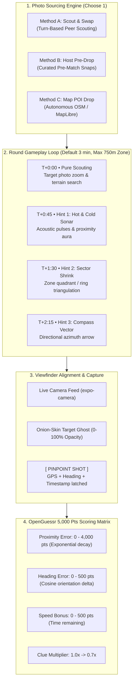

# GhostRun v3.0 Mode Specification — PINPOINT ("IRL OpenGuessr")

**Document Version:** 1.0.0  
**Target Milestone:** GhostRun v3.0 Flagship  
**Status:** Approved for Implementation  
**Architecture Pillar:** Pillar 6 (Geospatial Scavenger & Vision Engine)  
**Companion Documents:** [`docs/V3_BRAINSTORMING.md`](../V3_BRAINSTORMING.md), [`docs/MODES.md`](../MODES.md), [`docs/specs/HORDE_OUTBREAK_MODE_SPEC.md`](HORDE_OUTBREAK_MODE_SPEC.md)

---

## 1. Executive Summary & Narrative Context

**PINPOINT** is GhostRun's real-world geospatial scavenger hunt mode, bringing the viral deduction mechanics of **OpenGuessr / GeoGuessr** into the physical park and urban playground. 

In traditional GhostRun modes, players run from or chase live opponents. In **PINPOINT**, the physical world itself is the puzzle. Teams (Duos, Trios, Squads, or Solo FFA) are confined to a tactical geofenced arena with a configurable radius of up to **750 meters** (~1.77 $\text{km}^2$). Each round, players are given a target photograph taken from somewhere inside the boundary. Their objective: deduce the location, navigate the terrain, match the exact camera perspective, and take the closest matching shot before the round clock expires.



---

## 2. Core Game Rules & Arena Boundaries

### 2.1 Arena Geometry & Radius Configuration
- **Max Radius Limit:** **750 meters** ($\approx 1,500\text{m}$ diameter, $1.77\text{ km}^2$ play area).
- **Customizable Host Presets:**
  - **Micro / Sprint (150m – 250m):** High-density campus courtyards, shopping plazas, small parks (2-minute rapid rounds).
  - **Standard Grid (350m – 500m):** Medium city parks, university campuses, outdoor recreational centers (3–4 minute rounds).
  - **Expedition Grid (600m – 750m):** Expansive regional parks, botanical gardens, large academic campuses (4–5 minute rounds).
- **Out-of-Bounds Enforcement:** Players crossing the boundary receive a harsh amber HUD warning and haptic alert. Submissions outside the geofence boundary are automatically rejected by server-side PostGIS verification.

### 2.2 Team Formats & Player Scalability
PINPOINT supports flexible cooperative and competitive team structures:
- **Duos (2v2, 2v2v2):** Teams of 2. Partners can split up to search diverging pathways or sweep together.
- **Trios & Squads (3v3, 4v4):** Teams of 3 or 4. Enables strategic scout deployment across different quadrants of the 750m zone.
- **Multi-Team Battle Royale (up to 8 teams):** Multiple 2-player or 3-player squads racing on the same live leaderboard.
- **Solo Free-For-All (FFA, 2 to 12 players):** Every operative for themselves.

### 2.3 Match Structure & Victory
- **Standard Match:** Best of 3 or 5 rounds.
- **Round Duration:** Configurable 2:00 to 5:00 minutes (default: 3:00).
- **Victory Condition:** The team or solo player with the highest cumulative score across all rounds wins. In "First to 15,000" tournament rules, the first team to cross the threshold takes the trophy.

---

## 3. Photo Sourcing Engine (The 3 Methods)

PINPOINT provides three distinct photo generation pipelines to accommodate spontaneous park visits, curated competitive events, and zero-prep pickup games:

```
┌─────────────────────────────────────────────────────────────────────────────┐
│                       PINPOINT PHOTO SOURCING MODES                         │
├───────────────────────┬─────────────────────────────┬───────────────────────┤
│   Method A:           │   Method B:                 │   Method C:           │
│   Scout & Swap        │   Host Pre-Drop             │   Map POI Auto-Drop   │
├───────────────────────┼─────────────────────────────┼───────────────────────┤
│ • Turn-based peer     │ • Host prepares 3-5 drops   │ • Autonomous OSM      │
│   scouting            │   prior to lobby start      │   feature ingestion   │
│ • Team A snaps for    │ • Host walks or picks       │ • Zero prep required  │
│   Team B, and vice    │   verified local landmarks  │ • Instant pickup play │
│   versa               │ • Shared target for all     │   anywhere in world   │
│ • High social rivalry │ • Ideal for organized events│ • Great for new parks │
└───────────────────────┴─────────────────────────────┴───────────────────────┘
```

### 3.1 Method A: Scout & Swap (Turn-Based Peer Scouting)
- **Concept:** Teams become each other's puzzle masters.
- **Two-Phase Round Flow:**
  1. **Phase 1: The Scout Phase (1:30 - 2:00 min):**
     - Both teams scatter inside the 750m zone to find a clever, deceptive, or scenic landmark (e.g., a quirky statue, unusual brick pattern, distinctive tree trunk, or building alcove).
     - The team snaps their target photo using the in-app camera. GhostRun immediately latches the exact GPS coordinates ($Lat, Lng$) and true-north compass heading ($\theta$) into the database.
  2. **Phase 2: The Hunt Phase (3:00 min):**
     - Target photos are swapped across teams: Team A receives Team B's target photo, while Team B receives Team A's target photo.
     - Both teams race across the arena to hunt down the physical location and submit their matching shot.
- **Rivalry Dynamic:** Teams compete not only on navigation speed, but also on scouting creativity (snapping deceptive angles that look like multiple spots in the park).

### 3.2 Method B: Host Pre-Drop (Curated Event Mode)
- **Concept:** Designed for game masters, meetup organizers, and campus clubs.
- **Pre-Game Drop Flow:**
  - In the host lobby, the Host enters "Drop Setup".
  - The Host walks the boundary (or taps verified coordinates from recent matches) and captures 3 to 5 target photos with latched coordinates and headings.
  - Photos are stored in the match lobby manifest.
- **Symmetric Competition:** All teams receive the **exact same target photo simultaneously** at the start of each round, creating a direct physical race across the park to the exact same landmark.

### 3.3 Method C: Map POI Auto-Drop (Autonomous Map Engine)
- **Concept:** Zero setup required. Playable anywhere in the world instantly.
- **Engine Logic:**
  - GhostRun queries OpenStreetMap (via Overpass API / MapLibre vector tiles) within the defined radius (up to 750m) for verified outdoor features:
    - `historic=*` (monuments, memorial plaques, archaeological stones)
    - `leisure=*` (gazebos, sports pavilions, picnic shelters, bandstands)
    - `tourism=*` (sculptures, viewpoints, artwork)
    - `amenity=*` (fountains, historic clock towers)
    - `bridge=*` (pedestrian footbridges, footpaths)
  - The POI's coordinates serve as the target drop. GhostRun generates a high-contrast satellite aerial preview or MapLibre 3D isometric vector rendering as the visual clue.
  - Operatives must identify the structural layout from the aerial/vector profile and locate the real physical landmark.

---

## 4. Progressive Clue Engine (Dynamic Hot/Cold & Triangulation)

In a 750m radius zone, searching blind for a micro-landmark could lead to dead ends. PINPOINT features an automatic **Progressive Clue Timeline** that provides escalating sensory hints:

```
T+0:00                     T+0:45                     T+1:30                     T+2:15             T+3:00
  │                          │                          │                          │                  │
  ▼                          ▼                          ▼                          ▼                  ▼
┌──────────────────────────┬──────────────────────────┬──────────────────────────┬──────────────────┐
│   PHASE 0: PURE SIGHT    │  HINT 1: HOT & COLD      │  HINT 2: SECTOR SHRINK   │  HINT 3: BEARING │
│ • Target photo only      │ • Acoustic sonar pulses  │ • Quadrant highlight     │ • Azimuth arrow  │
│ • Full score multiplier  │ • Edge screen glow aura  │ • Zone ring shrink (250m)│ • Direct vector  │
│ • Max Multiplier: 1.0x   │ • Multiplier: 0.9x       │ • Multiplier: 0.8x       │ • Multiplier:0.7x│
└──────────────────────────┴──────────────────────────┴──────────────────────────┴──────────────────┘
```

### 4.1 Phase 0: Pure Sight (T+0:00 to T+0:45)
- Operatives have only the target photo with full pan and pinch-to-zoom capabilities.
- Operatives inspect background details (sun angle, shadows, foliage type, architectural trim).
- Finding and submitting the target during this window awards the **maximum $1.0\times$ score multiplier**.

### 4.2 Hint 1: Hot & Cold Radar Sonar (Unlocks at T+0:45)
- **Integration with `src/modes/hot_cold.ts`:** PINPOINT reuses GhostRun's battle-tested acoustic hot/cold engine.
- **Sensory Feedback:**
  - **Acoustic Loudspeaker Ping:** Rhythmic sonar pulse through the phone loudspeaker that increases in frequency as the operative gets closer:
    - $>300\text{m}$: Slow sub-bass pulse every 4.0 seconds (*"Freezing"*).
    - $150\text{m} - 300\text{m}$: Moderate sonar ping every 2.5 seconds (*"Cold"*).
    - $50\text{m} - 150\text{m}$: Fast melodic chirp every 1.2 seconds (*"Warm"*).
    - $15\text{m} - 50\text{m}$: Rapid double-chirp every 0.6 seconds (*"Hot"*).
    - $<15\text{m}$: High-frequency resonance chime (*"Boiling"*).
  - **Visual Ambient Aura:** Soft color pulse along screen edges (Frost Blue `#38BDF8` $\rightarrow$ Amber `#F59E0B` $\rightarrow$ Plasma Red `#EF4444`).
- **Scoring Multiplier:** $0.9\times$.

### 4.3 Hint 2: Sector Triangulation & Quadrant Shrink (Unlocks at T+1:30)
- The 750m arena boundary is visually quartered on the tactical minimap into 4 quadrants (NW, NE, SW, SE).
- The target quadrant is highlighted with an emerald pulse, or the search ring dynamically shrinks to a $250\text{m}$ radius circle centered around the landmark.
- Eliminates 75% of dead ground so operatives can focus their sprint on the correct sector.
- **Scoring Multiplier:** $0.8\times$.

### 4.4 Hint 3: Heading Vector & Compass Azimuth (Unlocks at T+2:15)
- An amber directional vector line and compass reticle unlock on the HUD.
- The arrow points along the direct azimuth toward the target coordinate.
- Ensures no match ends in frustration, giving every player a dramatic final 45-second sprint to reach the target before the buzzer.
- **Scoring Multiplier:** $0.7\times$.

---

## 5. Viewfinder & Camera Perspective Matching

The camera interface is powered by `expo-camera`, featuring GhostRun's custom **Onion-Skin Viewfinder**:

```
┌──────────────────────────────────────────────────┐
│ [PINPOINT] ROUND 2/3                  ⏱️ 01:24   │
├──────────────────────────────────────────────────┤
│                                                  │
│         LIVE CAMERA FEED                         │
│         (Real-world park fountain)               │
│                                                  │
│              ┌ - - - - - - - - - - ┐             │
│              ┆   SEMI-TRANSPARENT  ┆             │
│              ┆   TARGET PHOTO      ┆             │
│              ┆   (GHOST OVERLAY)   ┆             │
│              └ - - - - - - - - - - ┘             │
│                                                  │
│                                                  │
├──────────────────────────────────────────────────┤
│ GHOST OPACITY: ━━━●────────────── 45%            │
│ COMPASS: 184° S  •  GPS ACCURACY: ±2.8m          │
├──────────────────────────────────────────────────┤
│               [ 📸 PINPOINT SHOT ]               │
└──────────────────────────────────────────────────┘
```

### 5.1 Onion-Skin Target Ghost Overlay
- **Layering:** The target photo is rendered as a semi-transparent layer directly over the live CameraView.
- **Opacity Slider:** A continuous horizontal slider (or toggle buttons: 25%, 50%, 75%, 100%) allows players to adjust transparency to perfectly align edges, horizons, tree branches, or pillar columns.
- **Aspect Ratio Lock:** The overlay preserves the target photo's exact aspect ratio and field of view.

### 5.2 Sensor Data Latch
The instant the operative taps **`[ 📸 PINPOINT SHOT ]`**, the client captures:
1. **Compressed JPEG Snapshot:** Stored in app memory and asynchronously uploaded to Supabase Storage bucket `pinpoint-submissions`.
2. **High-Precision GPS Coordinate:** Latitude and Longitude with horizontal accuracy buffer ($\le 5\text{m}$ preferred).
3. **Compass Azimuth Heading:** True-North heading in degrees ($0.0^\circ - 359.9^\circ$) from `expo-location` Magnetometer/Compass watcher.
4. **Timestamp & Elapsed Seconds:** For speed bonus calculations.

---

## 6. The 5,000 Points Scoring Matrix (OpenGuessr Standard)

PINPOINT adopts the globally recognized **5,000 points per round** scoring standard, split across distance accuracy, camera orientation, and time efficiency:

$$\text{Round Score} = \Big( S_{\text{proximity}} + S_{\text{heading}} + S_{\text{speed}} \Big) \times M_{\text{clue}}$$

| Scoring Component | Point Range | Weight | Mathematical Formula |
|---|:---:|:---:|---|
| **GPS Proximity ($S_{\text{prox}}$)** | 0 – 4,000 pts | 80% | $4000 \cdot \exp\left(-\frac{\Delta d}{k}\right)$ |
| **Heading Alignment ($S_{\text{heading}}$)** | 0 – 500 pts | 10% | $500 \cdot \max\left(0, \cos(\Delta \theta_{\text{rad}})\right)$ |
| **Speed Bonus ($S_{\text{speed}}$)** | 0 – 500 pts | 10% | $500 \cdot \max\left(0, 1 - \frac{t_{\text{elapsed}}}{t_{\text{round}}}\right)$ |
| **Clue Multiplier ($M_{\text{clue}}$)** | $0.7\times - 1.0\times$ | Multiplier | $1.0\times$ (No clues) $\rightarrow 0.9\times \rightarrow 0.8\times \rightarrow 0.7\times$ |
| **Max Possible Round Score** | **5,000 pts** | 100% | Bullseye ($\le 3\text{m}$), aligned angle ($<10^\circ$), instant speed |

### 6.1 Proximity Decay Curve ($S_{\text{prox}}$)
For a 750m zone, decay scale factor $k \approx 100$:
- $\Delta d \le 3\text{m}$ (Bullseye): **4,000 pts**
- $\Delta d = 10\text{m}$: **3,620 pts**
- $\Delta d = 25\text{m}$: **3,115 pts**
- $\Delta d = 50\text{m}$: **2,425 pts**
- $\Delta d = 100\text{m}$: **1,470 pts**
- $\Delta d = 200\text{m}$: **540 pts**
- $\Delta d \ge 400\text{m}$: **0 pts**

### 6.2 Heading Alignment Curve ($S_{\text{heading}}$)
Calculated using normalized angular difference $\Delta \theta = \min(|\theta_1 - \theta_2|, 360^\circ - |\theta_1 - \theta_2|)$:
- $\Delta \theta < 10^\circ$ (Exact angle): **500 pts**
- $\Delta \theta = 30^\circ$: **433 pts**
- $\Delta \theta = 60^\circ$: **250 pts**
- $\Delta \theta \ge 90^\circ$ (Facing wrong direction): **0 pts**

---

## 7. Technical Architecture & Database Schema

### 7.1 Database Tables (Supabase / PostgreSQL)

```sql
-- PINPOINT Match Configuration
CREATE TABLE pinpoint_games (
    id UUID PRIMARY KEY DEFAULT gen_random_uuid(),
    game_id UUID NOT NULL REFERENCES games(id) ON DELETE CASCADE,
    radius_meters INTEGER NOT NULL DEFAULT 500 CHECK (radius_meters BETWEEN 100 AND 750),
    photo_source TEXT NOT NULL CHECK (photo_source IN ('scout_and_swap', 'host_drop', 'map_poi')),
    total_rounds INTEGER NOT NULL DEFAULT 3,
    round_duration_seconds INTEGER NOT NULL DEFAULT 180,
    created_at TIMESTAMPTZ NOT NULL DEFAULT NOW()
);

-- PINPOINT Rounds Manifest
CREATE TABLE pinpoint_rounds (
    id UUID PRIMARY KEY DEFAULT gen_random_uuid(),
    pinpoint_game_id UUID NOT NULL REFERENCES pinpoint_games(id) ON DELETE CASCADE,
    round_number INTEGER NOT NULL,
    target_photo_url TEXT NOT NULL,
    target_location GEOMETRY(Point, 4326) NOT NULL,
    target_heading NUMERIC(5, 2) NOT NULL, -- 0.00 to 359.99 deg
    scouted_by_team TEXT, -- NULL for host/POI drops, 'A' or 'B' for scout_and_swap
    status TEXT NOT NULL DEFAULT 'pending' CHECK (status IN ('scouting', 'active', 'scoring', 'completed')),
    started_at TIMESTAMPTZ,
    ends_at TIMESTAMPTZ,
    created_at TIMESTAMPTZ NOT NULL DEFAULT NOW()
);

-- PINPOINT Submissions & Scoring
CREATE TABLE pinpoint_submissions (
    id UUID PRIMARY KEY DEFAULT gen_random_uuid(),
    round_id UUID NOT NULL REFERENCES pinpoint_rounds(id) ON DELETE CASCADE,
    player_id UUID NOT NULL REFERENCES profiles(id) ON DELETE CASCADE,
    team TEXT NOT NULL,
    submission_photo_url TEXT,
    submission_location GEOMETRY(Point, 4326) NOT NULL,
    submission_heading NUMERIC(5, 2) NOT NULL,
    distance_error_meters NUMERIC(7, 2) NOT NULL,
    heading_error_degrees NUMERIC(5, 2) NOT NULL,
    score_proximity INTEGER NOT NULL DEFAULT 0,
    score_heading INTEGER NOT NULL DEFAULT 0,
    score_speed INTEGER NOT NULL DEFAULT 0,
    clues_unlocked INTEGER NOT NULL DEFAULT 0,
    total_score INTEGER NOT NULL DEFAULT 0,
    submitted_at TIMESTAMPTZ NOT NULL DEFAULT NOW()
);
```

### 7.2 Server-Authoritative PostGIS Scoring Function

```sql
CREATE OR REPLACE FUNCTION submit_pinpoint_shot(
    p_round_id UUID,
    p_player_id UUID,
    p_team TEXT,
    p_submission_photo_url TEXT,
    p_lat DOUBLE PRECISION,
    p_lng DOUBLE PRECISION,
    p_heading NUMERIC,
    p_clues_unlocked INTEGER
) RETURNS JSONB AS $$
DECLARE
    v_round RECORD;
    v_sub_point GEOMETRY;
    v_dist_meters NUMERIC;
    v_heading_diff NUMERIC;
    v_score_prox INTEGER;
    v_score_head INTEGER;
    v_score_speed INTEGER;
    v_multiplier NUMERIC := 1.0;
    v_total_score INTEGER;
    v_elapsed_sec NUMERIC;
    v_k_factor NUMERIC := 100.0;
BEGIN
    SELECT * INTO v_round FROM pinpoint_rounds WHERE id = p_round_id;
    IF NOT FOUND OR v_round.status != 'active' THEN
        RAISE EXCEPTION 'Round is not currently active';
    END IF;

    v_sub_point := ST_SetSRID(ST_MakePoint(p_lng, p_lat), 4326);
    v_dist_meters := ST_Distance(v_sub_point::geography, v_round.target_location::geography);

    -- Heading difference normalization
    v_heading_diff := ABS(p_heading - v_round.target_heading) % 360;
    IF v_heading_diff > 180 THEN
        v_heading_diff := 360 - v_heading_diff;
    END IF;

    -- Proximity score (0-4000)
    v_score_prox := ROUND(4000.0 * EXP(-1.0 * v_dist_meters / v_k_factor));
    IF v_dist_meters <= 3.0 THEN v_score_prox := 4000; END IF;
    IF v_dist_meters > 400.0 THEN v_score_prox := 0; END IF;

    -- Heading score (0-500)
    IF v_heading_diff < 90.0 THEN
        v_score_head := ROUND(500.0 * COS(RADIANS(v_heading_diff)));
    ELSE
        v_score_head := 0;
    END IF;

    -- Speed bonus (0-500)
    v_elapsed_sec := EXTRACT(EPOCH FROM (NOW() - v_round.started_at));
    v_score_speed := GREATEST(0, ROUND(500.0 * (1.0 - (v_elapsed_sec / 180.0))));

    -- Clue penalty
    IF p_clues_unlocked = 1 THEN v_multiplier := 0.9;
    ELSIF p_clues_unlocked = 2 THEN v_multiplier := 0.8;
    ELSIF p_clues_unlocked >= 3 THEN v_multiplier := 0.7;
    END IF;

    v_total_score := ROUND((v_score_prox + v_score_head + v_score_speed) * v_multiplier);

    INSERT INTO pinpoint_submissions (
        round_id, player_id, team, submission_photo_url, submission_location,
        submission_heading, distance_error_meters, heading_error_degrees,
        score_proximity, score_heading, score_speed, clues_unlocked, total_score
    ) VALUES (
        p_round_id, p_player_id, p_team, p_submission_photo_url, v_sub_point,
        p_heading, v_dist_meters, v_heading_diff, v_score_prox, v_score_head,
        v_score_speed, p_clues_unlocked, v_total_score
    );

    RETURN jsonb_build_object(
        'distance_error_meters', v_dist_meters,
        'heading_error_degrees', v_heading_diff,
        'score_proximity', v_score_prox,
        'score_heading', v_score_head,
        'score_speed', v_score_speed,
        'total_score', v_total_score
    );
END;
$$ LANGUAGE plpgsql SECURITY DEFINER;
```

---

## 8. Real-World Field Resilience & Edge Cases

| Edge Case | Failure Scenario | Engineered System Defense |
|---|---|---|
| **GPS Drift Near Tall Trees / Buildings** | Operative is standing at the exact tree, but GPS drifts $\pm 12\text{m}$. | Generous bullseye grace zone ($\le 5\text{m}$) where max score is awarded; compass heading weighting rewards accurate sightline alignment even when GPS is slightly noisy. |
| **Photo Upload Lag in Low Signal** | High-res camera image takes 8s to upload over 3G/LTE, missing buzzer. | The score submission payload (lat/lng, heading, timestamp) is posted immediately in a lightweight 1KB JSON RPC. The full JPEG image uploads asynchronously in the background. |
| **Boundary Violation** | Operative takes photo outside the 750m boundary. | PostGIS `ST_DWithin` geofence rejects submissions outside boundary with an immediate friendly error pill. |
| **Magnetometer Interference** | Metal handrails or belt buckles distort the compass reading by $30^\circ$. | Heading score has a wide cosine curve that does not penalize minor drift; proximity score remains the dominant factor (80% weight). |
| **Camera Permission Denial** | Player denies camera permissions on device. | Clear tactile fallback prompt with direct shortcut link to device OS app settings. |

---

## 9. Implementation Roadmap & Verification

- [ ] **Phase 1 (Database & RPC):** Run migration script adding `pinpoint_games`, `pinpoint_rounds`, and `submit_pinpoint_shot` RPC.
- [ ] **Phase 2 (Onion-Skin Viewfinder):** Build `src/components/PinpointViewfinder.tsx` using `expo-camera` with opacity slider and compass azimuth overlay.
- [ ] **Phase 3 (Clue Engine):** Connect `src/modes/hot_cold.ts` to trigger progressive radar cues at T+0:45, sector shrink at T+1:30, and azimuth vector at T+2:15.
- [ ] **Phase 4 (Sourcing UI):** Implement Step 4 Pinpoint Mode Selector with Method A (Scout & Swap), Method B (Host Pre-Drop), and Method C (Map POI Auto-Drop).
- [ ] **Phase 5 (Score Screen & Replay):** Render side-by-side photo comparison (Target vs Submission) with distance error delta ($\Delta d$), heading delta ($\Delta \theta$), and 5,000-point celebratory breakdown.
