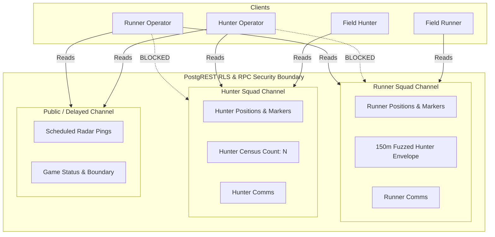

# Operator Role Add-on Specification (VM1 Verified)

> **Document Status:** Complete & Verified (`VM1: Spec check`)  
> **Target Role:** `operator` (Operator Remote Teammate Role Add-on)  
> **Compatible Base Modes:** `classic_chase`, `tag_hunt`, `jailbreak`, `relay_heist` (docs/MODES.md §2.3, §5.3)  
> **Source Specification:** [`docs/MODES.md` §5.3](file:///c:/ASK_Main/ASK/Projects/GhostRun/docs/MODES.md#L567-L584)  
> **Effort Estimate:** S–M (0.5 day for VM2 fixes)  

---

## 1. Executive Forensic Summary: Dispelling Unverified Claims

Before detailing rules and parameters, forensic audit of the codebase resolves the suspected discrepancies highlighted in the recovery protocol:

1. **"Orbital Recon":**
   - **Finding:** **DOES NOT EXIST.** The string `"orbital"` does not appear anywhere in code, migrations, schemas, or UI components.
2. **"Sensor Jammers":**
   - **Finding:** **DOES NOT EXIST FOR OPERATOR.** Operator has zero electronic warfare or jamming capabilities. Tactical items like `jam` belong exclusively to the Dead Drops modifier ([`supabase/migrations/20261102000000_v2_modifier_dead_drops.sql`](file:///c:/ASK_Main/ASK/Projects/GhostRun/supabase/migrations/20261102000000_v2_modifier_dead_drops.sql#L10-L40)), and "Radar Fog" appears solely as narrative flavor in an AI Game Master event.
3. **Satellite Imagery Source & Licence:**
   - **Finding:** **ZERO SATELLITE IMAGERY IS USED.** The entire application operates exclusively on OpenFreeMap Liberty vector map tiles (`https://tiles.openfreemap.org/styles/liberty`), established in [`docs/DECISIONS.md`](file:///c:/ASK_Main/ASK/Projects/GhostRun/docs/DECISIONS.md#L3-L9) and rendered via `@maplibre/maplibre-react-native`. OpenFreeMap serves OpenStreetMap vector tile data under the **Open Database License (ODbL)**. There is no commercial satellite feed, Google Maps Satellite SDK, Mapbox Satellite layer, or aerial imagery subscription in the project.
4. **Exact Opponent GPS Visibility:**
   - **Finding:** **ARCHITECTURALLY AND MATHEMATICALLY IMPOSSIBLE.** The Operator can never inspect or retrieve raw opponent coordinates. PostgREST RLS and `get_game_state` restrict live GPS streaming to teammates only. The Runner Operator scan produces an ephemeral 150 m circle fuzzed 10–30 m away from the nearest hunter; the Hunter Operator scan produces an aggregate integer headcount (`runner_count`) with zero coordinates, bearings, or identities.
5. **Voice Communications:**
   - **Finding:** **ZERO VOICE CHAT SDK.** No WebRTC, Agora, Twilio, LiveKit, or audio recording dependencies exist in `package.json`. Operator communication is strictly limited to text tactical broadcasts via `send_operator_message` (1 to 200 characters).

---

## 2. Rules Comparison: MODES.md §5.3 vs Implementation

| Rule Aspect | MODES.md §5.3 Specification | Implemented Behaviour | Status / Difference ID | Resolution Recommendation |
|---|---|---|---|---|
| **Pitch & Role Concept** | One player per team runs support from anywhere using a limited tactical view. Adds co-op, accessibility, and "mission control" feel. | Dedicated remote player role (`is_remote = true`). Participates without moving physically outdoors. Views squad live dots, scheduled pings, places markers, sends comms, and triggers scans. | Matching | **Keep as implemented** |
| **Team Size & Limits** | Max 1 Operator per squad. Recommended 4+ field players + up to 2 operators. Min test: 1 field runner, 1 field hunter + 1 operator. | Enforced in `set_player_remote` (raises `Squad already has an Operator assigned (limit 1 per team)`). `start_game` enforces at least 1 active field runner (`field_runners >= 1`) and 1 active field hunter (`field_hunters >= 1`). | Matching | **Keep as implemented** |
| **Base Mode Compatibility** | Compatible with team base modes (`classic_chase`, `tag_hunt`, `jailbreak`, `relay_heist`). Incompatible with solo modes (`assassin_ring`, `ghost_duel`). | Enforced in `mode_catalogue` and `set_player_remote` (`if current_game.mode_id in ('assassin_ring', 'ghost_duel') then raise exception`). Excluded from being selected as Double Agent, VIP, or Relay package carrier in `start_game`. | Matching | **Keep as implemented** |
| **GPS & Tag Immunity** | Joins as `is_remote = true`. Uploads no location, cannot be tagged, cannot tag. | `submit_position` early returns without writing to `player_positions` or `trail_points`. `apply_tag` and `attempt_tag` throw if hunter or target is remote. Remote player ready-check requires no GPS fix or boundary check. | Matching | **Keep as implemented** |
| **Tactical Map Markers** | Place map markers visible to the team. | `place_marker(p_game_id, p_lat, p_lng, p_label)` inserts entity with `kind = 'marker'`, `visible_to = me.team`. Auto-expires after 90 s. Max 3 concurrent markers per team (prunes oldest). Opponents cannot read markers under RLS. | Matching | **Keep as implemented** |
| **Marker Boundary Range** | Map markers placed within play area. | `place_marker` validates coordinate distance $\le 1.5\times$ `area_radius_m`. | **X-16 (Minor Variance)** | **Keep as implemented** (allows marking perimeter approaches and extraction rally points slightly outside boundary) |
| **Comms Channel** | Send quick messages to team. | `send_operator_message(p_game_id, p_message)` validates length 1–200 chars and emits `operator_message` event with `audience = me.team`. | Matching | **Keep as implemented** |
| **Recon Scan Cooldown** | Trigger a Scan every 90 s. | Strictly enforced via `player_resources.cooldowns->>'operator_scan'`. Calls within 90 s raise `Operator scan is on cooldown (N seconds remaining)`. | Matching | **Keep as implemented** |
| **Runner Operator Scan** | Shows a vague circle (150 m radius) around the nearest hunter's last known position, valid for 10 s. | Finds nearest hunter with fix $\le 45\text{ s}$. Applies deterministic pseudo-random fuzzing (10–30 m distance, 0–359° bearing). Inserts ephemeral `scan_envelope` entity (`radius_m = 150`, TTL 10 s) and emits `operator_scan_used` to runners. | Matching | **Keep as implemented** |
| **Hunter Operator Scan** | Shows how many runners are within 200 m of a chosen point (a count, no positions). | Hunter specifies `(p_lat, p_lng)` within `area_radius_m`. Server counts active field runners within 200 m with fix $\le 45\text{ s}$. Returns integer `count: N` only. Emits `operator_scan_used` to hunters. | Matching | **Keep as implemented** |
| **Hunter UI Scan Target** | Hunter selects chosen point on map to scan. | In `app/game/[id].tsx`, tapping SCAN defaults target to area center coordinates. | **X-17 (UI Simplification)** | **Keep as implemented** for mobile one-tap ergonomics; tap-to-target map interaction is a future UX polish item |
| **Root Payload Contract** | Client receives `scan_envelope` and `operator.scan_cooldown_s` in `get_game_state`. | Implemented in migration 138 (`20261113008000_b5_canonical_sim_fixes.sql`), but omitted in local recovery migration 146 (`20261118006000_r3_fix_canonical_game_state.sql`). | **X-15 (High Severity)** | **Change to match spec in VM2:** Restore `scan_envelope` and `operator.scan_cooldown_s` in canonical `get_game_state` |
| **Win Condition** | Shared with their team. | Remote operators are active players on team; win condition evaluation is team-based. | Matching | **Keep as implemented** |

---

## 3. Code & Migrations Inventory

### Database Migrations
- [`supabase/migrations/20261113000000_b5_operator_schema.sql`](file:///c:/ASK_Main/ASK/Projects/GhostRun/supabase/migrations/20261113000000_b5_operator_schema.sql): Sets `feature.role.operator = true` in `app_settings`; registers `operator` in `role_catalogue()` and mode compatibility.
- [`supabase/migrations/20261113001000_b5_operator_rpcs.sql`](file:///c:/ASK_Main/ASK/Projects/GhostRun/supabase/migrations/20261113001000_b5_operator_rpcs.sql): Implements `set_player_remote`, `place_marker`, `clear_marker`, `send_operator_message`, and `operator_scan`.
- [`supabase/migrations/20261113002000_b5_operator_lifecycle.sql`](file:///c:/ASK_Main/ASK/Projects/GhostRun/supabase/migrations/20261113002000_b5_operator_lifecycle.sql): Integrates `is_remote` guards in `apply_tag`, `attempt_tag`, `submit_position`, and `start_game`.
- [`supabase/migrations/20261113008000_b5_canonical_sim_fixes.sql`](file:///c:/ASK_Main/ASK/Projects/GhostRun/supabase/migrations/20261113008000_b5_canonical_sim_fixes.sql): Added `scan_envelope` and `operator.scan_cooldown_s` to `get_game_state`.
- [`supabase/migrations/20261118006000_r3_fix_canonical_game_state.sql`](file:///c:/ASK_Main/ASK/Projects/GhostRun/supabase/migrations/20261118006000_r3_fix_canonical_game_state.sql): Restores canonical `operator` and `markers` in `get_game_state` (pending local deployment; needs `scan_envelope` and `scan_cooldown_s` re-added).

### Server RPCs
- `public.set_player_remote(p_game_id uuid, p_is_remote boolean, p_player_id uuid default null)`: Assigns/unassigns remote operator status in lobby. Restricts to 1 operator per team. Cleans up any existing GPS records.
- `public.place_marker(p_game_id uuid, p_lat double precision, p_lng double precision, p_label text default null)`: Places a 90 s ephemeral tactical marker. Validates coordinate within $1.5\times$ area radius. Prunes oldest marker when exceeding 3 concurrent markers.
- `public.clear_marker(p_game_id uuid, p_marker_id uuid)`: Deletes an active marker owned by the caller's squad.
- `public.send_operator_message(p_game_id uuid, p_message text)`: Broadcasts tactical comms text (1–200 characters) to teammates via `operator_message` event.
- `public.operator_scan(p_game_id uuid, p_lat double precision default null, p_lng double precision default null)`: Executes recon scan subject to 90 s cooldown:
  - **Runner team:** Scans for nearest hunter fix within 45 s, applies 10–30 m deterministic fuzzing, and inserts 150 m `scan_envelope` valid for 10 s.
  - **Hunter team:** Requires `p_lat, p_lng` within boundary; counts active runners within 200 m with fresh fixes ($\le 45\text{ s}$). Returns integer count only.

### Client UI Components
- [`app/lobby/[id].tsx`](file:///c:/ASK_Main/ASK/Projects/GhostRun/app/lobby/[id].tsx#L745-L795):
  - Renders "Runner Operator" or "Hunter Operator" badge next to designated remote players.
  - Shows toggle button ("MAKE OPERATOR" / "MAKE RUNNER") for eligible squad members in lobby.
- [`app/game/[id].tsx`](file:///c:/ASK_Main/ASK/Projects/GhostRun/app/game/[id].tsx#L1560-L1645):
  - Derives `isOperator` from `state?.operator?.is_operator || selfPlayer?.is_remote`.
  - Disables GPS background tracking and foreground location upload loops for remote operators.
  - Contextual bottom dock rendering "SCAN" (with live countdown chip) and "+ MARK" buttons.
  - Tactical Mission Control card rendering active markers list with one-tap "CLEAR" buttons.
  - Renders Amber dashed circle on map (`#F59E0B`, 150 m radius) when `scanEnvelopeData` is active.
  - Renders Team-colored tactical pins (`#10B981` runner, `#EF4444` hunter) for active markers.

---

## 4. Parameters, Defaults, and Ranges

| Parameter | Default | Range / Constraints | Defined In | Description |
|---|---|---|---|---|
| `scan_cooldown_s` | `90` | Fixed at 90 s | `operator_scan` | Minimum elapsed time required between consecutive recon scans by the same operator. |
| `max_markers_per_team` | `3` | Fixed at 3 concurrent markers | `place_marker` | Maximum active tactical markers permitted simultaneously per squad. Older markers pruned on insert. |
| `marker_ttl_s` | `90` | Fixed at 90 s | `place_marker` | Lifetime of a tactical marker before automatic server expiration. |
| `marker_boundary_multiplier` | `1.5` | $\le 1.5\times \text{area\_radius\_m}$ | `place_marker` | Maximum allowed radial distance from game center to drop a marker. |
| `runner_scan_radius_m` | `150` | Fixed at 150 m | `operator_scan` | Radius of the vague detection circle envelope displayed to runners. |
| `runner_scan_ttl_s` | `10` | Fixed at 10 s | `operator_scan` | Duration the fuzzed hunter scan envelope remains visible on the runner map. |
| `runner_scan_fuzz_distance_m`| `10–30` | Random offset $[10, 30]\text{ m}$ | `operator_scan` | Offset applied to true hunter coordinates to prevent pinpoint accuracy. |
| `hunter_scan_radius_m` | `200` | Fixed at 200 m | `operator_scan` | Radius around target coordinate inspected for runner presence during census scan. |
| `hunter_scan_boundary` | `1.0` | $\le 1.0\times \text{area\_radius\_m}$ | `operator_scan` | Hunter scan coordinate must fall strictly inside the defined play boundary. |
| `fresh_fix_threshold_s` | `45` | $\le 45\text{ s}$ | `operator_scan` | Maximum age of a player's latest GPS fix to be included in scan sweeps or counts. |
| `message_max_length` | `200` | $1 \le \text{length} \le 200$ chars | `send_operator_message` | Maximum character length for tactical broadcast messages. |

---

## 5. Concurrency, Races, and Failure Modes

1. **Simultaneous Marker Placement (Race past limit):**
   - Two concurrent `place_marker` calls from the same squad could both read `v_active_markers = 2` and insert without pruning.
   - **Protection:** Handled safely by pruning logic on subsequent calls (`limit (v_active_markers - 2)`). Moreover, with exactly 1 Operator per team, concurrent calls from the same squad can only occur if the single player triggers multiple rapid taps. `setBusy('marker')` in the client prevents double-tap submissions.
2. **Scan Cooldown Race:**
   - Rapid multi-tap on the "SCAN" button before server response.
   - **Protection:** `player_resources` stores `operator_scan` timestamp with `clock_timestamp()`. `operator_scan` verifies interval under `clock_timestamp() - v_last_scan < interval '90 seconds'` before updating. Rapid parallel calls will serialize and reject with cooldown exception.
3. **Ghost / Stale GPS Target Detection:**
   - If a hunter or runner turns off location or loses cell connection, do they show up in scans?
   - **Protection:** Both scans strictly require `recorded_at >= now() - interval '45 seconds'`. Players who are offline $> 45\text{ s}$ are excluded from scan detection.
4. **Physical Tag Attempt on Remote Operator:**
   - Hunter physically approaches or spoof-tags the remote operator's user ID.
   - **Protection:** `apply_tag` checks `target_runner.is_remote` and throws `'Remote operators cannot be tagged.'`. `attempt_tag` queries `player_positions`, which contains zero rows for remote operators, so nearest-player distance matching can never resolve to an operator.

---

## 6. Secrecy & Privacy Architecture

1. **Zero Raw Opponent Coordinates:**
   - PostgREST RLS policy on `public.player_positions` prohibits selecting rows where `team <> auth_player.team`.
   - `get_game_state` security-definer function constructs `teammates` array using `where p.team = mine.team and p.id <> mine.id`.
   - `operator_scan` runner sweep returns fuzzed coordinates for the envelope center, not the hunter's true coordinates. The hunter's user ID, display name, and exact coordinates are never exposed in the payload.
   - `operator_scan` hunter census returns an integer `count` only. No coordinates, bearings, or IDs are included.
2. **Tactical Marker Secrecy:**
   - Markers are stored in `entities` with `kind = 'marker'` and `visible_to = me.team`.
   - PostgREST RLS policy on `entities` permits reads only if `visible_to in ('all', auth_player.team)`.
   - Opponents cannot inspect the `entities` table or query marker locations.
3. **Tactical Comms Secrecy:**
   - `send_operator_message` inserts rows into `events` with `audience = me.team`.
   - PostgREST RLS and `get_game_state` event filtering restrict delivery to squad members. Opponents never receive tactical broadcast events.
4. **Post-Game Reveal:**
   - After match completion (`status in ('ended', 'cancelled')`), `get_game_trails` and `get_game_replay` reveal full routes and tags. Operators leave no trails (they submitted no fixes), but their scans and markers appear in the recap timeline.

---

## 7. Environmental & Player Safety Review

1. **Pedestrian & Traffic Safety:**
   - Remote operators play from indoors, a home base, or a bench. They submit no GPS coordinates and are strictly forbidden from field running.
   - For field runners receiving operator intelligence: the coarse 150 m envelope and tactical markers provide strategic guidance ("hunter near north exit") without demanding high-speed reactive sprints.
2. **Never Reward Running:**
   - Operator scans have a 90 s cooldown, preventing rapid pings that might incite reckless pursuits.
   - Hunter census gives only a headcount ("2 runners in park center"), rewarding positional flanking rather than blind chasing.
3. **SOS Distress Signals:**
   - If a field runner or hunter triggers SOS, `sos_active` event is broadcast to all participants.
   - Remote operators immediately see the emergency banner on their tactical console and can coordinate assistance or alert authorities.
4. **Consent & Privacy (C1–C5 Compliance):**
   - Remote operators must complete the safety and age acknowledgement during onboarding.
   - Because remote operators submit zero GPS fixes, no location data, trails, or coordinates are ever collected, stored, or published for remote operators.

---

## 8. Abuse & Cheating Vectors

1. **Third-Party Out-of-Band Voice Relay (Discord / Phone Call):**
   - *Threat:* Field players and remote operators talk over Discord, phone call, or walkie-talkie.
   - *Mitigation:* Because the operator's tactical screen only displays what field teammates already know plus coarse scans (150 m fuzzed circle or sector headcount), out-of-band voice relays zero secret enemy coordinates. It functions as tactical coordination, which is the intended spirit of the role.
2. **Multiple Remote Operators (Ghost Army):**
   - *Threat:* Squad attempts to designate multiple remote operators to flood the map with markers.
   - *Mitigation:* `set_player_remote` enforces a hard limit of 1 operator per team. Second assignment is rejected at the database level.
3. **Remote Operator Tagging / Griefing:**
   - *Threat:* Remote operator uses modified client to call `attempt_tag` on field runners.
   - *Mitigation:* Database enforces `if me.is_remote then raise exception 'Remote operators cannot tag runners.'`.
4. **Out-of-Bounds Hunter Census Exploitation:**
   - *Threat:* Hunter operator scans a point 10 km away to probe unintended areas or crash the server.
   - *Mitigation:* `operator_scan` enforces `st_distance(v_scan_geog, current_game.area_center) <= current_game.area_radius_m`. Out-of-bounds scan raises exception immediately.

---

## 9. Test Plan & VM2 Fix List

### Automated Test Coverage (Regression Suite)

#### 1. RLS Secrecy Matrix (`scripts/rls-check.ts`):
- [x] Remote operator designation succeeds for first player on team.
- [x] Second operator designation on same squad is rejected by server.
- [x] Remote operator cannot submit GPS position (`submit_position` early returns).
- [x] Remote operator is immune to tagging (`attempt_tag` throws).
- [x] Remote operator cannot execute tags (`attempt_tag` throws).
- [x] Marker secrecy: Opponents cannot select or read team markers in `entities`.
- [x] Runner scan secrecy: Returns 150 m fuzzed envelope; zero raw hunter coordinates exposed.
- [x] Hunter scan boundary: Hunter scan outside play boundary is rejected.
- [x] Hunter scan secrecy: Returns census count only; zero runner coordinates exposed.

#### 2. Simulator Scenario (`scripts/sim/index.ts` `operatorScenario`):
- [x] Full round lifecycle with 2 field players + 2 remote operators (`classic_chase` & `tag_hunt`).
- [x] Both operators place and clear tactical markers (3-marker limit and 90 s expiration verified).
- [x] Operator sends tactical broadcast message; teammates receive event.
- [x] Runner scan executes and triggers 90 s cooldown; second call within 90 s is rejected.
- [x] Hunter scan executes inside boundary and returns correct runner count.
- [x] Hunter attempts tag on remote operator; rejected.

### Fix List for VM2:
1. **Restore `scan_envelope` and `operator.scan_cooldown_s` in `get_game_state`:**
   - In migration 146 (`20261118006000_r3_fix_canonical_game_state.sql`), `scan_envelope` was omitted and `operator` omitted `scan_cooldown_s`.
   - **Fix:** Author migration 151 (`20261118011000_vm2_operator_game_state_canonical.sql`) or patch migration 146 to restore `'scan_envelope'` and `'scan_cooldown_s'` in `get_game_state`.
2. **Negative Tests in Test Harness:**
   - Add negative tests verifying that non-operators cannot call `place_marker`, `operator_scan`, or `send_operator_message`.
3. **Physical & Device Checklist:**
   - Add Operator role physical verification checklist to [`docs/PLAYTEST.md`](file:///c:/ASK_Main/ASK/Projects/GhostRun/docs/PLAYTEST.md) §3.10.
