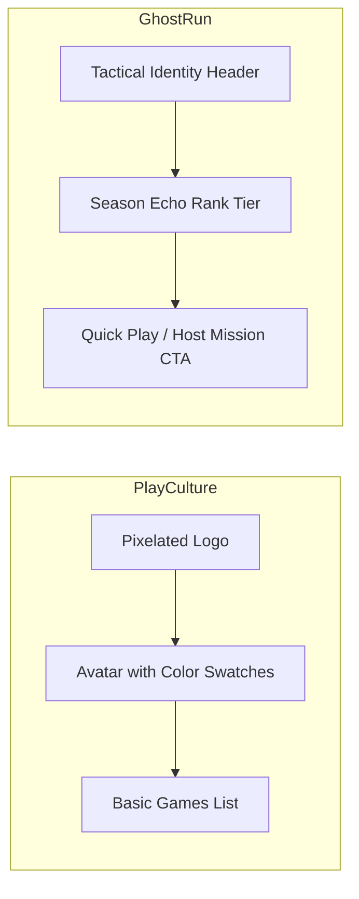

# Comprehensive Benchmark: GhostRun vs PlayCulture

> [!NOTE]
> This benchmark provides a side-by-side comparative analysis of **GhostRun** (production release v2.9.4 / build 20) against **PlayCulture** (Version 140), based on direct examination of all 32 PlayCulture design references in `playculturess/` and GhostRun's 26 canonical production captures.

---

## 1. High-Level Architectural & Design Overview

| Dimension | PlayCulture (v140) | GhostRun (v2.9.4 Production) | Winner / Advantage |
| :--- | :--- | :--- | :--- |
| **Aesthetic & Theme** | Retro 8-bit pixel arcade / indie cartoon | AAA military-grade tactical cyber-thriller (Valorant / Warzone) | **GhostRun** (High contrast, modern tactical polish) |
| **Typography** | Pixelated bitmap font (Press Start / Arcade) | Engineered typography (`Archivo-Black` headers + `Segoe UI` telemetry) | **GhostRun** (Superior glanceability when sprinting outdoors) |
| **Color System** | Warm burgundy/brown dark mode (`#3E121E`) + neon green/orange | Dark vector slate (`#0F172A`) + Tactical Lime (`#C8FF00`) + Alert Coral (`#FF5A5F`) | **GhostRun** (Zero rainbow mud; clean role identity) |
| **Game Modes** | **1 Mode:** "ZOMBIES" only | **6 Modes:** Outbreak Horde, Territory Pulse, Classic Chase, Jailbreak, Relay Heist, Ghost Duel | **GhostRun** (Massive gameplay depth & replayability) |
| **In-Game Map** | Minimalist dark radar canvas with range rings (25m, 50m, 100m) | Full 2D Dark Vector Street Map (MapLibre GL) + 3D building outlines | **GhostRun** (Real-world street navigation + tactical overlay) |
| **Map Centering** | Static 0m badge in center of radar circles | **Heading-Up Lock:** 12 o'clock operative lock + smooth map rotation underlay | **GhostRun** (Real-time orientation tracking, 60ms stream) |
| **Perimeter HUD** | Static top/bottom banners | **Off-Screen Objective Reticles:** Ray-box edge badges + Proximity Threat Vignette | **GhostRun** (Glanceable 360° situational awareness) |
| **Host Setup Flow** | 3-step basic setup (Duration $\rightarrow$ Radius $\rightarrow$ Toggles) | 5-step guided wizard (Mode $\rightarrow$ Modifiers $\rightarrow$ Extras $\rightarrow$ Arena $\rightarrow$ Review) | **GhostRun** (Granular balance & interactive beacon drop) |
| **Lobby & Sync** | QR Code start/join cards with basic open/closed toggle | Real-time Supabase sync, 4-digit PIN auto-focus, synchronized lime ready checks | **GhostRun** (Zero-friction mobile party onboarding) |
| **Post-Match Debrief** | Basic leaderboard list (`1. alphaop - 200`) | **Valorant 3-Tab Debrief:** Summary XP, Operatives Scoreboard, Map Replay, 9:16 Share Card | **GhostRun** (Modern competitive debrief with viral sharing) |

---

## 2. Screen-by-Screen Detailed Comparison

### A. Home Screen & Identity

* **PlayCulture** ([Screenshot_20261117_015545.jpg](file:///c:/ASK_Main/ASK/Projects/GhostRun/playculturess/Screenshot_20261117_015545.jpg)):
  * Uses a pixel-art avatar box with a 7-color swatch picker (cyan, blue, purple, magenta, orange, yellow, green).
  * Navigation is split into 3 tabs: "You", "Search", "Game".
  * Casual, cartoonish vibe.
* **GhostRun** ([phase_a_01_home_dev1.png](file:///c:/ASK_Main/ASK/Projects/GhostRun/test-run-screenshots/phase_a_01_home_dev1.png) & [phase_a_01_home_dev2.png](file:///c:/ASK_Main/ASK/Projects/GhostRun/test-run-screenshots/phase_a_01_home_dev2.png)):
  * Displays personal rank tier, Season Echo progression bar, operative level badge, and real-time battery guard telemetry.
  * Crisp tactical navigation with instant HOST MATCH and JOIN MISSION action buttons.

---

### B. Host Game Creation Flow

* **PlayCulture** ([Screenshot_20261117_015717.jpg](file:///c:/ASK_Main/ASK/Projects/GhostRun/playculturess/Screenshot_20261117_015717.jpg), [015750.jpg](file:///c:/ASK_Main/ASK/Projects/GhostRun/playculturess/Screenshot_20261117_015750.jpg), [015724.jpg](file:///c:/ASK_Main/ASK/Projects/GhostRun/playculturess/Screenshot_20261117_015724.jpg)):
  * **Duration Wheel:** 3-column scroll wheel for START (2min), PLAY (30min), and END (2min). Shows helper text: "Start is runaway time... Play is main game... End is return time".
  * **Arena Picker:** Light Google Maps view with a simple orange circle overlay and a coarse diameter slider (1500m diameter).
  * **Options:** Basic toggles for Ranged Health, Bluetooth infection, and Recharge Speed (40s).
* **GhostRun** ([02_host_step1_mode_selection_dev2.png](file:///c:/ASK_Main/ASK/Projects/GhostRun/test-run-screenshots/02_host_step1_mode_selection_dev2.png) to [06_host_step5_review_dev2.png](file:///c:/ASK_Main/ASK/Projects/GhostRun/test-run-screenshots/06_host_step5_review_dev2.png)):
  * **5-Step Professional Wizard:**
    1. *Mode Selection:* 6 modes with tactical rules, player counts, and difficulty badges.
    2. *Game Modifiers:* Granular sliders for Bio-Lifespan, Antidote Boost (+65s), Drift Velocity, and Sprint Penalties.
    3. *Tactical Extras:* Modular toggles for Radar frequency, Jamming zones, Noise detection, and Voice comms.
    4. *Vector Map Arena:* Dark vector map with interactive play boundary radius and **point-and-drop tactical beacon placement** (Jail nodes, Extraction zones, Vault sites).
    5. *Mission Review:* Comprehensive mission brief with DEPLOY MISSION confirmation.

---

### C. Live In-Game Map & Tactical HUD

* **PlayCulture** ([Screenshot_20261117_015942.jpg](file:///c:/ASK_Main/ASK/Projects/GhostRun/playculturess/Screenshot_20261117_015942.jpg), [015945.jpg](file:///c:/ASK_Main/ASK/Projects/GhostRun/playculturess/Screenshot_20261117_015945.jpg)):
  * Renders a dark squircle radar canvas with concentric range circles (25m, 50m, 100m).
  * Center is an orange hexagon badge reading `0m`.
  * Bottom shows a 1-row leaderboard card (`1. alphaop - 200 coins`).
  * The map is static and does not follow the user's heading. No street geometry or buildings.
* **GhostRun** ([101_live_hud_concentric_dev1.png](file:///c:/ASK_Main/ASK/Projects/GhostRun/test-run-screenshots/101_live_hud_concentric_dev1.png) & [101_live_hud_concentric_dev2.png](file:///c:/ASK_Main/ASK/Projects/GhostRun/test-run-screenshots/101_live_hud_concentric_dev2.png)):
  * **Full Vector City Tiles:** Real street maps with road names and 3D footprints.
  * **Heading-Up Lock:** Operative chevron locked pointing straight up at 12 o'clock while the map rotates smoothly beneath via 60ms orientation stream and linear camera easing.
  * **Concentric Alignment:** Chevron centroid mathematically concentric with the red dashed tag ring (within 0.5px).
  * **Off-Screen Objective Reticles:** Perimeter badges with ray-box clamping showing Antidote (138m), Extraction (229m), and Jail beacons with directional arrows.
  * **Proximity Threat Vignette:** Escalating edge glow alerting survivors when hunters enter $< 25\text{m}$ proximity.
  * **Ability Dock:** In-game tactical buttons (Cloak, Haste, Decoy, Infect Survivor) with live countdown timers and haptic feedback.

---

### D. Post-Match Debrief & Story Sharing

* **PlayCulture** ([Screenshot_20261117_015951.jpg](file:///c:/ASK_Main/ASK/Projects/GhostRun/playculturess/Screenshot_20261117_015951.jpg), [020022.jpg](file:///c:/ASK_Main/ASK/Projects/GhostRun/playculturess/Screenshot_20261117_020022.jpg)):
  * Simple list of cancelled/finished games with basic text (`ID Q0E // Cancelled - Schedule 01:55`).
  * No match stats breakdown, no XP calculations, no GPS replay, no social story card export.
* **GhostRun** ([93_valorant_summary_dev1.png](file:///c:/ASK_Main/ASK/Projects/GhostRun/test-run-screenshots/93_valorant_summary_dev1.png), [94_valorant_operatives_dev1.png](file:///c:/ASK_Main/ASK/Projects/GhostRun/test-run-screenshots/94_valorant_operatives_dev1.png), [95_valorant_drawer_dev2.png](file:///c:/ASK_Main/ASK/Projects/GhostRun/test-run-screenshots/95_valorant_drawer_dev2.png), [96_valorant_map_dev2.png](file:///c:/ASK_Main/ASK/Projects/GhostRun/test-run-screenshots/96_valorant_map_dev2.png), [97_valorant_share_modal_dev1.png](file:///c:/ASK_Main/ASK/Projects/GhostRun/test-run-screenshots/97_valorant_share_modal_dev1.png)):
  * **Valorant 3-Tab Architecture:**
    1. *Summary:* Bold VICTORY (#C8FF00) / DEFEAT (#FF5A5F) header, horizontal Season Echo progression bar, clean borderless 3-column personal metrics strip (TAGS, CLOSEST PING, HUNT TIME for Hunters; SURVIVED, DISTANCE, UNSEEN STREAK for Runners), single highlight accolade card.
    2. *Operatives Scoreboard:* Clean tabular roster grouped by Hunters vs Runners with chevrons that expand inline drawers revealing Peak Noise, Closest Call, and GPS Route Fixes.
    3. *Tactical Map Replay:* Full-screen interactive vector map with a 10s ping timeline scrubber showing exact chase paths, tag events, and extraction trails.
  * **9:16 Social Story Export:** Dedicated slide-up modal previewing full 9:16 vertical card with distance, survival stats, and QR link ready for Instagram Stories or TikTok.

---

## 3. What GhostRun Adopted & Improved from PlayCulture

1. **Two-Color Radiant Proximity Blooms:**
   * *PlayCulture:* Used subtle radial glows around radar dots.
   * *GhostRun:* Elevated this into high-resolution 256x256 cosine-quadratic radial gradient blooms (`#FF2A55` for Hunters, `#00F0FF` for Runners) that dynamically expand from 36px to 120px with an active danger breathing pulse when within 25m.
2. **Directional Sonar Threat Arcs:**
   * *PlayCulture:* Concentric radar range circles.
   * *GhostRun:* Added curved radial sonar wavefront arcs that propagate forward along the user's heading vector and render red curved arcs along the exact threat bearing.
3. **Glanceable Telemetry (`0m · YOU`):**
   * *PlayCulture:* Center badge with `0m`.
   * *GhostRun:* Retained the glanceable `0m · YOU` badge in Extreme Radar mode while pairing it with an engineered forward-facing chevron on the full street vector map.

---

## 4. Key Strengths Summary

* **Visual Sophistication:** GhostRun looks like an authentic AAA tactical game (Valorant / Ghost Recon), whereas PlayCulture relies on a retro 8-bit arcade visual language.
* **Information Hierarchy:** GhostRun uses glanceable typography and high-contrast tactical color coding, allowing players to read critical metrics in bright sunlight while sprinting at full speed.
* **Gameplay Depth:** GhostRun features 6 diverse game modes compared to PlayCulture's single Zombie mode.
* **Post-Match Value:** GhostRun provides a complete competitive debrief (XP breakdown, operative scoreboard with telemetry drawers, interactive map scrubbing, and 9:16 social cards), giving players a rewarding sense of progression after every match.
